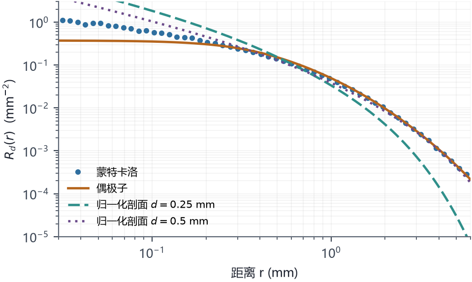
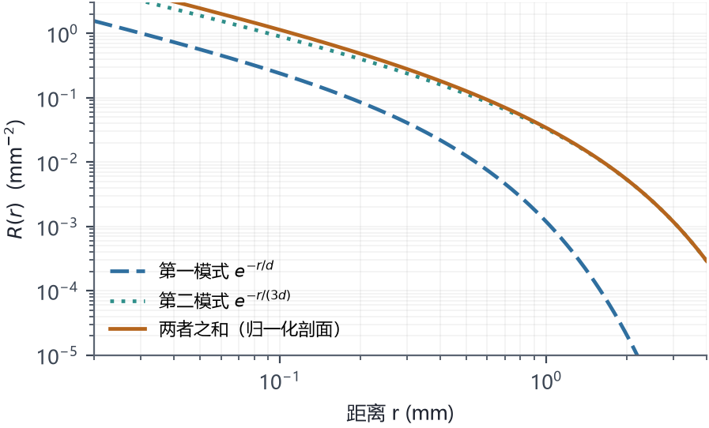

# 第 17 章 量化扩散与归一化剖面

## 17.1 一个具体的要求

做一块皮肤的材质，美术要在面板上调三个东西：透光的深浅、光斑的大小、整体的亮度。第三个是能量，前两个是形状。

用偶极子做不到。三个旋钮背后其实只有两个物理参数（$\sigma_a$ 与 $\sigma_s'$），而且能量和形状都由它们决定：想让光斑变大就得降 $\sigma_s'$，但降 $\sigma_s'$ 同时让总反射率上升。两个要求打架，没有解。

这不是偶极子的缺陷，是物理的：真实的材料确实只有那两个自由度。问题出在"物理参数"和"美术想要的自由度"不匹配。美术想要的三件事在物理上是耦合的，而在制作流程里它们必须解耦。

这一章讲两类解耦的办法。一类是工程上的：换一条曲线，让能量和形状由两组独立的参数控制。另一类是理论上的：d'Eon 与 Irving 在 2011 年提出的量化扩散，它把扩散方程按边界条件展开成一组离散模式，在保留更多物理的同时把近场和薄层做对。

## 17.2 归一化剖面

Christensen 与 Burley 在 2015 年给出一个极简的剖面：

$$R(r)=\frac{e^{-r/d}+e^{-r/(3d)}}{8\pi d\,r} , \tag{17.1}$$

$d$ 控制宽度。这个式子的关键性质是它的面积分恒等于 1，与 $d$ 无关。两项分开算就看得出来：

$$\int_0^\infty\frac{e^{-r/d}}{8\pi d\,r}\,2\pi r\,dr=\frac{1}{4}\int_0^\infty e^{-r/d}\,\frac{dr}{d}=\frac{1}{4} , \tag{17.2}$$

第二项把 $d$ 换成 $3d$，积分值是 $3/4$，相加等于 1。

于是能量和形状分开了：想要多少能量就乘多少，想要多宽就调 $d$。

$$\tilde R(r)=A\cdot\frac{e^{-r/d}+e^{-r/(3d)}}{8\pi d\,r} . \tag{17.3}$$

这就是 Disney 的 normalized diffusion，用在 Hyperion 渲染器里。代价是 $A$ 与 $d$ 不再由 $\sigma_a,\sigma_s$ 决定——它们是独立参数，跨场景复用时需要重新给定。

## 17.3 它真的比偶极子准吗

不一定。这是这一节要说清楚的事，因为很多资料把归一化剖面的动机说成"偶极子不准"。

图 17-1 里，偶极子（实线）从 0.03 毫米到 6 毫米几乎完全贴着蒙特卡洛的点。归一化剖面两条虚线分别取 $d=0.25$ 与 $d=0.5$，前者在 $r>1$ 之后掉得太快，后者在 $r<0.2$ 处高出一倍。原因是两个指数的组合只有两个自由度，而真实的剖面在近端和远端需要不同的曲率。

所以在"均匀、半无限、单层、折射率匹配"这个设定下，偶极子比归一化剖面准。归一化剖面的价值不在精度，在于三件事：能量与形状解耦，可以直接和美术参数对接；计算便宜，一次指数运算就够；可以拟合任意的实测数据（把 $d$ 拟出来即可），不需要先有 $\sigma_a,\sigma_s$。

## 17.4 两个指数从哪来

(17.1) 的形式不是凑的。扩散方程在半无限介质里的解，按本征模式展开是一串指数项，每一项对应一个衰减率，衰减率是 $\mu_{\text{eff}}$ 的奇数倍。取前两项，衰减率之比是 1:3，正是 $e^{-r/d}$ 与 $e^{-r/(3d)}$。

图 17-2 把两项分开画。这个分解说明归一化剖面可以理解成"扩散解的截断谱，常数被重新配平过"。物理推导给出的系数不满足能量守恒（因为边界条件是近似的），拟合出来的系数满足。

它也说明了局限：只有两个模式，形状的自由度有限。低反照率或者薄层需要更多模式，两项不够。要继续加，就得回到解方程，那就是量化扩散。

## 17.5 量化扩散

量化扩散（quantized diffusion）的出发点是：不要用镜像法凑边界条件，直接把解按边界条件展开成本征函数。

镜像法的问题在于它是"用无穷多个源满足两个条件"：系数的计算依赖级数求和，每一项的物理意义模糊，板越薄收敛越慢。换成展开，光通量密度写成

$$\varphi(x)=\sum_k c_k\,\psi_k(x) , \tag{17.4}$$

$\psi_k$ 是满足边界条件的本征函数。平板里是正弦，半无限介质里是正弦与指数函数的乘积，球里是球 Bessel 函数。每一项有明确的衰减率，边界条件被精确满足。

d'Eon 与 Irving 的工作还有两层。他们把 P1 里的通量矢量一起展开，并且用了修正的边界条件，使得近源处的方向性得到部分保留；结果是一个在低反照率、薄层、近场三种情况下都比偶极子准的模型。代价是公式长：他们的 BSSRDF 有十来项，每项要算一个 Bessel 函数或者指数。

离线渲染不介意这个代价。实时渲染介意，所以实时管线里更常见的是归一化剖面。

### 17.5.1 高斯为什么能穿过光束

展开成 Bessel 函数只是第一步。真正让量化扩散在工程上可用的是另一件事：把扩散核写成一串**高斯**，而高斯沿光束积分之后还是高斯。

从三维归一化高斯出发：

$$G_{3D}(v,\mathbf{x})=(2\pi v)^{-3/2}\,e^{-\|\mathbf{x}\|^2/(2v)} , \tag{17.5}$$

其中 $v$ 起方差的作用。把它沿一条射线积分，并乘上沿路径的吸收：

$$\int_0^{\infty}G_{3D}\big(v,\sqrt{r^2+z^2}\big)\,e^{-\sigma_t' z}\,dz
=\frac{\sigma_t'}{2}\,f\!\left(\frac{\sigma_t'^2v}{2}\right)G_{2D}(v,r) , \tag{17.6}$$

其中

$$G_{2D}(v,r)=\frac{1}{2\pi v}e^{-r^2/(2v)},\qquad f(x)=e^{x}\,\mathrm{erfc}\big(\sqrt{x}\big) . \tag{17.7}$$

推导只有三步：横向部分不含 $z$，提到积分外；纵向是一个"半高斯乘指数"，配方后凑成误差函数；最后把系数整理成 $G_{2D}$。

这个恒等式的物理含义值得说清楚。三维高斯沿射线积分得到二维高斯，因为高斯的横向与纵向独立，纵向积掉之后只剩横向分布。而 $f(x)$ 是一个"没走完"的修正：如果源是无限长的一条线，纵向积分完整，横向就是纯高斯；但源只存在于 $z>0$ 的一半，另一半被切掉，所以要乘一个修正。$x\to0$ 时 $f\to1$，$x$ 大时 $f\approx1/\sqrt{\pi x}$。

剩下的一步是把扩散核本身变成高斯之和。Grosjean 的扩散项不是高斯，但稳态解可以写成瞬态解的积分：

$$\frac{1}{4\pi D}\frac{e^{-\sigma_{tr}r}}{r}=\int_0^{\infty}e^{-\sigma_a\tau}\,G_{3D}(2D\tau,r)\,d\tau , \tag{17.8}$$

其中 $\tau=ct$ 是用长度表示的时间。把 $\tau$ 轴切成若干段，每段用一个同方差的高斯加权重代替，权重取该段的吸收份额：

$$w_i=\int_{\tau_i}^{\tau_{i+1}}e^{-\sigma_a\tau}\,d\tau
=\frac{e^{-\sigma_a\tau_i}-e^{-\sigma_a\tau_{i+1}}}{\sigma_a} , \tag{17.9}$$

于是

$$\int_0^{\infty}e^{-\sigma_a\tau}G_{3D}(2D\tau,r)\,d\tau\approx\sum_{i=0}^{k-1}w_i\,G_{3D}(v_i,r) . \tag{17.10}$$

再套 (17.6)，每个高斯沿光束积分成二维高斯，整条剖面就成了

$$R_d(r)\approx\sum_{i=0}^{k-1}w_i'\,G_{2D}(v_i,r) . \tag{17.11}$$

权重 $w_i'$ 里含 (17.6) 的修正因子，与位置无关。

这一步的工程意义很大。权重只与材料参数有关，与着色点无关，所以可以离线算成一张表，运行时查表加十几个二维高斯求和。d'Eon 与 Irving 取约四十项，误差已经低于肉眼阈值。

代价也在这里。权重与 $x$ 无关，意味着任何依赖着色位置的修正都塞不进去——这正是光子束扩散那条路线存在的理由（第 19 章）。

## 17.6 三种做法怎么选

**要物理一致。** 用偶极子。参数是 $\sigma_a,\sigma_s,g$，能和光谱、多层、其它物理量联动，误差在 5% 以内，近源偏低三倍。

**要可控。** 用归一化剖面。能量和形状分开调，计算便宜，适合实时和资产制作。参数没有物理意义，跨场景要重新拟合。

**要准。** 用量化扩散或者蒙特卡洛。前者在薄层和低反照率下比偶极子准，后者在一切情况下都准。

三种是分工，不是替代。成熟管线里三种都会出现：实时预览用归一化剖面，离线终稿用偶极子加单次散射，参考图用蒙特卡洛。

## 17.7 一个容易踩的坑

归一化剖面最常见的误用是直接把 $d$ 取成 $1/\mu_{\text{eff}}$。

两者不在同一个尺度上。$d$ 是形状参数，约等于光斑半衰减半径除以一个常数（这个常数由剖面的形状定，约等于 2.2）；$1/\mu_{\text{eff}}$ 是 $e$ 折衰减长度。两者的比值随 $\alpha'$ 变化，不是常数。

用错的表现是：低反照率材料的光斑偏小，高反照率的偏大，而且换材料之后又错回去。正确做法是做一张映射表：给一组 $(\sigma_a,\sigma_s,g)$，用偶极子或者蒙特卡洛算出剖面，取半衰减半径，反推 $d$，把 $d$ 对 $\alpha'$ 与 $\sigma_t'$ 列表。渲染时查表插值。

这张表不大。$d$ 基本上只依赖 $1/\mu_{\text{eff}}$（比例约 1:2.2），偏离主要发生在 $\alpha'<0.7$ 的位置。一张 $16\times16$ 的表足够覆盖常见材料。

---

这一章处理的是"参数与外观绑死"这件事。归一化剖面把能量和形状解开，代价是失去物理；量化扩散把边界条件做对，代价是公式变长。两者都不如偶极子在均匀半无限介质上准，但它们覆盖了偶极子覆盖不了的情形：可调、多层、薄层、近场。
