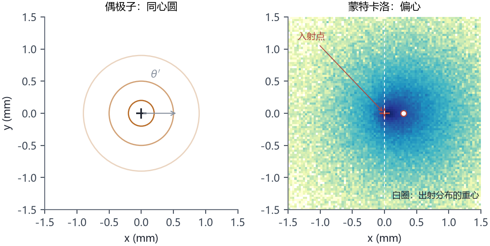
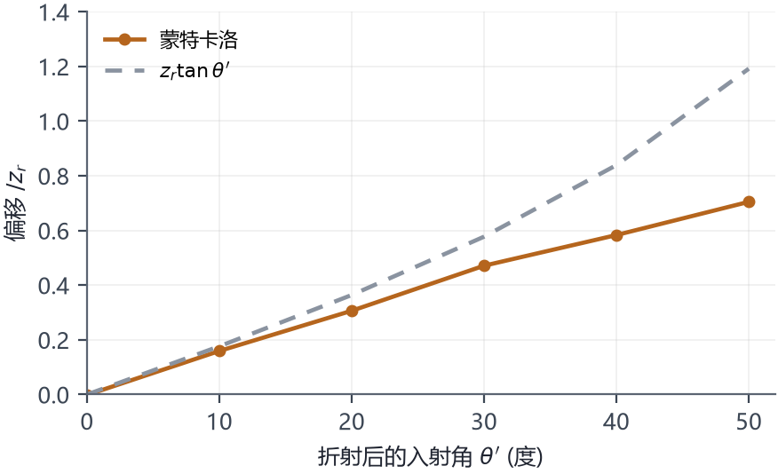

# 第 18 章 方向偶极子

## 18.1 手电斜着照手背

拿一支手电，垂直照在手背上，光斑是一个圆，中心最亮，四周均匀衰减。把手电倾斜六十度，光斑变了：它不再对称，朝光的传播方向偏，背光那一侧的衰减比迎光那一侧慢得多。整个亮区的重心移动了大约一毫米。

这个偏移不能靠调参数补出来。偶极子对 $r$ 是各向同性的，它的等值线是同心圆，无论参数怎么选都画不出偏心。

偏移的来源很直接。光斜着进入介质，进去之后的方向是折射后的方向，与法线成一个角度 $\theta'$。在最初的几个输运自由程里，光沿着这个方向走，所以散射事件集中在一条斜的线上，而不是竖直的线上。这条斜线在表面上投影出偏移。

偏移量大约是 $z_r\tan\theta'$，其中 $z_r\approx1/\sigma_t'$ 是源的深度。皮肤上 $\theta'=40$ 度（外部 60 度折射后），$z_r=0.5$ 毫米，偏移约 0.4 毫米。图 18-1 里看到的偏移量级与这个估计一致。

## 18.2 一个直接的修法：挪源

最简单的修法是把点源沿着折射方向挪：源的位置从 $(0,0,z_r)$ 变成 $(z_r\tan\theta',0,z_r)$。

这个修法抓住了主要效应，但有两个问题。它把"光在近处沿斜线分布"变成了"源在一个斜的位置"，是一个粗略的替换；而且它破坏了互易性——入射与出射交换后，源的位置不该变，但按这个规则会变。

## 18.3 方向偶极子

Frisvad、Habel、Jensen 与 Christensen 在 2014 年给出的做法更彻底：把源从一个各向同性的点换成一个沿入射方向的小偶极，也就是"一个正源加一个紧跟其后的负源"，两者的连线沿折射方向。

这个结构的物理含义是"单次散射的角分布"。一个各向同性的点源发出的光在所有方向上一样多，而真实的光在进入介质后的最初一段里是朝前偏的——这个偏置可以用一对靠得很近的正负源表示，它们的偶极矩沿入射方向。

数学上，一对相距 $t$ 的正负源，当 $t\to0$ 时趋于一个偶极子源，它的场是 Green 函数的方向导数。方向偶极子模型把入射源写成"各向同性部分 + 偶极矩部分"：

$$Q(x,\omega)=\Phi\left[a_0\,\delta(x-x_0)+a_1\,\frac{\partial}{\partial s}\delta(x-x_0)\right] , \tag{18.1}$$

$a_0$ 与 $a_1$ 由入射光的角分布决定。各向同性入射时 $a_1=0$，退化成偶极子。

场的解就是 Green 函数的两项：零阶项与一阶导数项。导数项给出一条与入射方向有关的贡献，它让等值线偏心。

图 18-1 是这个对比。蒙特卡洛的等值线（右）相对偶极子（左）整体右移约 0.4 毫米，并且在右下方拉出一条长尾。这条长尾对应"光沿着传播方向走了几个自由程才扩散开"的那部分。

## 18.4 偏移有多大

偏移量可以定量算。在蒙特卡洛里，记录每个出射光子的位置，算出射点分布的重心，重心相对入射点的位移就是偏移。

图 18-2 里的偏移在 $\theta'=40$ 度时约 $0.45z_r$，简单的 $\tan\theta'$ 估计给出 $0.84z_r$，实际明显偏小。原因是重心被远处那部分（已经扩散开的、对称的）光拉回来了：只有近源那一部分偏移，远处的光是对称的。

这个观察有实用含义：偏移在近源处最明显，而近源处恰好也是偶极子最不准的地方。所以方向偶极子的主要贡献不是"整体平移"，而是"修正近场的形状"。

## 18.5 与互易性的冲突

方向偶极子有一个理论上的麻烦：它不对称。

BSSRDF 必须满足互易性 (3.5)：交换入射与出射，函数值不变。方向偶极子的构造是"对着光源方向偏心"，交换之后偏心方向也应当跟着交换，但模型的参数（$a_0,a_1$）是按入射光定的，交换后会得到另一个模型。

Frisvad 等人在原文里讨论了这一点。他们的处理方式是让 $a_1$ 只依赖入射角与折射率，不含出射方向，这样互易性在"交换后重新计算参数"的意义下成立，而不是在同一个参数下成立。

对渲染的影响很小，因为大多数渲染器的 BSSRDF 采样是从光源侧出发的，交换很少发生。但在双向方法里要小心。

## 18.6 什么时候需要它

方向偶极子的开销比偶极子大：多算一个源、多算一次方向导数，公式长一倍。它换来的改进集中在三个场合。

斜射光的近场。手电、台灯、窗光都是斜的，皮肤、蜡、大理石上的光斑形状对真实感影响很大。

掠射光。入射角大于 70 度时，折射后的角度接近临界角，光在很浅的一层里就被反射回来，偏移和形状都变得极端，偶极子完全失效。

薄片。薄片里的光走不了几步，方向记忆还没丢，所以方向性影响大。这时的正确做法是把方向偶极子与多极子结合起来，但公式会很难看。

反过来说，在"远处"（$r>3$ 毫米）和"厚物体"上，方向偶极子与普通偶极子的差别在噪声以内——那里光已经扩散了几十次，方向记忆早没了。所以如果只关心大范围的光晕，用普通偶极子就够。

## 18.7 实现上的两个细节

方向偶极子的场可以写成两项之和：一个各向同性的偶极子场，加上一个沿入射方向的导数项。导数项不必解析求出来，用差分近似就够了：把正源沿入射方向偏移一个很小的量 $\epsilon$，两次求值相减再除以 $\epsilon$。$\epsilon$ 取 $10^{-3}z_r$ 量级，精度足够而数值稳定。

偏移方向要用**折射后**的方向，不是外部方向。这一点经常被写错。外部入射角 60 度、$\eta=1.4$ 时内部角度只有 40 度，两者相差 20 度，用外部方向会让偏移量高估 50%。

另一个细节是出射方向的因子。方向偶极子的近场项与方向有关，而可分离形式里的 $F_t(\omega_o)$ 是各向同性的（只依赖出射角）。两者叠加时要注意不要重复计入方向依赖：正确的做法是让导数项只负责"偏移"，让 $F_t$ 只负责"透射率"，两者相乘。

## 18.8 它值不值得

方向偶极子的计算量大约是偶极子的 1.5 到 2 倍（多一次源求值、多一次差分）。它换来的改进只在近场与斜射时可见。

判断规则很简单：如果镜头里的光源都是从正面打过去的（影棚布光、正面闪光），方向偶极子带来的差别小于噪声；如果有明显的侧逆光、窗光、手电式的点光，那么近场光斑的形状会直接进入画面，值得付出这个代价。

还有一个折中方案：只在光线与法线的夹角大于某个阈值（比如 45 度）时启用方向修正，否则退回普通偶极子。这样平均代价可以降到 1.2 倍，而视觉差异几乎看不出来。

---

这一章处理了"光源有方向"这条假设。方向偶极子把点源换成一个沿入射方向的小偶极，让近场的光斑偏心。代价是公式变长、互易性变得含糊，收益是斜射光的近场形状。

下一章换一条完全不同的路：不做任何近似，直接把光子追出来。
