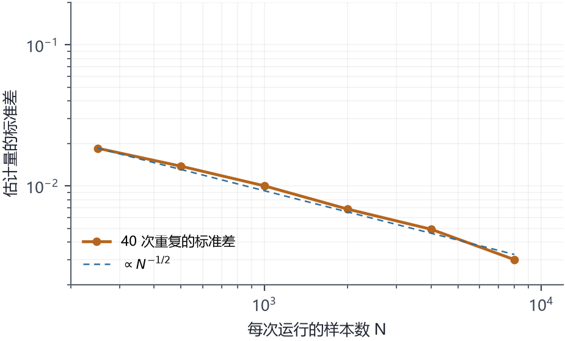
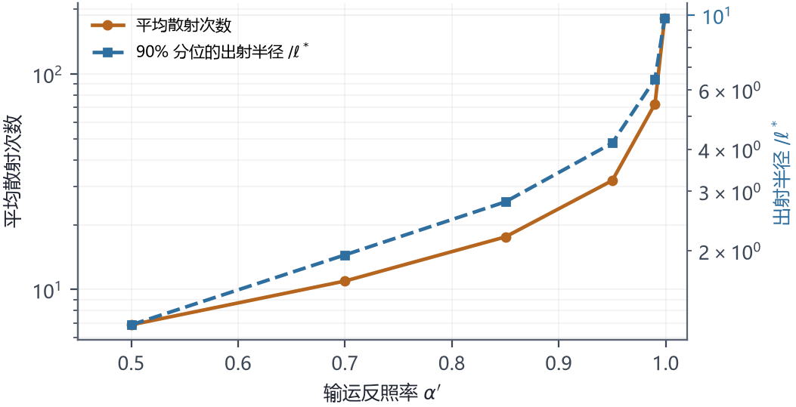

# 第 19 章 随机游走：不做近似的做法

## 19.1 放弃公式

前面十八章都在做同一件事：找一个能写下来的公式，让它近似地回答"光从 $x_i$ 进去，从 $x_o$ 出来多少"。每个公式都带着一串假设，每修一条假设就多一项。

这一章换一条路：不找公式，直接在介质里追光子。追足够多之后，统计出来的分布就是答案。除了统计噪声，没有别的误差。

这条路的代价是算力。但它有别的路没有的好处：它同时是正确的、可验证的、可扩展的。正确，因为它就是 RTE 定义的随机过程的直接模拟；可验证，因为任何解析模型都可以和它对比；可扩展，因为多层、纹理、任意几何都可以直接加进来，不需要重新推导。

第 8 章已经用过这个方法做裁判。这一章把它当成生产工具讲清楚：算法怎么写、方差从哪里来、怎么和路径追踪接起来。

## 19.2 一个光子的流程

算法只有四步，循环执行。

**采样步长。** 从当前位置沿当前方向走一段，长度按指数分布采样：

$$s=-\frac{\ln u}{\sigma_t} . \tag{19.1}$$

这是 (4.6) 的逆变换。$u$ 是均匀随机数。

**判断边界。** 如果沿这一步会穿过表面，就处理界面：按 Fresnel 反射率决定是反射回来还是离开。反射时把方向关于法线镜像，位置停在表面；离开时记录出射点与方向，光子结束。

**判断吸收。** 以概率 $\alpha=\sigma_s/\sigma_t$ 继续，否则被吸收，光子结束。这个做法叫模拟式（analog）吸收，权重始终是 1，实现简单，方差可控。

**散射。** 按相函数采样新方向，回到第一步。

这四步合起来就是一个 Markov 链。它的转移概率与 RTE 的积分核一致，所以大量样本的统计结果收敛到 RTE 的解。这个一致性是蒙特卡洛方法唯一需要的数学基础，不需要额外证明。

```python
def walk(pos, dirs, sigma_a, sigma_s, g, L, rng):
    st = sigma_a + sigma_s
    while dirs.size:
        n = dirs.size
        step = -np.log(rng.random(n)) / st
        hit = pos + dirs * step[:, None]
        # 上表面：z < 0
        esc = hit[:, 2] < 0
        record(pos[esc], dirs[esc])
        # 下表面：z > L（有限厚度时）
        esc = hit[:, 2] > L
        record(pos[esc], dirs[esc])
        # 存活者散射
        alive = ~(esc | esc)
        pos, dirs = hit[alive], scramble(dirs[alive], g, rng)
        keep = rng.random(dirs.shape[0]) < sigma_s / st
        pos, dirs = pos[keep], dirs[keep]
```

这段代码省略了界面反射与数组压缩的细节，但结构是完整的。

## 19.3 方差从哪里来

蒙特卡洛的误差正比于 $1/\sqrt{N}$，$N$ 是样本数。要把噪声减半，样本要乘四。这个规律不可绕过，但常数因子可以优化。

方差的来源有三处。

**出射点的分布。** 一个光子只贡献一个出射点。如果关心的是某个小区域（比如光斑中心），大部分光子都落在了别处，浪费了。

**散射次数的分布。** 高反照率介质里，光子平均散射上百次，其中大部分散射对最终结果影响很小。

**界面上的取舍。** 用模拟式吸收时，光子要么全活要么全死，方差较大；用权重（每次散射乘 $\alpha$）时，权重连续衰减，方差小但会造成长尾。

三种来源对应三类改进。

**重要性采样。** 从出射点反向追（从相机出发），或者对出射点做分层。后者在多维积分里效果明显：把 $[0,1]^2$ 分层成 $16\times16$ 的网格，噪声能降一半。

**俄罗斯轮盘。** 当权重低于阈值时按概率终止，把剩余权重归一。这不改变期望，只降低计算量。

**解析的部分解析。** 单次散射可以解析算（第 7 章），不必追。把"第一次散射"这一步用解析公式替代，剩下的从第二次开始追，方差会下降，而且近源区的偏差也被修掉。



图 19-1 是这个规律的直接测量：40 次独立重复的标准差随 $N^{-1/2}$ 下降，与理论线重合。重要性采样只能降低常数，不能改变斜率——它改的是每次样本的方差，不是收敛阶。

## 19.4 与路径追踪的接口

真实的渲染器里，随机游走不是独立模块，而是路径追踪的一个分支。

做法是：从相机出发追一条路径，碰到表面时按 Fresnel 决定折射还是反射。折射进入介质后，开始在介质里游走（19.2 的四步）。游走结束时，光子从某个点离开介质，这条路径就继续按普通的表面路径追下去。

这个集成方式有一个重要的性质：它自然处理了多层与纹理。三种介质的多次散射在同一个循环里完成，不需要为每一层单独写模型；空间变化的 $\sigma$（比如皮肤上的色斑）只要在采样步长时查一下就行。

Chiang、Kutz 与 Burley 在 2016 年把这条路做成了生产工具。他们的关键贡献不是算法本身，而是工程上的三件事：把游走限制在有限步数内并用剩余能量做补偿估计；用"按需展开"的方式处理界面，避免在薄层里无限反射；把 $r<0$ 的情况（内部反射）与 $r>0$ 的情况统一处理。



图 19-2 给的是开销估计。$\alpha'=0.99$ 时平均 74 次散射，最深到 3 个 $\ell^*$；$\alpha'=0.5$ 时平均 2 次。这解释了为什么蒙特卡洛在白材料上贵、在深色材料上便宜——与解析模型相反，解析模型在白材料上最准，在深色材料上最不准。

## 19.5 什么时候必须用它

**薄层与多层。** 光学厚度小于 2 的板，扩散模型全线失效（第 15、16 章）。这时的正确答案只有蒙特卡洛。

**低反照率。** $\alpha'<0.5$ 时偶极子的近源误差可以到八倍。深色皮肤、咖啡、墨汁都属于这一类。

**强方向性。** 斜入射、掠射、小尺寸光源。解析模型对方向的处理都是平均化的。

**验证。** 任何新模型上线之前，必须和蒙特卡洛对一遍。这是第 22 章的流程的核心。

## 19.6 它自己的问题

蒙特卡洛不是万能的。

噪声有结构。次表面散射的噪声在屏幕空间里沿着厚度方向相关，普通的屏幕空间降噪器会把它抹成一片，看起来像"糊了"。正确的做法是在路径空间降噪（用 albedo 与法线做引导），或者提高样本数。

难以插值。解析模型可以预计算成表、可以拟合成曲线、可以跨像素复用。蒙特卡洛的结果只属于那条路径。

对光源变化敏感。移动一盏灯，所有路径都要重算。解析模型只需要改一下入射方向，甚至可以用预积分的表。

所以生产管线的现实是混合的：大部分像素用解析模型，关键区域用蒙特卡洛；或者用蒙特卡洛离线生成一张表，运行时查表。

---

这一章给出了不做近似的做法，也就是全书唯一没有系统偏差的方法。它的算法只有四步，方差按 $1/\sqrt{N}$ 下降，和白材料的开销比深色材料大。

到这里，四篇的模型都齐了：偶极子、多极子、量化扩散、方向偶极子、随机游走。第五篇把它们装进一个能跑的系统。
