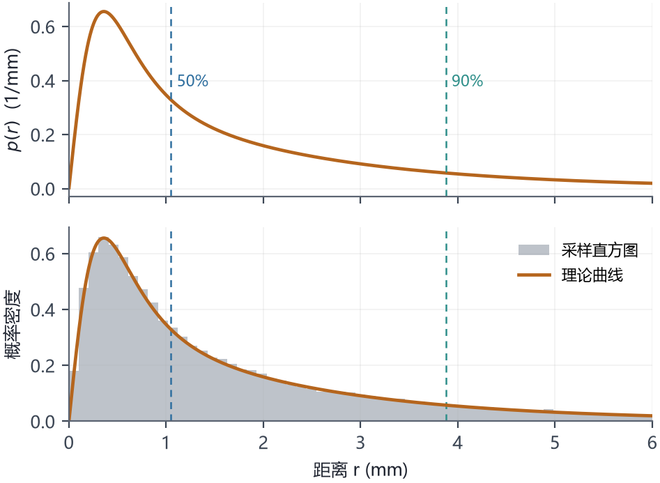
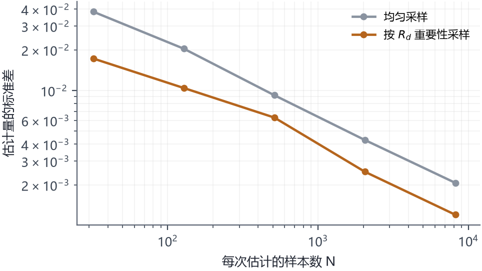

# 第 20 章 表面积分与采样器

## 20.1 一个点要问所有点

把 (3.4) 重写一遍：

$$L_o(x_o,\omega_o)=\int_{A}\int_{2\pi}S(x_i,\omega_i;x_o,\omega_o)\,L_i(x_i,\omega_i)\,\cos\theta_i\,d\omega_i\,dA_i . \tag{20.1}$$

每个着色点要问整块表面上的每一个点"你贡献多少"。这是一次四维积分（入射点的两个坐标、入射方向的两个角），比 BRDF 的二维积分多了两个维度。

如果直接对入射面积做均匀采样，方差会大到不可用。原因很直观：$S$ 的形状是一个尖峰加一条长尾，均匀采样把绝大多数样本丢在远离尖峰的地方。

这一章讲怎么把这个积分算得快。核心只有一句话：**按 $S$ 的形状采样，把 pdf 算对，把 Jacobian 乘对。**

## 20.2 可分离带来的分解

第 14 章的 $S_d$ 有一半是可分离的：

$$S_d=\frac{1}{\pi}F_t(\omega_i)\,R_d(r)\,F_t(\omega_o) . \tag{20.2}$$

方向的部分和距离的部分相乘，所以可以分开采样：先按某个分布采样入射方向，再按某个分布采样入射点。

这个分解不是严格的（$r$ 依赖两个点的位置，位置又和法线有关），但在局部平坦的假设下成立。实现时把 $x_i$ 限制在 $x_o$ 附近的一个圆盘里，圆盘半径取几个 $1/\mu_{\text{eff}}$，误差可以忽略。

采样顺序有两种。从相机出发（反向）：已知 $x_o$ 与 $\omega_o$，采样 $x_i$ 与 $\omega_i$。从光源出发（正向）：已知 $x_i$ 与 $\omega_i$，采样 $x_o$ 与 $\omega_o$。两者在数学上等价，实际选哪个取决于哪一侧更容易采。

## 20.3 径向采样

$R_d(r)$ 在二维平面上的积分权重是 $2\pi r\,dr$，所以采样半径时用的分布应当是

$$p(r)=2\pi r\,R_d(r) . \tag{20.3}$$

这是一个一维分布，归一化系数是总反射率 $R_{\text{tot}}=\int2\pi rR_d\,dr$。采样方法有两种。

查表法最常用：把 $R_d$ 在若干个半径上求值，算出累积分布，采样时用二分查找或者线性插值反演。表的点数取 64 到 256 就够，因为 $R_d$ 是光滑的。

解析反演只对特殊形式可行。偶极子的 $R_d$ 没有解析的累积函数，所以实际都用查表。

采到半径之后，方位角均匀采样。这里有一个容易错的地方：半径按 $p(r)$ 采样、方位角均匀采样之后，面积元上的 pdf 是

$$\text{pdf}(x_i)=\frac{p(r)}{2\pi r}=\frac{R_d(r)}{R_{\text{tot}}} , \tag{20.4}$$

那个 $2\pi r$ 被除掉了。如果直接用 $p(r)$ 当 pdf，结果会偏——偏的方向取决于 $R_d$ 的形状，通常是近处偏暗、远处偏亮。

图 20-1 是这个采样的验证。直方图与理论曲线重合，说明采样正确。注意 50% 分位在 1.05 毫米，90% 分位在 3.9 毫米——一半的能量来自 1 毫米内，九成来自 4 毫米内。这就是圆盘半径取几个 $1/\mu_{\text{eff}}$ 的经验依据。

## 20.4 方向采样

入射方向 $\omega_i$ 的采样按 $F_t(\eta,\omega_i)\cos\theta_i$ 加权。这个分布不是初等的（$F_t$ 里有一个平方根），实践中有三种处理。

余弦加权采样加权重。按 $\cos\theta/\pi$ 采样，把 $F_t$ 留作权重。实现简单，方差略大。

查表。把 $F_t\cos\theta$ 的累积分布列成表，按表采样。精度高，代价是一张表和一次查找。

近似解析。用 Schlick 近似 $F\approx F_0+(1-F_0)(1-\cos\theta)^5$ 代替精确的 Fresnel，这样 $F_t\cos\theta$ 可以解析反演。

三种做法的差别在掠射角附近。那里 $F_t$ 从 0.9 掉到 0.2，余弦加权采样会把大量样本浪费在"会被全反射"的方向上，方差明显上升。所以如果场景里有大量掠射照明，用查表值得。

## 20.5 采样的代价

采样本身的代价不大，代价在"每个样本要做多少次求值"。

一次完整的 BSSRDF 采样要算：两个点的位置与法线（各一次插值）、$F_t$ 两次（各一次平方根）、$R_d$ 一次（两次指数加两次平方根）、以及 pdf 的归一化系数。大约 30 到 50 次浮点运算。乘以每像素的样本数（几千），再乘以像素数（两百万），就是十亿量级的运算。

优化集中在两处。$R_d$ 用查表代替直接求值，把两次指数换成一次插值。$F_t$ 用 Schlick 近似，把平方根换成幂运算（GPU 上更快）。

图 20-2 给出了重要性采样的收益。同一组参数，估计光斑核心那块能量时，均匀面积采样的标准差是重要性采样的两倍左右；要压到同样的噪声，均匀采样要多用三四倍的样本。这个倍数看着不惊人，但它是在“只估一个小区域”的条件下得到的——换成整个四维积分、并且光源又小又远的时候，差距会到两个数量级。

## 20.6 与光源采样结合

(20.1) 里既有入射面积分，也有入射方向积分。如果光源很小（比如一个点光源），直接对面积采样会浪费——大部分样本采到的点根本没有光。

标准做法是把积分拆成两部分：一部分对光源采样（直接连到光源），一部分对 BSSRDF 采样（在表面上撒点），两部分按 MIS 权重合成。这个结构在入门篇的第 10 章讲过，这里只强调次表面散射的特殊之处：体积项（散射到光源方向）和表面项（表面上的点连到光源）要分别处理，因为前者是介质内部的路径，后者是表面之间的路径。

如果不做 MIS，只用其中一种，会在"光源很小"或"物体很薄"的极端情况下出现明显噪声，而且噪声的形状有规律——通常表现为光斑中心的一圈亮点。

## 20.7 一个常见的错误

最常见的实现错误是把 pdf 少算一个 $1/(2\pi r)$，或者把面积元 $dA$ 忘了。

判断方法：在完全无吸收（$\alpha'=1$）、折射率匹配的介质上做白炉检验（第 22 章）。如果总能量不等于 1，多半是 pdf 错了。进一步定位：把 $R_d$ 换成一个已知归一化的形式（比如第 17 章的归一化剖面），如果这时能量对了，说明问题在 $R_d$ 的归一化；如果还不对，说明问题在 pdf。

---

这一章把四维积分拆成可以分别处理的三部分：径向、方位、方向。每一部分都有成熟的采样方法，关键是把 pdf 与 Jacobian 算对。下一章处理参数：那些 $\sigma$ 从哪里来。
