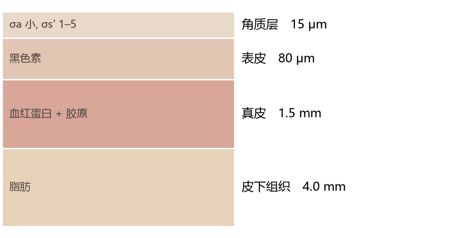
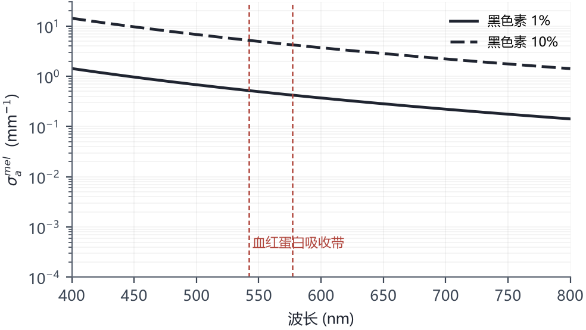

# 第 21 章 从旋钮到参数：多层皮肤、光谱与毛发

## 21.1 美术面板上的三个数

一个皮肤材质在美术面板上通常只有三个数：色调、透光强度、粗糙度。物理模型需要的是 $\sigma_a,\sigma_s,g,\eta$ 加上层厚。中间缺了一座桥。

这座桥要跨过三段：从"色调"到"黑色素浓度与血氧饱和度"，从色素浓度到各层的 $\sigma_a$，从细胞结构到 $\sigma_s$。三段里前两段有明确的物理依据，第三段只能靠拟合。

这一章把这座桥搭起来，并且把波长维度接进来。最后一段处理毛发：它内部也是介质，但几何是圆柱而不是平面，所以公式要换。

## 21.2 皮肤的四层

皮肤从外到内是四层，每层的厚度与光学性质差很多。

**角质层。** 厚度 10 到 20 微米，主要成分是角蛋白，几乎不含水。散射强而吸收弱，$\sigma_s'$ 在 1 到 5 $\mathrm{mm^{-1}}$ 之间，$\sigma_a$ 很小。它的作用是产生表面的那层薄雾，以及提供一层低折射率的界面。

**表皮。** 厚度 50 到 100 微米，最内层是基底层，黑色素细胞在这里。黑色素颗粒的直径约 0.5 微米，吸收强且随波长急剧变化。

**真皮。** 厚度 1 到 2 毫米，主要成分是胶原纤维和血管。胶原纤维的直径几微米，是主要的散射体；血管里的血红蛋白是主要的吸收体之一。

**皮下组织。** 厚度不定，主要是脂肪。散射强，吸收弱，颜色偏黄。

对渲染来说，前三层是关键，第四层只在极薄的部位（耳廓、鼻翼）才有影响。

图 21-1 把四层画在一起，注意厚度的跨度：角质层 15 微米，真皮 1.5 毫米，相差一百倍。这个跨度决定了不能用单一均匀介质近似——角质层和真皮的 $\sigma_a$ 差十倍以上。

## 21.3 吸收从哪里来

皮肤的颜色由三种吸收体决定。

**黑色素。** 吸收系数随波长按幂律下降，常用形式是

$$\sigma_a^{\text{mel}}(\lambda)=6.6\times10^{11}\,\lambda^{-3.33}\qquad(\lambda\text{ 以 nm 计，单位 }\mathrm{cm^{-1}}) , \tag{21.1}$$

这是 Jacques 在 2013 年的综述里给出的拟合式。指数 3.33 意味着波长从 400 纳米增加到 700 纳米，吸收降了六倍多。这就是为什么黑色素让皮肤偏棕而不是偏灰。

体积分数从 1%（很白）到 30%（很黑），吸收系数与之成正比。

**血红蛋白。** 两条吸收带在 542 与 577 纳米（氧合态），脱氧态的带位置略有移动，在 555 纳米处有一个等吸收点。血红蛋白的吸收是皮肤"红"的主要来源：它吃绿光，放过红光。

血容量（单位体积内的血液体积分数）在真皮里是 0.2% 到 4%。

**水与脂肪。** 在可见光区吸收很弱，在近红外有吸收峰，对渲染影响不大。

黑色素与血红蛋白的谱线在 600 纳米附近交叉。短于这个波长，黑色素主导；长于它，血红蛋白主导。这解释了皮肤的色调：白皮肤（低黑色素）偏红，因为血红蛋白在 600 纳米以下吸收强，红光透过；深色皮肤偏棕，因为黑色素在短波吸收更强，整体亮度下降但色调偏暖。

## 21.4 散射从哪里来

散射体是胶原纤维与细胞器，尺度 0.1 到 10 微米，远大于波长，所以散射是米氏型的，前向为主，$g$ 在 0.8 到 0.9 之间。

约化散射系数随波长下降，常用幂律：

$$\sigma_s'(\lambda)=\sigma_s'(\lambda_0)\left(\frac{\lambda}{\lambda_0}\right)^{-b} , \tag{21.2}$$

$b$ 在 0.5 到 1.5 之间。皮肤常用 1.0 左右，也就是瑞利散射与米氏散射之间。这个依赖让短波的散射更强，进一步加深了"蓝光出不来"的印象。

## 21.5 三层模型的拼装

拿到每层的参数之后，怎么拼成一个能渲染的 BSSRDF？

**一层近似。** 把表皮与真皮合并成一层均匀介质，参数用厚度加权平均。误差在薄部位（耳廓）很大，在厚部位（脸颊、背部）可以接受。

**两层。** 表皮一层（薄、吸收强、散射弱），真皮一层（厚、吸收弱、散射强）。两层的界面用 Fresnel 处理，或者假设折射率接近而忽略。多层扩散的解法在第 16 章提过，需要解一个线性系统。

**全蒙特卡洛。** 直接把四层放进随机游走，层间界面按 Fresnel 处理。这是最准的，代价是慢。

生产上两层模型最常见。它的关键参数是表皮厚度与黑色素浓度，这两个决定了"皮肤看起来有多白"；真皮的散射系数决定了"光晕有多宽"。

## 21.6 毛发：圆柱内的介质

一根头发的直径 60 到 100 微米，内部是角质细胞与色素颗粒。光进入之后在内部走十几微米，相对于直径不算小，所以"半无限平面"的图像完全失效。

正确的几何是圆柱。光从侧面进入，在内部经过折射、散射、内反射，从侧面出来。渲染上常用的模型（Kajiya–Kay，1989；Marschner 等，2003）把这条路径分成几个模态：R（直接反射）、TT（透射两次）、TRT（透射—内反射—透射），每个模态对应一条出射角分布。

这些模态的强度由内部的吸收决定，而吸收又由色素浓度决定。所以毛发与皮肤在参数层面是同一套东西：$\sigma_a$ 决定颜色，$\sigma_s$ 决定浑浊度，几何决定光路。

圆柱几何下的推导与平面情况平行，只是坐标从极坐标换成了柱坐标。这里只需要记住一件事：圆柱几何里的 $R_d$ 是一维的角分布，不是二维的径向剖面；与其说它是"另一个模型"，不如说它是"同一个方程在另一个几何下的解"。

## 21.7 从旋钮到参数的实现

实际的映射分三步走。

第一步，美术给出三个数：$m$（黑色素 0 到 1）、$b$（血容量 0 到 1）、$d$（散射强度 0 到 1）。

第二步，换算成物理量：

$$\text{mel}=\text{mel}_{\max}\,m,\qquad v_{\text{blood}}=v_{\max}\,b,\qquad \sigma_s'=\sigma_{s0}'\,d^{\gamma} , \tag{21.3}$$

$\text{mel}_{\max}$ 取 0.3，$v_{\max}$ 取 0.04，$\gamma$ 取 1 到 2 之间（让旋钮的手感更线性）。

第三步，按波长求值：用 (21.1) 与 (21.2) 算出每个波长上的 $\sigma_a,\sigma_s'$，再算 $\mu_{\text{eff}}$、$z_b$、剖面。

三步的顺序不能颠倒。如果先按 RGB 求剖面再插值，得到的颜色会偏：因为剖面本身依赖波长（$\mu_{\text{eff}}$ 随波长变化），红光的光晕比蓝光宽。正确的做法是对每个波长各算一遍剖面，最后按光谱权重合成——这就是"渲染要在线性光下做"的另一个理由。

---

这一章给出了参数从哪来的完整链条：色素与血容量决定吸收谱，胶原与细胞器决定散射谱，层厚决定几何。三者结合成一个可渲染的模型，代价是要么接受均匀化误差，要么付出多层的计算。

下一章处理最后两件事：实时管线怎么近似，以及怎么知道自己做对了。
