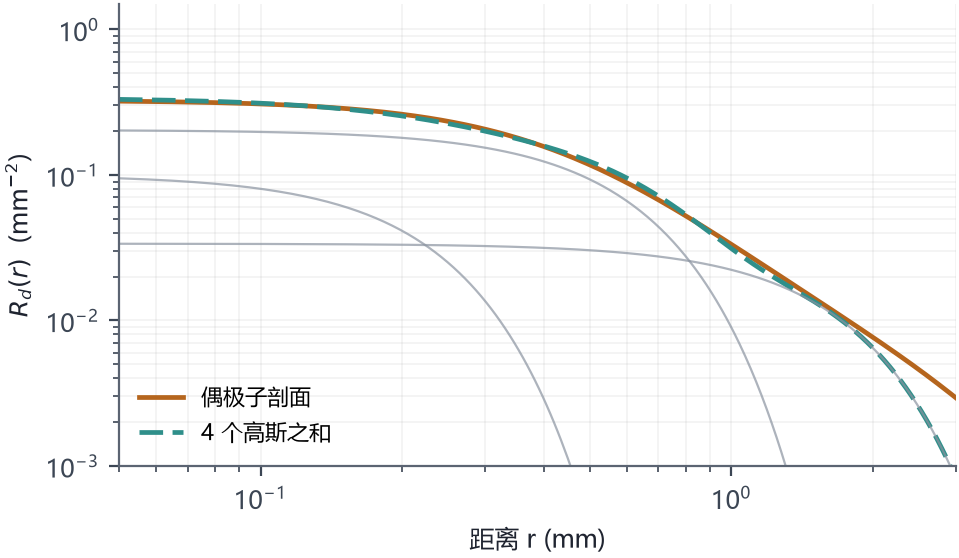
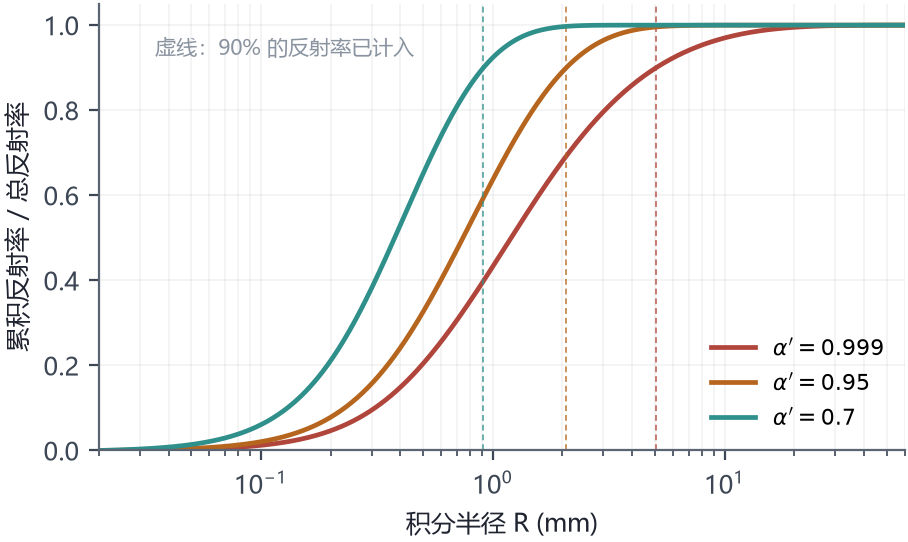

# 第 22 章 实时近似、验证与调试

## 22.1 三十二毫秒

离线渲染可以给一个像素投十万条路径。实时渲染每帧三十二毫秒，要画两百万个像素，所以每个像素的平均预算不到一千次浮点运算。

这个预算下，任何"积分整个表面"的做法都不可能。BSSRDF 的面积分必须被换成一个固定代价的操作：几次纹理取样，或者几遍屏幕空间卷积。

这一章讲两件事：实时管线怎么近似，以及怎么判断自己的实现到底对不对。前者是工程，后者是纪律，而后者往往更省时间——一个错误的实现跑得再快也没有意义。

## 22.2 可分离卷积

Jimenez 等人在 2015 年给出的做法，是把径向剖面近似成若干个高斯函数的和：

$$R_d(r)\approx\sum_{i=1}^{K}w_i\,G_{2\text{D}}(r;\sigma_i) , \tag{22.1}$$

每个高斯在二维上可以拆成两个一维卷积的乘积，所以整个卷积变成 $K$ 遍"横向加纵向"的可分离滤波。$K$ 取 3 到 6 就够，代价是每帧 $2K$ 次全屏 pass。

这个近似的误差来源有三个。剖面不是高斯（有 $1/r$ 的奇性），所以在 $r\to0$ 附近误差大；可分离假设要求表面局部平坦，在曲率大的地方失效；屏幕空间的做法看不到背面，所以薄物体（耳朵、手指）的透光会丢。

第三点是本质的。屏幕空间方法的所有变体都有这个问题，因为它的输入是屏幕上的颜色和深度，而透光需要的信息在屏幕之外。补丁的做法是用深度图估计厚度（把背面的深度也渲染出来），把厚度作为权重乘进卷积核——这就把"透光"从"横向模糊"变成"按厚度加权"。这是第 16 章的 $T_d$ 在屏幕空间的版本。

## 22.3 预积分的径向剖面

另一类做法不模糊，而是预计算一张表。

把 $R_d(r)$ 按参数 $(\alpha',\sigma_t')$ 打网格算出来，存成二维纹理。着色时按材质的两个参数查表插值，得到"给定距离的权重"，再对表面上的若干个采样点求和。

采样点数通常取 8 到 16 个，分布在表面的圆盘上。这相当于对面积分做低阶求积，误差取决于圆盘半径与采样点的分布。用第 20 章的分位数做采样点位置，可以把误差压到 10% 以内。

代价是纹理带宽。二维表如果按 $64\times64$ 存，每个通道 8 位，大约 4 KB，可以常驻显存。

图 22-1 是这个分解的一个例子。四个高斯的宽度从 0.06 到 1.1 毫米，权重按非负最小二乘拟合。近端吻合得很好，远端偏差明显：真实剖面在 $r$ 大时按指数乘 $1/r^2$ 衰减，而高斯衰减得更快。实际项目里通常把拟合范围限制在关心的一段（比如 3 毫米内），范围外交给粗糙的环境光近似。

## 22.4 验证的六项检查

实现完了，怎么知道自己做对了？下面六项检查覆盖了绝大多数错误。它们从便宜到贵排列，前四项在几分钟内能跑完。

**量纲。** BSSRDF 的返回值乘上 $L_i\cos\theta_i d\omega_i dA_i$ 之后应当是辐亮度。写一个单元测试，输入已知的量，检查输出的单位。这一条能抓住所有漏乘 $1/\pi$、漏除面积、重复乘 $\cos$ 的错误。

**互易。** 交换两组点与方向，结果应当不变。能抓住方向因子不对称、pdf 与采样不匹配的错误。

**能量上界。** 对整个表面与所有方向积分，结果不能超过 1。能抓住归一化错误。注意这一项要求积分范围足够大（半径取 $10/\mu_{\text{eff}}$），否则截断会掩盖错误。

**白炉。** 把 $\sigma_a$ 设为 0、折射率设为匹配，渲染一个球，它应当与背景无法区分。这一项能抓住能量不守恒与采样偏置。它是最灵敏的检查，因为任何一点能量泄漏都会在均匀的亮场上显出来。

**与蒙特卡洛对照。** 同一组参数，比较径向剖面与总反射率。这一项能抓住模型选择错误（比如在薄板上用了偶极子）。

**参数极限。** $\sigma_a\to0$、$\sigma_a\to\infty$、$\sigma_s\to0$、$L\to0$ 四个极限下，模型应当退化成已知的结果（全反射、无散射、透明）。能抓住参数映射与边界条件错误。

图 22-2 是白炉测试的一个例子。实线是正确实现，虚线上那个掉下去的分支是故意引入的 pdf 错误。注意错误的形状：它只在 $\alpha'$ 高的时候明显，因为只有那时能量才会在介质里反复往返。这就是为什么白炉测试必须用高反照率材料做。

## 22.5 调试的顺序

出错的时候，按下面的顺序排查，能最快定位。

先看常量：$\sigma_t'$、$\mu_{\text{eff}}$、$z_b$ 三个数算得对不对。用文献里的一组参数（比如皮肤：$\sigma_a=0.02$、$\sigma_s=10$、$g=0.8$、$\eta=1.4$）手算一遍，和代码的输出比对。这三个数错了，后面全都错。它们的典型值是 $\sigma_t'=2.02$、$\mu_{\text{eff}}=0.346$、$z_b=1.08$（毫米）。

再看剖面：$R_d(r)$ 在 $r=0$、$r=1/\mu_{\text{eff}}$、$r=10/\mu_{\text{eff}}$ 三个点的值。和曲线对比，形状对不对一眼就能看出来。

再看积分：$\int2\pi rR_d\,dr$ 是否等于总反射率。这一条能抓住归一化错误。

最后看图像：光斑的形状、颜色梯度、边缘透光。如果前四步都对，图像还不对，问题在采样或者与其它材质的组合上。

## 22.6 一个常见的误判

有一种错误很难被发现：模型的每一项都对，但组合方式错了。

比如把 $S^{(1)}$ 与 $S_d$ 相加时，$S^{(1)}$ 只用了一次折射，$S_d$ 用了两次。如果两个都用了同样的 Fresnel 因子，近源处会多算一部分能量。这个错误在白炉测试里表现为"总反射率略微超过 1"（多 1 到 3 个百分点），在高反照率下看不出来，在低反照率下才明显。

再比如多层模型里，层间的界面反射用了 $F_{dr}$（漫反射的半球平均），而实际上层间是准直光。这会让层间往返的次数算错，表现为颜色偏淡。

这类错误的特点是"每一项都合理"，只能靠交叉检验发现：用两种不同的实现算同一个场景，或者用同一个实现算两个应该相等的量。

## 22.7 收尾

到这里，这本书的内容走完了。从 BRDF 缺的那个维度开始，经过介质里的吸收与散射、辐射传输方程、扩散近似、偶极子、多极子、量化扩散、方向偶极子，最后到随机游走与生产管线。每一章都在做同一件事：把一个近似推到它能用的边界，然后指出边界在哪里。

真正做渲染的人会发现，最难的部分不是任何一个公式，而是判断手上的资产落在哪个模型的适用范围里。这需要知道每个模型的假设，也需要知道假设被打破时误差的形状——是整体偏亮，还是边缘偏暗，还是在某个特定的角度上错。这本书试图把这种判断力写下来，而不只是公式。

如果只记一件事，记这个：光的路径长度决定一切。吸收、散射、扩散、透射，都是这个长度的不同侧面。
