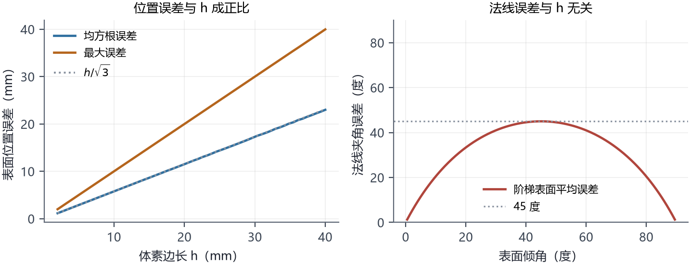
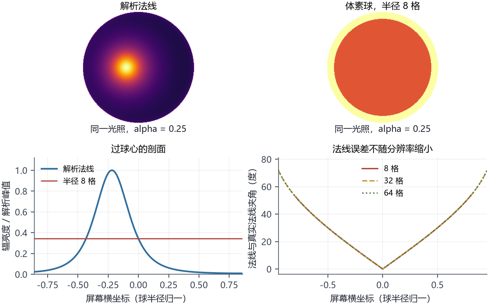
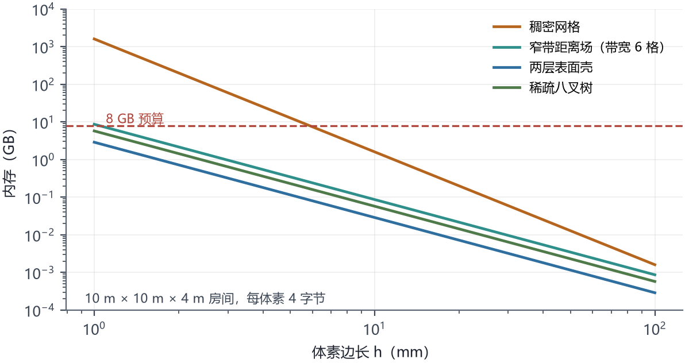

# 第 1 章 把连续几何切成格子

## 1.1 一个方块球

在场景里放一个球，用体素做全局光照，把体素边长设成一厘米。渲染出来第一眼看到两件事。

近处的轮廓是阶梯，尤其是掠射的边缘。这在意料之中，分辨率不够。远处的墙角、走廊深处、桌底这些地方反而比路径追踪的快速预览更像样，光从窗户进来，打到地板，再弹到天花板上，颜色是对的，衰减也是对的。

第二件事更有意思。球的正面，高光不见了。整个球面变成一片均匀的亮，边缘一圈更亮。明明光照没变，材质参数也没变，只是几何从解析球变成了体素球，高光就从一个点变成了一整片。

这一章要解释的就是这两件事为什么发生，以及它们各自能好到什么程度。结论先说：位置误差随体素边长线性下降，法线误差不下降。这个不对称是体素渲染所有麻烦的源头。

## 1.2 阶梯能有多高

把表面看成一个截面。平面上一条直线，倾角为 $\theta$，用边长 $h$ 的格子去覆盖它。每个格子要么算作实心，要么算作空，二分的结果就是一个阶梯：

$$y_{\text{step}}(x)=h\left\lfloor \frac{x\tan\theta}{h}\right\rfloor . \tag{1.1}$$

真实表面是 $y(x)=x\tan\theta$。两者之差

$$e(x)=h\left\lfloor \frac{x\tan\theta}{h}\right\rfloor - x\tan\theta \tag{1.2}$$

在 $x$ 均匀取值时，$x\tan\theta$ 在模 $h$ 的意义下均匀分布，所以 $e$ 在 $(-h,0]$ 上均匀分布。于是三个数可以立刻写出来：

$$\bar e=-\frac{h}{2},\qquad \sqrt{\overline{e^2}}=\frac{h}{\sqrt{3}}\approx 0.577h,\qquad \max|e|=h . \tag{1.3}$$

阶梯总是落在真实表面的下方，平均低半个格子，偏差的均方根是 $h/\sqrt{3}$，最坏情况整整一个格子。图 1-1 左边把这三个量画在一起，横轴是体素边长，单位毫米。曲线是直线，斜率就是这些常数，说明误差严格正比于 $h$，没有任何"分辨率够高就消失"的阈值。

$h=1\,\mathrm{cm}$ 时，最大偏差是一厘米。这个数听起来很小，换算到屏幕上就不小了：垂直视场 60 度、1080 行的画面，在 3 米处一个像素覆盖

$$\frac{2\times 3\times\tan 30^\circ}{1080}\approx 3.2\,\mathrm{mm} . \tag{1.4}$$

一厘米的偏差是三个像素。轮廓上的三级台阶，人眼一眼就能看出来。

所以位置误差这一项没有意外，提高分辨率就行。真正的问题在下一节。

## 1.3 法线只有六个方向

体素的面是轴对齐的，一个格子最多贡献六个法线方向，$\pm x$、$\pm y$、$\pm z$。阶梯上的每一段水平面法线都朝正上方，每一段竖面都朝水平方向。真实表面是斜的，它的法线在两者之间，而这个中间值在体素表示里根本不存在。

对倾角 $\theta$ 的平面，一个周期内水平段的长度占比是 $1/(1+\tan\theta)$，竖段的占比是 $\tan\theta/(1+\tan\theta)$。前者的法线误差是 $\theta$，后者是 $90^\circ-\theta$，平均误差

$$\bar\delta(\theta)=\frac{\theta+\tan\theta\,(90^\circ-\theta)}{1+\tan\theta} . \tag{1.5}$$

这条曲线画在图 1-1 右边，横轴是倾角，纵轴是平均角度误差。它在 45 度附近达到最大值 45 度，在 0 度和 90 度处归零，因为这两个极端情况下轴对齐恰好是对的。

关键在于这条曲线里没有 $h$。分辨率翻倍，阶梯变细，阶梯的段数变多，但每一段的法线仍然只有那六个方向之一，平均误差一点没变。图 1-2 右下角把这一点画得更直接：同一个球，半径取 8 格、32 格、64 格，法线误差随屏幕位置的变化几乎完全重合，只有在轮廓那一圈因为阶梯尺寸不同而略有差别。

位置误差 $O(h)$，法线误差 $O(1)$。这个差别决定了体素化之后哪一类材质还能用。漫反射对法线的依赖是 $\cos\theta$，45 度的法线误差最多让亮度差三成，而且被平均之后看不太出来。高光不行。

## 1.4 高光为什么碎掉

GGX 的法线分布

$$D(\theta_h)=\frac{\alpha^2}{\pi\left((\alpha^2-1)\cos^2\theta_h+1\right)^2} \tag{1.6}$$

在 $\alpha=0.25$ 时，$D$ 降到峰值一半对应的半角是 9.5 度，整个高光瓣的宽度不到 20 度。法线误差 45 度，比整个瓣还宽两倍多。

$\alpha=0.12$ 时瓣宽只有 9 度，情况更糟。

后果不是高光变暗或者变糊，而是它被摊平了。所有法线都被归到 $+z$，等于整个球面用同一个法线参与着色。图 1-2 上半部分是这个计算的直接结果：解析法线的球上有一个明亮的小点，体素球的整个正面是一块均匀的亮，峰值只剩解析峰值的 34%。能量没有丢，总亮度也差不多，但它分布到了整个球面上，形状完全没了。

这一条比表面粗糙更致命。表面粗糙还能靠抗锯齿和位移贴图掩盖，高光形状没了没有任何后处理能补回来。它意味着纯体素表示不适合做低粗糙度的材质。

补救的办法是从占据率重建法线，而不是用格子的面。占据率在球面上是一个从 1 到 0 的过渡带，过渡带的梯度方向就是法线，这个方向上包含连续的角度信息。第 7 章讲具体做法。这里只需要记住一件事：体素渲染里"表面"和"法线"是两个独立的问题，位置精度和法线精度不是同一个数量级。

## 1.5 换回来的三样东西

代价说清楚了，看看收益。体素换回来的东西有三样，每一都在别的结构里很难拿到。

**查询有上界。** 八叉树里找射线碰到的第一个非空格子，代价是树的最大深度，与场景里有几百万个三角形无关。BVH 是 $O(\log n)$，渐进上看起来差不多，但 BVH 的节点数是场景的线性函数，常数随规模涨。更要紧的是动态性：BVH 每帧重建要重排整个结构，八叉树改一个格子只影响一条路径。

**过滤几乎不要钱。** 要估计一个像素覆盖的一小片区域的平均亮度，体素往上跳几层就是那个区域的平均值。这个性质是所有体素全局光照方法的基础。BVH 的节点里没有存"这一块的平均反射率"，要么额外维护一套结构，要么老老实实多打几条线。Crassin 等人 2011 年的锥追踪（voxel cone tracing）就是靠这一点，用一条锥换掉成百上千条射线。

**光是可加的。** 规则网格上的邻接关系固定，往格子里注入光和读出来都是数组操作，多次弹射可以写成一个迭代。迭代的收敛性有保证的前提是每次传播的能量不超过 1，这一条比路径追踪的方差分析容易验证得多。

收益和代价都要用字节和毫秒来算，不能靠感觉。先算带宽。1080p 的画面，每像素八条锥，每条锥平均走三十步，每步读一个砖块的三线性样本，一共是五亿次采样。一个样本按 16 字节算（占据率、法线、辐照度六向各一字节还有余量），是 80 GB 的读取量。显存带宽按 500 GB/s 算是 0.16 秒，按 100 GB/s 算是 0.8 秒。这个估算说明体素全局光照在高端显卡上是一帧几十毫秒的量级，在集显上就是一秒以上，而且瓶颈完全在带宽，不在算力。少读一个通道、少走一步，收益都是线性的。取一个具体的房间，10 米乘 10 米，高 4 米，内表面积 360 平方米。四个方案的存储量随体素边长的变化画在图 1-3 里。

稠密网格的体素数是 $V/h^3$，一厘米边长时是四亿个格子。每个格子存一个占据字节加三个法线字节，就是 1.6 GB。这个数在 8 GB 的预算里还塞得下，但只够放一个房间，而且没有任何空间留给光照。

窄带距离场只存表面附近的一条带，带宽 $\pm3$ 格，体素数是 $6A/h^2$，一厘米时是两千一百万个，86 MB。

两层表面壳更省，$2A/h^2$，一千四百万个，29 MB。但它只适合做遮挡和注入，因为它没有内部信息，锥追踪穿过去就什么都不知道了。

稀疏八叉树的节点数是表面叶子数的 1.33 倍（每一层是上一层的四分之一，等比求和），每个节点 12 字节，一共 57 MB。

三条稀疏曲线和稠密曲线平行，斜率差一次方。这个差在分辨率提高时会被放大：边长减半，稠密涨八倍，稀疏涨四倍。图 1-3 里稠密网格在 6 毫米左右撞上 8 GB 的线，稀疏结构要到 1 毫米。

## 1.6 什么时候值得用

把前面的账合起来，可以写出一条判据。用体素的前提是三条同时成立。

**第一，特征尺寸远大于体素。** 场景里最细的结构如果只有几个体素宽，它就会被阶梯和法线量化毁掉。经验上要求最细的特征至少跨 8 到 16 个体素，这个数来自阶梯的相对误差：8 个体素宽的结构，轮廓误差 12%，看起来还在；4 个就明显了。

**第二，反射不需要锐利。** 判断依据是高光瓣宽度和法线误差的比较。$\alpha$ 大于 0.4 时瓣宽超过 40 度，体素法线的 45 度误差还能接受；$\alpha$ 小于 0.2 时瓣宽不到 15 度，纯体素一定出问题，除非重建法线或者混入距离场。镜面反射完全不行。

**第三，需要的是光的多次弹射，不是几何细节。** 体素的收益全部在光的传播上。如果只需要一次弹射的环境光遮蔽，屏幕空间的方法更便宜也更准。如果只需要直接光加阴影，阴影贴图加体素遮挡体就够。体素真正无可替代的场合是多次弹射、动态光源、大范围场景这三者同时出现。

反过来，有几类场景几乎一定不该用体素：需要看清物体边缘的产品展示，需要镜面反射的建筑可视化，需要半透明和折射的玻璃制品，以及任何几何精度本身就是卖点的场合。

把这三条判据套到一个具体场景上，看看账怎么算。一个室内场景，房间六米见方，层高三米，内表面积一百四十四平方米，需要多次弹射的全局光照，材质以乳胶漆和木地板为主，粗糙度都在 0.5 以上。

第三条判据满足，需要多次弹射。第二条判据满足，粗糙度高，高光瓣宽，四十五度的法线误差看不出来。第一条判据要看最细的特征，门框、扶手、踢脚线的断面在五厘米量级。

五厘米体素下，五厘米的门框刚好是一个格子宽，落在"八到十六格"的下限之外，它会变成一根断断续续的方块。把它调到二厘米，门框跨两个半格子，还是不够。这就是为什么体素项目里常见的做法是把细长构件单独用三角形画，不参与体素化。

如果只看墙、地板、家具这些大块面，五厘米体素足够，存储是 $8	imes144/0.0025$ 字节，约 460 KB（两层壳，每格四字节），可以忽略。真正决定分辨率的是那几根细构件，而它们本来就不该用体素表达。

这个例子说明判据要分对象用。同一个场景里，大块面和小构件的最优分辨率差一个数量级，用一个全局分辨率去覆盖所有东西，要么内存爆掉，要么细节全丢。第 8 章的分块与 LOD 就是为这件事准备的，让不同区域用不同的分辨率。

判据之外还有一个实用的中间路线：用体素只算间接光，用三角形算直接光和主可见性。这样高光和轮廓由三角形保证，反弹带来的颜色渗透和软阴影由体素提供。第 9 章讲这条路线怎么接，以及它会引入哪些偏差。

---

这一章量化了一笔交易。位置误差是 $h/\sqrt{3}$ 量级，随分辨率线性下降；法线误差由六个轴方向决定，是常数，不随分辨率下降。前者让轮廓变糙，后者让高光消失。换回来的是有上界的查询、免费的过滤和可加的光，这三样让多次弹射的全局光照变得可行。值不值得，取决于场景的最细特征、材质的粗糙度和是否需要多次反弹。

下一章看这些格子怎么存，以及为什么稠密数组在分辨率提高时会先崩掉。
