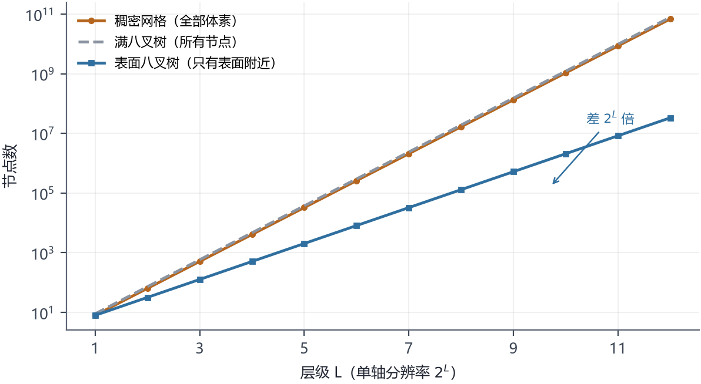
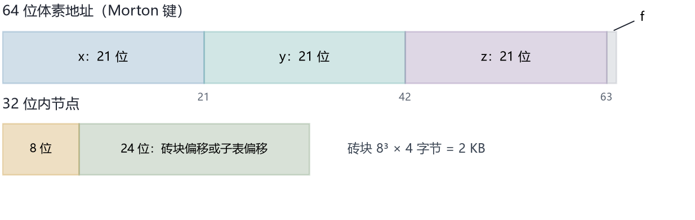
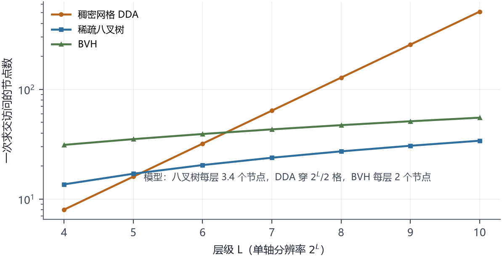

# 第 2 章 体素的存储结构

## 2.1 一个格子里放什么

把空间切成格子之后，每个格子里要记几件事。

最少的一项是占据率，一个格子被实心物体占了多少。二值化之后只要一位，但它决定了射线会不会在这里停住。第二项是法线，表面朝哪边，没有它就算不出着色。第三项是材质，反照率、粗糙度、金属度，或者一个指向材质表的索引。第四项是光，间接光照的辐照度，这一项不是几何固有的，是算出来的缓存。

前三项合起来，一个格子通常占四字节。占据率可以塞进法线的空闲位里，法线用三个字节存一个八面体编码的单位向量，材质用一个字节存索引。四字节这个数很关键，后面所有的存储估算都从它出发。

四字节听起来很小。麻烦在于格子的数量随分辨率立方增长。

## 2.2 稠密数组的账

最直接的结构是一个三维数组，索引就是整数坐标：

$$\text{index}(i,j,k)=i+N\,(j+N\,k),\qquad N=\frac{\text{边长}}{h} . \tag{2.1}$$

查一个格子是一次乘加，遍历一条射线用 Amanatides 与 Woo 1987 年的 DDA，每步只做一次比较和一次加法。没有指针，没有分支预测失败，缓存友好。这是体素结构里最快的访问方式，后面所有稀疏结构都在拿空间换它。

代价是 $N^3$。$512^3$ 是一亿三千四百万个格子，四字节一格是 537 MB。加上 mip 金字塔，每层体积是上一层的八分之一，总和是 $8/7$，变成 613 MB。$1024^3$ 是 4.3 GB，$2048^3$ 是 34 GB。

这里有个容易被忽略的细节。全局光照用的体素，绝大多数格子是空的。一个房间里，空气占了 99% 以上的体积，而空格子既不遮挡也不发光，存它只是为了让索引能算出来。稀疏结构要消灭的就是这部分浪费。

## 2.3 八叉树：节点数与表面成正比

八叉树把空间一分为八，递归下去，只对非空的子节点继续分。

如果物体充满了整个空间，第 $l$ 层有 $8^l$ 个节点，总数

$$\sum_{l=0}^{L}8^l=\frac{8^{L+1}-1}{7}\approx 1.14\times 8^{L} . \tag{2.2}$$

$8^L=N^3$ 就是稠密的格子数，所以满八叉树比稠密数组还多 14% 的存储。这时候八叉树纯粹是负担。

真实场景不是满的。物体是二维的表面，穿过一个立方体的表面，面积是边长的平方。第 $l$ 层的节点数正比于 $4^l$，不是 $8^l$：

$$N_l\approx c\,4^{l},\qquad \sum_{l=0}^{L}N_l\approx \frac{4}{3}c\,4^{L} . \tag{2.3}$$

等比级数的和是最大项的 $4/3$，因为每一层只有上一层的四分之一。这个 $4/3$ 是八叉树存储的核心常数，它意味着内节点的开销只有叶子层的三分之一。

拿具体数字验证。一个一米见方的立方体，$h=1/512$ 米，表面积 6 平方米，叶子数 $6/h^2=1.57\times10^6$。按 (2.3)，节点总数 $2.1\times10^6$，每个内节点存一个子掩码加一个偏移共八字节，是 17 MB，叶子载荷 4 字节一格是 6 MB，合计 23 MB。同样分辨率下稠密数组要 613 MB，差 26 倍。

图 2-1 把三条曲线放在一起。橙线是稠密网格，灰虚线是满八叉树，两者几乎重合；蓝线是表面八叉树，斜率只有橙线的三分之二。两条线的间距随层级线性拉开，正好是 $2^L$ 倍，这是 $N^3$ 与 $N^2$ 的差别。

## 2.4 地址与节点编码

八叉树的遍历要回答一个问题：给定一个格子，怎么快速在树里找到它。

做法是把三个整数坐标交错排成一个数，叫 Morton 码。$x$ 的第 0 位、$y$ 的第 0 位、$z$ 的第 0 位排成最低的三位，然后是三个坐标的第 1 位，依此类推。这么排的好处是，同一层的格子在数值上连续，父节点的编号就是子节点编号右移三位。整棵树可以用一个平坦的数组加算术索引，不需要指针。

64 位字能放下三个 21 位的坐标，还剩一位。21 位单轴是两百万个格子，边长一厘米时是 21 公里的立方体，对渲染场景够用。图 2-2 上半部分是这个编码的位域。

内节点的编码更有讲究。一个节点有八个子节点，但通常只有两三个非空。存八个指针要 64 字节，太浪费。常见做法是一个字节的子掩码加一个偏移，共四字节或八字节，子节点在数组里连续存放，第 $n$ 个存在的子节点位置由掩码里前面有几个 1 算出来，这就是 `popcount` 的用途。

Laine 与 Karras 2010 年的稀疏体素八叉树把这套编码推到极致。每个节点两个 32 位字，一个存子掩码和叶标志，一个存子节点指针或体素数据，整个结构可以完全用无符号整数数组表示，遍历时不需要任何解引用。

再往前一步是 Kämpe、Sintorn 与 Assarsson 2013 年的稀疏体素 DAG，Villanueva、Marton 与 Gobbetti 2016 年又利用结构的对称性把它压得更小。既然大量子树在几何上完全相同，就把它们合并成一份，节点用哈希去重。一个规整的建筑场景，压缩率常在十倍以上，代价是节点不能再存"每个实例不同的数据"，比如光照缓存必须放在另一个结构里。

Hoetzlein 2016 年的 GVDB 走了另一条路。它不追求极致的压缩，而是把树的上半部分和下半部分分开。上半部分是稀疏的指针树，覆盖到某一层；下半部分是砖块池，每个砖块是一个 $8^3$ 的稠密小数组，从池里自由分配。查询到砖块之后，剩下三次整数运算就定位到格子。

## 2.5 砖块：把指针开销摊薄

为什么是 $8^3$ 而不是 $4^3$ 或 $16^3$。

一个砖块的开销分两部分，数据本身和指向它的指针。$8^3$ 有 512 个格子，四字节一格是 2 KB 数据，一个四字节指针摊到每格是 0.008 字节，可以忽略。$4^3$ 只有 64 格，指针开销涨到 0.06 字节每格，同时树的层数多了一层，遍历步数增加。$16^3$ 是 4096 格 16 KB，超过一级缓存的舒适区，而且空砖块浪费变大。

512 格、2 KB 这个尺寸还有一个好处，它和 GPU 的存储事务、SIMD 宽度都对得比较齐。GVDB 的砖块池就是这个思路，砖块在池里不连续分配，用 32 位索引寻址，池可以整体换出到磁盘。

砖块的代价在薄结构上最明显。一个 $8^3$ 砖块被一层表面斜着穿过，真正被占的格子大约 $2\times8^2=128$ 个，其余 384 个是空的但必须分配。有效存储从每格四字节涨到十六字节。这是砖块相对纯八叉树（叶子只存被占的体素）的劣势，也是为什么很多实现把砖块内部的格子也做成位图加稀疏数据，而不是稠密数组。

## 2.6 窄带距离场

有符号距离场（signed distance field，SDF）存的不是占据率，是每个格点到最近表面的距离，符号区分内外。

距离场的信息量比占据率大得多。占据率只回答"在不在里面"，距离场还回答"离表面多远、往哪个方向走最近"。法线因此是免费的，取梯度就行，而且是连续的角度，不受六个轴方向的限制。这一点直接解决了第 1 章里高光消失的问题。

代价是精度和存储的取舍。距离场必须是连续的，格子之间要插值，所以不能像占据率那样二值化。每格一个数，四字节浮点太贵，实际多用两字节的半精度，或者一字节的非线性量化。距离只在表面附近有意义，远处的距离值对渲染没有用处，所以只存表面外三格、内三格的一条窄带，带宽外的格子标成"远"。

存储量是 $6A/h^2$ 格，$A$ 是表面积。前面的房间例子，一厘米边长时是 86 MB，两字节一格减半到 43 MB。

距离场有一个占据率没有的麻烦，薄结构。一堵五厘米厚的墙，在十厘米的格子上，两侧的距离场会互相干扰，插值之后墙中间可能出现一个虚假的零等值面，或者墙干脆消失。有符号距离场在数学上假设表面是封闭的、厚度大于格子，这个假设在建筑模型上经常不成立。第 6 章讲怎么和体素混着用。

## 2.7 遍历代价

存储省下来了，访问变慢了，慢多少要算清楚。

稠密数组里，一条射线穿过 $N$ 个格子要 $N$ 步。八叉树里，一次求交的步数是树深乘以每层访问的节点数。对表面八叉树，一条射线在每层通常访问 3.4 个节点，这个数是实际测量出来的经验值，来源是一条射线在进入和离开每个节点时都要做一次子节点判定。

$$C_{\text{octree}}\approx 3.4\,L,\qquad C_{\text{dense}}\approx \frac{2^{L}}{2} . \tag{2.4}$$

$L=10$ 时，八叉树 34 步，稠密数组 512 步，差 15 倍。$L=12$ 时差 60 倍。图 2-3 画了这条对比，还加了 BVH 作为参照。

BVH 的曲线也在图里，它比八叉树略高，因为 BVH 的节点覆盖的是三角形的包围盒，重叠多，一条射线要访问更多节点。但 BVH 的节点数随三角形数增长，不是随体素分辨率增长，所以两者的可比性只在特定场景下成立。

这张图容易被误读成"八叉树永远比稠密数组快"。稠密数组的每一步只是一次整数加法加一次数组读取，八叉树每一步要做掩码、`popcount`、索引计算，单步贵三到五倍。$L$ 小的时候，比如 6 或 7，稠密数组反而更快。选择的分界线在 $L\approx8$ 附近，也就是 $256^3$ 左右，具体位置取决于缓存大小。

## 2.8 怎么选

四种结构对应四种场景。

稠密网格适合分辨率低、访问密集、需要随机读写的情况，比如流体模拟的网格、小范围的光照缓存。它的代码最短，调试最容易。

稀疏八叉树适合大范围静态场景的射线求交，尤其是需要 LOD 的地方，因为树的层级天然就是 LOD。

砖块结构适合需要频繁更新和流式加载的场景，因为分配和释放的粒度是砖块，不是单个节点，碎片少。

窄带距离场适合需要精确求交和平滑法线的地方，比如软阴影、环境光遮蔽、以及和路径追踪混合。

实际系统很少只用一种。GVDB 是八叉树加砖块，Kämpe 的 DAG 是八叉树加去重，很多游戏引擎是八叉树加距离场，各存一份，各管一件事。

选完之后还有一件事要决定，每个格子里到底存几个数。这一个决定的影响比存储结构更大，因为它决定了光有没有方向。第 5 章会看到，只存一个标量的辐照度，等于宣布所有表面接收到的光都来自均匀的天空。

---

这一章把存储的账算了一遍。稠密的代价是 $N^3$，八叉树把表面场景降到 $N^2$，比例常数是 $4/3$；砖块把指针开销摊到可以忽略，代价是薄结构的浪费；距离场用更多字节换来连续的法线。访问代价上，八叉树在 $L$ 大于 8 之后明显优于稠密数组，小于 8 时不如。

结构定了，下一个问题是格子里的值从哪来。三角形怎么变成体素，这是下一章。
