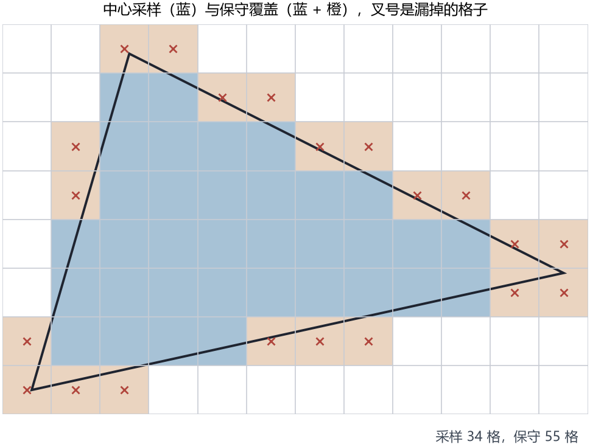
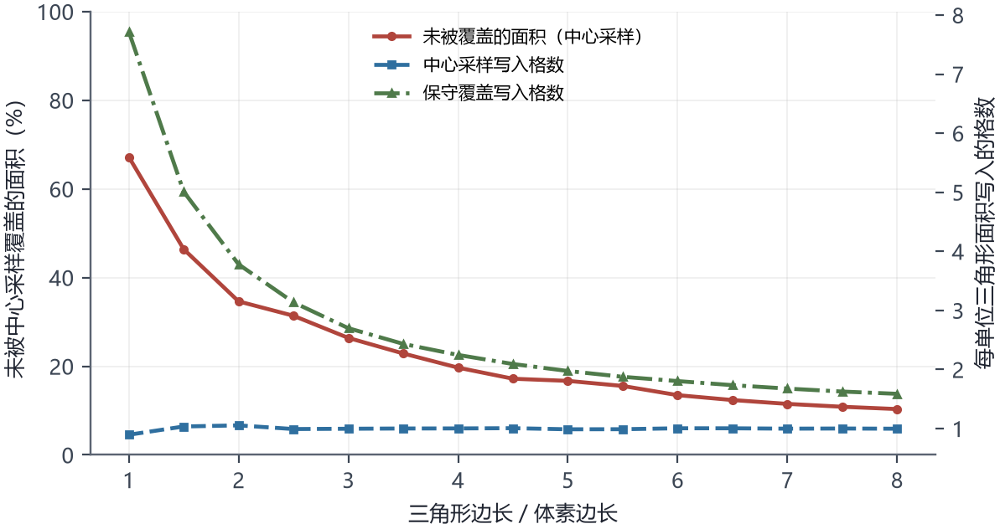
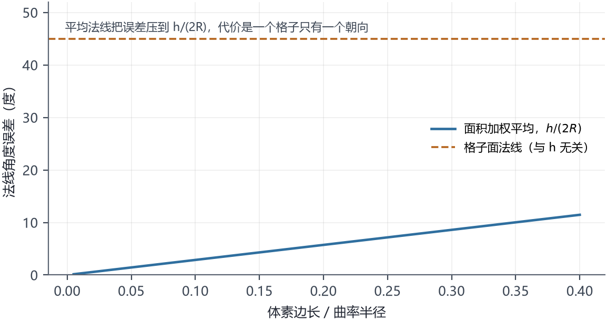

# 第 3 章 体素化

## 3.1 一根消失的栏杆

美术馆的模型里有一排细栏杆，直径三厘米，间距二十厘米。体素边长设成十厘米做全局光照，渲染出来栏杆不见了。不是变细，是整根消失，地板上也没有它的影子。

换成一厘米，栏杆回来了，但断断续续，中间缺几节。再细一档，连续了，可栏杆的投影变成了虚线，因为影子是逐格判断遮挡的，格子之间的缝隙让光漏了过去。

这三个现象对应体素化的三种错误。格子比物体大，物体整个被漏掉。格子与物体尺寸相当，物体断成几段。格子够细了，相邻格子的判定不一致，产生缝隙。它们都不是精度不够这么简单，而是覆盖判定这个操作本身有几种不同的定义。

## 3.2 中心采样

最直觉的体素化是遍历三角形包围盒里的每个格子，取格子中心，判断它在不在三角形内：

$$\text{inside}(c)=\bigwedge_{i=0}^{2}\ \operatorname{sign}\left((v_{i+1}-v_i)\times(c-v_i)\right)=\text{const} . \tag{3.1}$$

三个叉积同号就在里面。这个判定的代价是一次包围盒遍历加三次叉积，实现简单，在 CPU 上跑得很快。

它的问题在于把一个面积判定换成了一个点判定。一个三角形覆盖了一百个格子的各一小部分，但可能一个格心都不包含。极端情况是三角形的宽度小于格子，且恰好从格子中间穿过，格心落在三角形外面，整个三角形就消失了。

漏掉的概率可以估。三角形面积 $A$，格子面积 $h^2$，格心在空间里近似均匀分布，格心落在三角形里的期望个数是 $A/h^2$。当这个数远小于 1 时，多数三角形一个格心都碰不到：

$$P(\text{漏掉})\approx \exp\!\left(-\frac{A}{h^2}\right) . \tag{3.2}$$

一根三厘米粗、二十厘米长的栏杆片，正对相机的那一面被切成几十个细长三角形，每个面积约 $3\times10^{-4}$ 平方米。$h=0.1$ 米时 $A/h^2=0.03$，漏掉概率 97%。$h=0.01$ 米时 $A/h^2=3$，漏掉概率 5%，但只是"每个三角形有 95% 的概率被至少一个格子记住"，记住的也只是三角形的一部分，看起来就是断断续续。

图 3-1 是一个二维的例子。三角形覆盖 55 个格子，按格心判定只认了 34 个，边上那一圈格子被叉号标出来，它们与三角形相交但没有被写入。对渲染的影响不只是轮廓变毛，这一圈格子同时也是遮挡体，漏掉它们，光就从边缘渗进来。

## 3.3 保守覆盖

保守的含义是，只要格子与三角形有任何重叠，就标记为占据。宁可多标，不可漏标。

判定两个凸体是否相交，用分离轴定理。两个凸体不相交，当且仅当存在一个方向，它们在这个方向上的投影不重叠。三角形与轴对齐方盒之间，需要检查十三根轴：三个坐标轴，三角形所在平面的法线，以及三条边与三个坐标轴的九个叉积。Akenine-Möller 2001 年的文章给了这个测试的完整写法，它的好处是可以提前退出，实际平均只需要检查两三次。

二维情况下是六根轴，图 3-1 的橙色格子就是这个测试的结果。

保守覆盖解决了漏，代价是多写。写入的格子数有一个几何估计，来自把三角形"加粗"半个格子之后数落在里面的格点：

$$N_{\text{write}}\approx \frac{A}{h^2}+\frac{P}{2h}+\frac{\pi}{4} , \tag{3.3}$$

$A$ 是面积，$P$ 是周长，$h$ 是体素边长。第一项是面积项，第二项是边界项，第三项是角落的常数。$A/h^2$ 远大于 1 时，多写的开销可以忽略；$A/h^2$ 接近 1 时，边界项占主导，写入量是面积项的好几倍。

图 3-2 是这个估计的数值验证。横轴是三角形边长与体素边长之比，左轴是中心采样没有覆盖到的面积比例，右轴是两种方法每单位面积写入的格子数。边长等于一格时，保守覆盖写了 8 倍于面积的格子，中心采样只写 1 倍但漏掉了三分之二的面积。边长到八格时，保守覆盖降到 1.5 倍，中心采样仍然漏掉 8% 的边界面积。

换算成工作量。一个中等复杂度的场景，五百万个三角形，平均每个三角形覆盖几个格子，保守光栅化要写几千万次。这是纯几何量，跟渲染分辨率无关，体素化一次就能重复用。动态物体每帧都要重做，这就变成了第 8 章的预算问题。

## 3.4 缝隙从哪里来

即使每个三角形都不漏，相邻三角形之间仍然可能出问题。

两个三角形共享一条边，各自按保守覆盖标记了自己覆盖的格子。共享边两侧的格子被两个三角形都碰到了，都会被标记，所以这里不会漏。保守覆盖天然没有缝隙，这是它相对采样的第二个好处。

中心采样就不行。一条边两侧的格心可能分别落在两个三角形外面，中间空出一条缝。缝的宽度最大可到一个格子，因为决定权在格心位置，而格心之间的距离就是一格。光线穿过这条缝，遮挡失效，阴影里出现一条亮线。

缝隙还有另一种形式，来自实体化的方向。如果只对三角形的正面做覆盖，背面没有处理，两层表面之间的体素是空的。从侧面看，物体是空壳，光可以穿进去。要解决就得做封闭的处理，让每个被表面围住的格子都被标记。

有一种折中叫 $k$-separating。6-separating 只要求格子与三角形的共享面相交就标记，26-separating 要求共享顶点也算。前者写入少但可能留下对角缝隙，后者保证任何一条连续路径都被阻断。选择哪一种取决于用途，做遮挡体时 26-separating 更安全。

## 3.5 实体化

表面体素化只标记表面经过的格子，实体化要把内部也填满。

最直接的做法是从每个空格子发一条射线，数它穿过的三角形个数，奇数就在内部。这是奇偶规则，前提是网格封闭且不自交。开放网格，比如一张纸、一片树叶，用这个方法会把"碰到一次"判成内部，整片纸变成一个实心板。

也可以用面片增厚。把每个三角形沿法线两侧各扩半个格子，形成一个薄的六面体，然后对它做保守光栅化。相邻三角形的增厚区域在共享边处重叠，只要重叠厚度不小于一格，内部就被封住了。这个方法的优点是只依赖三角形本身，不要求全局封闭；缺点是在尖锐的凹角处可能封不严。

工业实现常用第三种，沿三个正交方向各做一次二维扫描。每个方向把三角形投影到平面上，用扫描线求出每个格子的覆盖区间，再沿第三轴推出内部。三次扫描的交集就是实体。这个方法在 GPU 上可以做得很快，Kämpe 等人 2013 年的工作就是用硬件光栅化器完成这一步，把三角形渲染到体素网格的切片上，利用光栅化器自带的覆盖判定。

三条路各有各的失败模式。奇偶规则在开放网格上错，增厚在凹角处错，三向扫描在非水密网格上会把内部判成外部。选之前先确认模型是什么类型，建筑模型通常是水密的，扫描或手工建模的资产经常不是。

## 3.6 格子里存哪个法线

一个格子里可能落进好几个三角形，它们的法线不同，材质也可能不同。

法线的处理是面积加权平均：

$$\bar n=\frac{\sum_i A_i\,n_i}{\left\|\sum_i A_i\,n_i\right\|} . \tag{3.4}$$

$A_i$ 是第 $i$ 个三角形落在该格子内的面积。用整块三角形的面积去加权是常见的偷懒，会在细长三角形上产生偏差。

平均法线的误差有一个简单的估计。曲率半径为 $R$ 的表面上，跨度 $h$ 的一段法线转角是 $h/R$。用一个平均法线代表整段，段两端的误差是半个转角：

$$\delta\approx \frac{h}{2R} . \tag{3.5}$$

图 3-3 把这条线和格子面法线的 45 度误差放在一起。$h/R=0.1$ 时平均法线误差 2.9 度，比 45 度好一个数量级。这是一个实实在在的收益，但它仍然是 $O(h)$，分辨率不够时照样会糊。第 7 章会讲更好的做法，从占据率梯度求法线，误差也是 $O(h)$ 但常数更小，而且不需要保留三角形。

材质的处理麻烦得多。两个格子里的反照率可以插值，粗糙度可以插值，但材质索引不能平均。一个格子同时含有木头和金属，你没法取平均得到一个"半金属"。常见做法是取占据面积最大的那个材质，接受边缘处的分类错误；另一种是允许一个格子存两个材质和它们的混合比例，代价是存储翻倍。

还有一类信息必须保留，就是这个格子是表面还是内部。内部格子不参与着色，但参与遮挡和光传播。两者的区分不能用占据率，因为两者占据率都是 1。通常用一个额外位标记，或者约定表面格子的法线非零、内部格子法线为零。

## 3.7 体素化的代价

把一次体素化的工作量拆开，有三部分。

覆盖判定，每个三角形一次，代价与它覆盖的格子数成正比。写入，每次写入一个格子四字节，走一遍显存。如果有多个三角形写同一个格子，还要处理冲突，平均法线和材质混合都需要读改写，这会引入竞态。

冲突的处理方式影响很大。纯覆盖写入可以用原子或直接覆盖，谁写都一样；面积加权平均必须做原子加法，代价高一个数量级。很多系统因此放弃精确平均，改成"最后写入者胜出"，用分辨率来掩盖误差。

还有一层容易被忽略，体素化结果的更新粒度。静态场景体素化一次，成本摊到整个项目里可以忽略。动态场景每帧都要做，一个表面积两平方米的角色，五毫米体素，表面格子八万个，每帧写 0.3 MB；若为了省事连内部一起填，是两百多万个格子，9 MB。单看这个数不大，但一个场景里动的东西不止一个，再乘上阴影和光照缓存的同步更新，就是几十兆字节的量级。第 8 章讲怎么把这个数压下来。

---

这一章讲了三件事。覆盖判定必须是保守的，中心采样会漏掉小三角形和边界的格子，漏掉的格子既让几何消失，也让光从缝隙里漏进来。实体化需要封闭性假设，不同的实体化方法在不同的模型上失败。格子里存的是平均量，法线的平均误差是 $h/(2R)$，材质的平均需要一个不能平均时的规则。

格子填好了，下一个问题是光怎么在这些格子上传播。这从一次查询一大片区域开始，也就是锥追踪。
