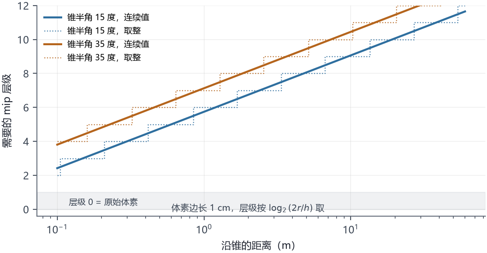
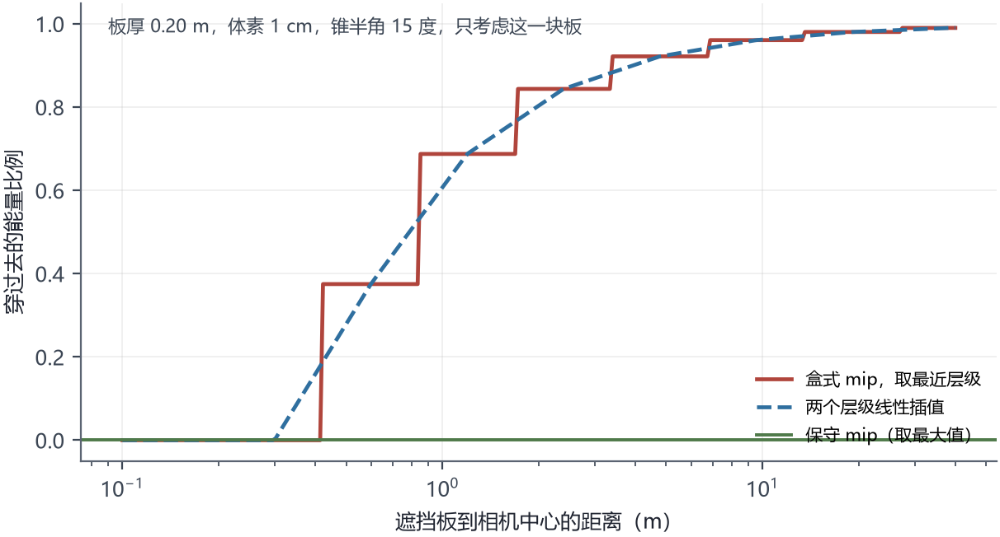
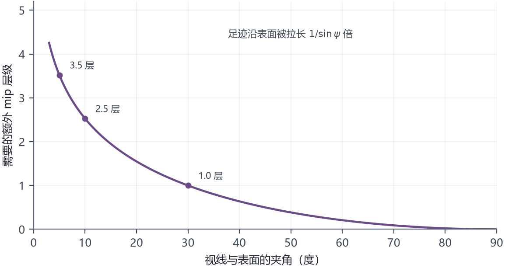

# 第 4 章 体素锥追踪

## 4.1 走廊尽头的亮斑

一条封闭的走廊，尽头是一堵墙，墙上没有窗。走廊中间有一盏灯，光应该只落在走廊的地面和两侧墙上，尽头的墙应该是暗的，最多有一点反弹过来的光。

用体素做全局光照，尽头的墙上出现了一块亮斑，位置正好对着走廊的开口。近处看没有，走远了才出现，越远越大。

走廊宽两米，灯在中间偏上的位置，离尽头的墙八米。八米处一个 15 度的锥半径是一点一米，比走廊的半宽还大，锥已经同时罩住了两侧的墙。这不是巧合，是这类场景普遍出现问题的距离。

这块亮斑不是采样噪声，重跑多少次都在同一个位置，形状也稳定。它不是漏了阴影，因为直接光的阴影是对的。它是间接光那一遍里，锥穿过了两侧的墙，从墙外"看到"了别的亮处，把那份亮度当成了墙后面的东西。

锥追踪的三个核心问题，都能从这块亮斑里提出来。锥有多粗，粗到什么程度；粗过物体之后会发生什么；粗的代价能不能通过别的办法补回来。

## 4.2 锥的半径与它需要的层级

锥追踪的做法是，从一个点出发，沿着一个方向张成一个锥，锥内的体素都参与贡献。锥在距离 $t$ 处的半径是

$$r(t)=r_0+t\tan\theta , \tag{4.1}$$

$r_0$ 是起点处的初始半径，通常取像素在起点平面上的足迹，$\theta$ 是半角。

如果锥只用一个分辨率的体素去采样，要么采样太密（浪费），要么太疏（走样）。正确做法是让体素的尺寸跟着锥的半径走。在距离 $t$ 处，锥的直径是 $2r(t)$，用它去除以体素边长，得到需要的 mip 层级：

$$L(t)=\log_2\frac{2r(t)}{h} . \tag{4.2}$$

$r=0.1$ 米、$h=0.01$ 米时 $L=4.3$，也就是第 4 层，格子边长 16 厘米。这个式子说明层级随距离对数增长，走远十倍只多三层多一点。

图 4-1 画了两条曲线。15 度半角的锥在 1 米处需要 5.7 层，10 米处 9.1 层；35 度的锥在同样距离上多一层多。曲线的斜率是 $\log_2$，看起来很平，但纵轴每一格是分辨率翻倍，实际的信息量差别很大。

## 4.3 层级是离散的

(4.2) 给出的是实数，实际只能取整数层。取整有两种方式，向下取整或四舍五入，两者都会丢失信息。

取整的误差最多半层，半层意味着体素尺寸差 $\sqrt{2}\approx1.41$ 倍。也就是说，锥取样用的格子可能比它需要的粗 1.41 倍，或者细 1.41 倍。粗了会漏细节，细了会走样（因为锥里塞不下那么多格子，采样点之间的空隙被跳过）。

这个 $1.41$ 不是可以忽略的小误差。它和后面要讲的漏光是同一件事的两面，只是这里发生在每个像素、每条锥的每一段上，而不是集中在某个特定距离。

修法是在两个相邻层级上各采一次，按小数部分线性混合：

$$v=(1-f)\,v_{\lfloor L\rfloor}+f\,v_{\lfloor L\rfloor+1},\qquad f=L-\lfloor L\rfloor . \tag{4.3}$$

代价是两次采样，收益是层级过渡变连续。这个技巧叫三线性过滤，和纹理里的做法完全一样，只不过这里第三维是层级而不是坐标。

## 4.4 遮挡怎么累积

一条锥穿过若干体素，每遇到一个就有两种可能，被挡住一部分，或者直接穿过去。

把这当成一串不相关的事件，穿过的能量是

$$T=\prod_{i}\left(1-\alpha_i\right),\qquad \alpha_i=\text{该体素的占据率} . \tag{4.4}$$

每穿过一个体素，就把它携带的辐亮度乘以当前的 $T$ 加进结果：

$$L_{\text{out}}\approx\sum_i T_i\,\alpha_i\,L_i,\qquad T_i=\prod_{j<i}(1-\alpha_j) . \tag{4.5}$$

这个式子和体积渲染的积分是同一个东西，区别只在体素里的 $\alpha$ 是几何占据率，不是消光系数。它有一个重要的性质，$\alpha$ 只能来自占据率，不能来自"这一层 mip 的平均值"，因为平均值会把"有"和"没有"混成"有一点"，而"有一点不透明"在物理上不存在。

步长的选择也有讲究。每一步走的距离应该等于当前层级的格子尺寸，走短了同一格被采多次，浪费带宽；走长了可能跨过一整格而没读过它。因为层级随距离增长，步长也是越来越大的，前几步很密，后面几步很疏。这个设计让一条锥的总步数大约是层数乘以一个常数，常见的实现是三十到六十步，与场景大小无关。

还有一个可以省掉大量工作的细节，终止条件。当 $T$ 小于千分之一时，后面的贡献可以全部丢掉，因为剩下的能量微不足道。在封闭的场景里，一条锥走出十几步就会碰到东西，提前退出的比例很高，这是锥追踪在实测中比理论步数便宜的原因。

这句话是后面所有漏光问题的根源。mip 的每一层都是下一层的算术平均，一堵墙在某一层里占据率从 1 变成 0.3，锥读到 0.3，就认为 70% 的光能穿过去。它没有说谎，那一层的数据确实是 0.3；错的是用平均值去做可见性判断这件事本身。

## 4.5 漏光的三种来源

漏光有三种，成因不同，修法也不同。

**第一种，过滤核大于物体。** 板厚 20 厘米，体素 1 厘米，距离 4 米时 15 度的锥半径是 1.07 米，需要的层级是 7.7，格子边长 1.6 米。这个格子里，20 厘米的板只占 12%，占据率 0.125，透射率 0.875。锥追踪认为这块板几乎不存在。

图 4-2 是这个计算的完整曲线。横轴是板到相机的距离，纵轴是穿过去的能量比例。0.45 米处第一次出现穿透（因为层级从 4 跳到 5，格子从 16 厘米变成 32 厘米，比板厚了），1 米处穿过 69%，4 米处 92%，再远就接近 100%。

**第二种，锥是一个扇形，可见性不是。** 锥里的东西被当成均匀分布，可是真实情况是锥心有个亮点，锥边是暗的。锥追踪把两者平均，得到一个中间值，于是亮的地方变暗，暗的地方变亮。这不是分辨率问题，即使分辨率无限高，用有限宽的锥去估计必然有这个平均。锥越宽，误差越大。

**第三种，步长跳过了物体。** 如果每一步的步长等于当前层级的格子尺寸，而物体比格子薄，那么物体可能整个落在两步之间。这种情况和第一种本质相同，但它发生在"明明层级选对了"的场合，因为层级的选取是基于锥半径，不是基于物体的厚度。

有没有办法补救。把 mip 从算术平均换成取最大值，问题就反过来，所有薄的东西都变成完全遮挡，墙后面的空间全黑，光照的柔和过渡消失。图 4-2 的绿线就是这个结果，一条贴着零的直线。真正的修法不在 mip 上，而在结构上，比如给每个节点存"最大占据率"和"平均占据率"两个值，按用途选择；或者用不透明的表面体素单独一遍遮挡。

## 4.6 掠射角的各向异性

锥是圆的，可是它在表面上留下的足迹不是圆的。

视线与表面夹角为 $\psi$ 时，锥在表面平面上的足迹是一个椭圆，沿视线方向被拉长 $1/\sin\psi$ 倍。掠射时 $\psi$ 很小，拉长倍数很大：

$$\text{额外层级}=\log_2\frac{1}{\sin\psi} . \tag{4.6}$$

$\psi=5$ 度时是 3.5 层，也就是需要的分辨率粗了 11 倍。$\psi=30$ 度时是 1 层。图 4-3 画了这条曲线。

后果是地面上的一条亮带。地板是掠射的，锥在地板上的足迹很长，需要很粗的层级，可是锥本身需要的层级是按圆形算的，于是采样在地板方向上过密、在垂直方向上合适。表现是地面反射的细节被抹掉，同时远处的噪点没有减少。

补的办法有几种。用拉长的体素，也就是各向异性的 mip，代价是存储和索引复杂。用多条锥代替一条，沿拉长方向排开，代价是采样数上升。或者接受它，因为掠射表面的可见性本来就被压缩，人眼对那里的细节不敏感。实际项目多采用第三种，只在明显出问题的地方加锥。

## 4.7 用几条锥

漫反射和镜面反射需要的锥数完全不同。

漫反射是半球积分，需要覆盖整个半球。常见做法是 6 到 8 条锥，方向均匀分布，半角取 30 到 45 度，相邻锥之间略有重叠，保证没有缝隙。锥数少了，半球覆盖不全，会出现方向性的条纹；锥数多了，代价线性上升。

镜面反射只沿反射方向一条锥，半角由粗糙度决定，$\theta\approx\alpha$。粗糙度小的时候锥很细，需要的层级低，采样反而便宜；粗糙度大的时候锥很粗，等同于漫反射，但又只采了一条，误差很大。所以高粗糙度的镜面通常退化成漫反射那一组锥。

这套配置里有一个隐含的假设，锥的方向和宽度对应着一个滤波核，而这个核要和 BRDF 的瓣匹配。匹配得好，偏差小；匹配得差，能量分布就歪。第 9 章会把这件事说成一个卷积，那里能看到匹配的严格条件。

## 4.8 它到底在算什么

把 (4.5) 和真实的渲染方程放在一起，能看清锥追踪在数学上做了什么。

真实的间接光是入射辐亮度在半球上的积分，权重是 BRDF 和余弦。锥追踪用有限条锥去近似这个积分，每条锥内部又用一个滤波核去近似。两层近似叠起来，等价于把入射辐亮度先和一个核做卷积，再在半球上做数值积分：

$$\tilde L_o=\sum_k w_k\int K_k(\omega)\,\tilde L_i(\omega)\,d\omega , \tag{4.7}$$

$K_k$ 是第 $k$ 条锥的核，$\tilde L_i$ 是被 mip 过滤过的入射辐亮度。

这个式子的意义在于，它说明了锥追踪的误差是系统性的，不是随机的。增加采样数不会让它收敛到正确值，只会让这个被卷积过的结果更平滑。要减小误差，只能减小核的宽度，也就是用更细的锥、更高的层级，代价是更多的采样。

理解了这一点，就能解释为什么锥追踪的结果看起来"很干净但有点假"。它没有噪点，因为每个像素都做了平均；它的阴影边缘柔和得不像话，因为核把边缘抹开了；它的漏光是确定的，因为核的支撑集跨过了墙。

---

这一章的主线是一条：锥的宽度决定了过滤核的宽度，过滤核的宽度决定了漏光和模糊，而这两者不可能同时消除。

锥的半径随距离增长，需要的 mip 层级随之增长，层级是离散的，取整带来 1.41 倍的误差，双层级插值能把它抹平。遮挡按乘积累积，用的是占据率，而占据率的平均值在物理上没有意义。这正是漏光的根源，板越薄、距离越远、锥越宽，漏得越多。掠射面上足迹被拉长，需要额外三到四层。

下一章把锥换成另一种用法，不是问"那边有多亮"，而是问"这些格子之间怎么传光"。
