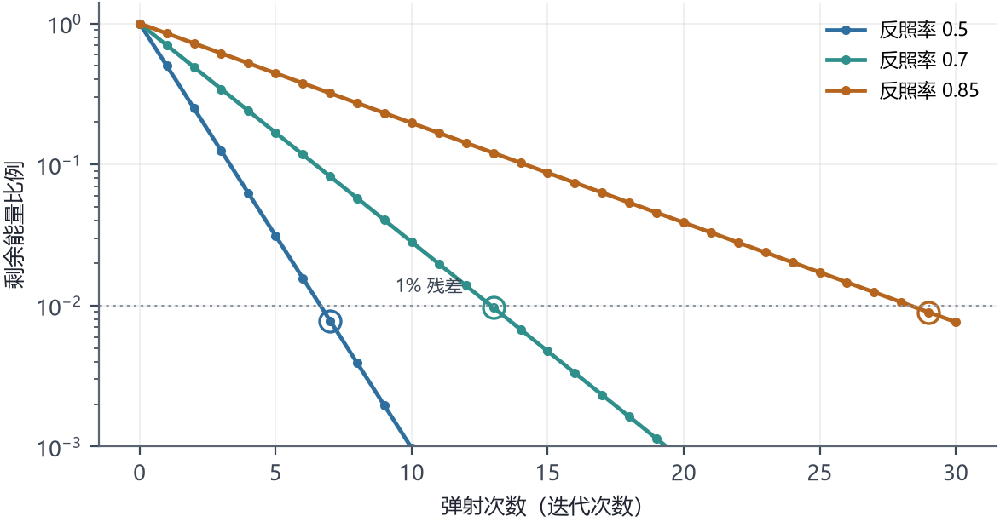
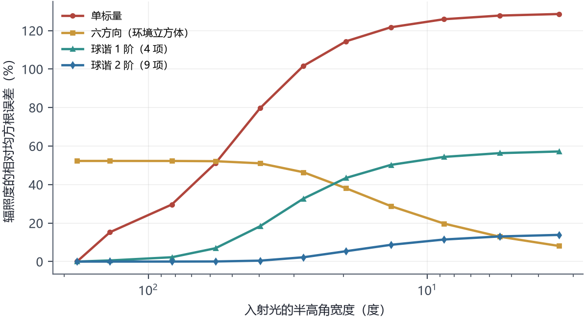

# 第 5 章 体素上的光传播

## 5.1 一个只会变灰的房间

白墙的房间，一扇窗，下午的光从窗口斜进来。路径追踪渲染出来的结果是，窗口附近的地板亮得发白，靠里的墙被地板反射的光染成暖色，天花板的角落有一层柔和的亮，颜色偏蓝，因为那是天空从窗口绕进来又弹上去的光。

换成体素做间接光，颜色是对的，亮度也是对的，但整个房间看起来平。墙和墙的交界没有明暗差，法线贴图贴上去完全看不出来，靠近窗户的墙和远离窗户的墙亮度差不多。

这个"平"不是分辨率造成的。把体素边长缩小一半，还是平。它是另一个维度上的损失，光在这个表示里没有方向。

## 5.2 注入直接光

传播之前要先把光源放进格子里。

每个光源对每个表面体素贡献的辐照度是

$$E(x)=\sum_{l}L_l\,\frac{A_l\cos\theta_l}{d_l^2}\,V(x,\omega_l) , \tag{5.1}$$

$A_l$ 是光源面积，$d_l$ 是距离，$V$ 是可见性。点光源要换成有限的面积，否则 $1/d^2$ 在近处会爆掉，而且无法产生软阴影。

这一步的代价容易被低估。一个房间几十万个表面体素，几十个光源，就是几千万次可见性查询。优化办法是把光源按空间分桶，每个体素只考虑影响范围内最亮的那几个，其余忽略。这个近似的合理性来自 $1/d^2$，远处光源的贡献本来就小，但要注意在封闭场景里多次反射之后，远处光源的贡献会被放大，截断阈值要留余量。

注入还有一个选择，注入到哪个层级。如果把光注入到最细的体素，后续的 mip 生成会把它们平均上去，锥追踪读到的是正确的平均值。如果为了省事注入到较粗的层，细节会丢失，而且平均之后不再可逆，因为 mip 的生成方向是自下而上。注入总是从最细层开始，除非那一层没有数据。

## 5.3 遮挡体素

可见性 $V$ 有两种算法，一种是沿光源方向打一条细锥，用第 4 章的锥追踪；另一种是沿光源方向走一条 DDA，逐格判断。

细锥的好处是软阴影免费。锥的初始半径决定阴影边缘的模糊程度，半径大一点，边缘就更软，物理上对应一个面积光源。这个软化的形状是错的（真实的软阴影由光源的形状决定，不是由锥的半径决定），但观感上通常可以接受。

DDA 的好处是硬阴影准确，代价是每个体素都要走一遍，锯齿明显。混合做法是先用粗层快速判断"肯定被挡"和"肯定没挡"，只对边界上的体素做细层判断，这个思路和 BVH 的遍历剪枝完全一样。

阴影的质量还受一个因素制约，体素化的保守性。第 3 章说过，保守覆盖会把边界格子也标成占据。对遮挡来说这是好事，不会漏光；对阴影形状来说这是坏事，阴影会比真实的大一圈，边缘多出半个体素的膨胀。这个膨胀在细分辨率下看不出来，在粗分辨率下会让细长的阴影变粗，比如栏杆的影子会变成一条连续的带。

## 5.4 弹射：把传播写成一个迭代

光打到墙上弹回来，落到别的墙上，再弹回来。这个过程在体素里可以写成一个线性算子。

把每个格子的辐亮度记成 $L_v$，一次弹射之后

$$L_v^{k+1}=L_v^{e}+\rho_v\sum_{u\in N(v)}w_{uv}\,L_u^{k} , \tag{5.2}$$

$N(v)$ 是邻居，$w_{uv}$ 是几何权重，$\rho_v$ 是反照率。权重可以用六个面邻居的立体角近似，也可以用锥追踪算得更准。用六个面邻居是最便宜的做法，误差主要来自它假设光只沿轴方向传播。

这个迭代的收敛速度由反照率决定。把 (5.2) 写成矩阵形式，$L^{k+1}=L^e+AL^k$，误差按 $A$ 的谱半径衰减，而谱半径不会超过最大反照率 $\rho_{\max}$：

$$\left\|L^{k}-L^{\infty}\right\|\le \rho_{\max}^{\,k}\left\|L^{0}-L^{\infty}\right\| . \tag{5.3}$$

图 5-1 画了这条界。反照率 0.5 的房间七次迭代到 1% 残差，0.7 要十三次，0.85 要二十九次。白墙的反照率常在 0.8 以上，也就是说一个明亮的房间需要二十多次弹射才能收敛，这个数字比大多数人预想的多。

为什么需要这么多次。因为每一次弹射只把光推到相邻的一格，光要从窗户走到房间深处，需要走很多格。迭代次数不够时，远离光源的地方是暗的，看起来像"光没有传过去"。这不是收敛慢，是传播距离不够，两者需要区分，修法也不同。前者要更多次迭代，后者要更远的传播步长。

有些实现把这两件事混在一起，用一次迭代传播很远的距离（比如用锥一次跨过整个房间），代价是每次迭代更贵，收益是总迭代次数少。哪种更快取决于场景的形状，狭长的走廊适合远距离传播，开阔的房间适合多次近邻迭代。

## 5.5 为什么一个数不够

现在回到 5.1 节那个"平"的问题。

一个格子只存一个辐亮度，意味着这个格子向所有方向发出的光是一样的。这个假设只有在入射光本身各向同性时才成立，也就是光从所有方向均匀照来。窗户进来的光是高度方向性的，从窗口一个方向来，存成一个标量之后，方向信息就没了。

后果可以量化。假设入射光是一个圆对称的瓣，宽度可变，从均匀的全天光到一个很窄的点光源。四种表示各自重建辐照度，误差画在图 5-2 里。

单标量在均匀光下误差为零，光一窄就崩，130% 的误差意味着重建值可能只有真值的一小部分，也可能反过来。它的错误不是随机的，是系统性的欠估计，因为在方向性光下，大部分表面接收到的能量远小于平均值。

六方向表示（环境立方体）在每个轴上存一个辐照度，重建时

$$E(n)\approx\sum_{j=1}^{6}\max(0,\,n\cdot a_j)\,E_j , \tag{5.4}$$

$a_j$ 是六个轴方向。它在窄光下误差只有 7%，因为窄光基本只点亮一个轴。它在均匀光下反而有 52% 的误差，原因是权重的和在对角方向上超过 1，$n=(1,1,1)/\sqrt{3}$ 时三个轴各贡献 $1/\sqrt{3}$，加起来是 $1.73$，重建值比真值高七成。

球谐展开是更系统的做法。辐照度是入射辐亮度和 clamped cosine 的卷积，卷积在球谐域里是对角的：

$$E(n)=\sum_{l,m}\hat A_l\,c_{lm}\,Y_{lm}(n),\qquad \hat A_0=\pi,\ \hat A_1=\frac{2\pi}{3},\ \hat A_2=\frac{\pi}{4} . \tag{5.5}$$

一阶四项能表示一个方向，误差在窄光下 57%，因为它表达不了 cosine 瓣的形状。二阶九项在窄光下误差 14%，在均匀光下接近零。再往上收益递减，四阶已经很接近精确，但存储和注入的开销翻倍。

存储的账很清楚。单标量一倍，六方向六倍，球谐一阶四项，二阶九项。这是每个格子都要付的，不管它有没有光。实际的折中是只对表面附近的格子存方向信息，内部格子只存标量，因为内部格子不参与着色，只参与传播，而传播本来就是各向同性的。

## 5.6 与辐照度体积的关系

辐照度体积是 Greger 等人 1998 年提出的结构。它把场景装进一个规则网格，每个格点存一个辐照度，渲染时对表面的每个点做三线性插值。

这个想法和体素光照几乎是同一个东西，区别在两处。

第一，辐照度体积是为表面准备的缓存，它假设几何由三角形表示，网格只是光的载体。体素表示里几何和光是同一份数据，格子既是遮挡体又是光源，这带来了统一性，也带来了耦合，改一个格子的占据率会同时改变几何和光。

第二，辐照度体积的格点通常比体素粗得多，因为它只需要捕捉光的低频变化。一个房间用 $32^3$ 的辐照度网格就够，而几何体素要 $512^3$。两者的比例是分辨率与用途的关系，不是任意选择。

第三处区别在更新。辐照度体积是纯缓存，场景变了要重算，重算的范围是整块；体素的 mip 链是几何的一部分，改一个格子可以只更新它到根节点的那条路径。这个差别在动态场景里决定了能不能实时，第 8 章会展开。

Greger 的原始工作里有一个细节值得注意，他在格点上存的是方向性的辐照度，用一组球谐系数，并明确指出单标量会在方向性光下失败。这个结论在二十多年后依然成立，只是当年的存储代价太高，多数实现退化成了标量。

## 5.7 方向丢失的具体后果

方向丢失不只是"看起来平"，它会导致几种可以指认的错误。

**法线贴图失效。** 法线贴图的作用是让平面看起来有凹凸，原理是法线扰动改变了 $\cos\theta$。如果格子里的光是一个标量，扰动了法线也算不出新的 $\cos\theta$，因为不知道光从哪来。表现是法线贴图贴上去只有一点点明暗变化，甚至完全没有。

**墙角的过亮。** 两个墙面相交的角，真实的辐照度比平面低，因为彼此遮挡了半个天空。标量表示里，两个墙面存的都是平均值，角上的采样又做了三线性插值，插值会把两侧的值拉平，角变亮。这不是插值的错，是数据里本来就没有"这个方向被挡住"的信息。

**颜色渗透的饱和度。** 一面红墙把光弹到白墙上，白墙会带一点红。用标量表示时，红墙的辐亮度被平均到所有方向，弹出去的光比真实的多（真实情况下，正对白墙的那个方向才是红的），于是渗透的颜色更饱和，范围更大。这是一个方向性的错误伪装成颜色错误。

**半兰伯特这类技巧的失效。** 很多实时渲染器用 $\max(0,(n\cdot l+1)/2)$ 来软化明暗交界。这个技巧隐含假设环境光占主导，标量表示下它反而会放大错误，因为它把方向信息又抹了一遍。

修这四种错误的路线都一样，给格子加上方向维度。代价是存储，六倍或九倍。什么时候值得付这个代价，判据是场景里有没有方向性明显的光源，以及材质有没有法线细节。两者都没有的场景，标量就够了。

---

这一章讲光的注入与传播。直接光注入是逐光源的可见性求和，遮挡用锥或 DDA，体素化的保守性会让阴影略微膨胀。多次弹射是一个线性迭代，收敛速度等于反照率，白墙房间需要二十多次。方向信息的丢失是最容易被忽略的一项，单标量在方向性光下误差可以超过一倍，六方向或球谐能把它压到 10% 左右，代价是六到九倍的存储。

下一章引入一种不同的表示，它不存占据率而存距离，法线因此变成连续的，求交也变成另一个样子。
