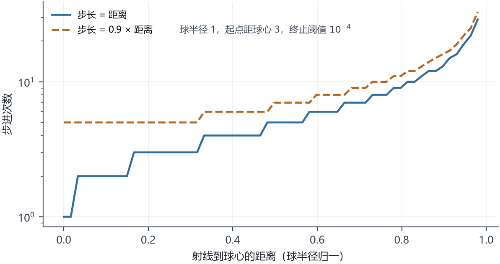
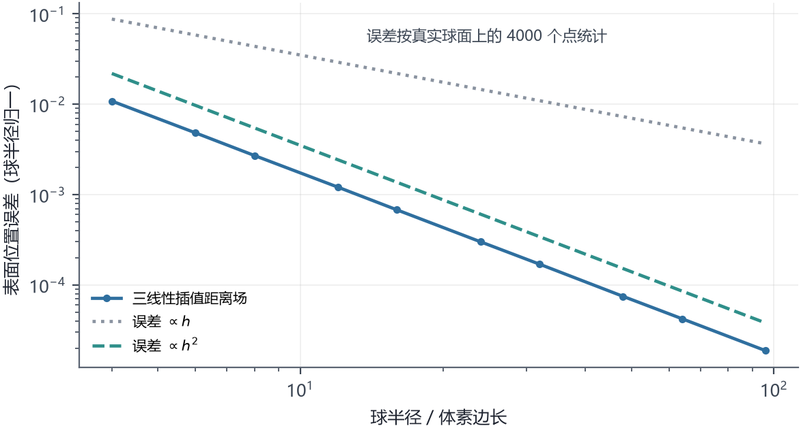
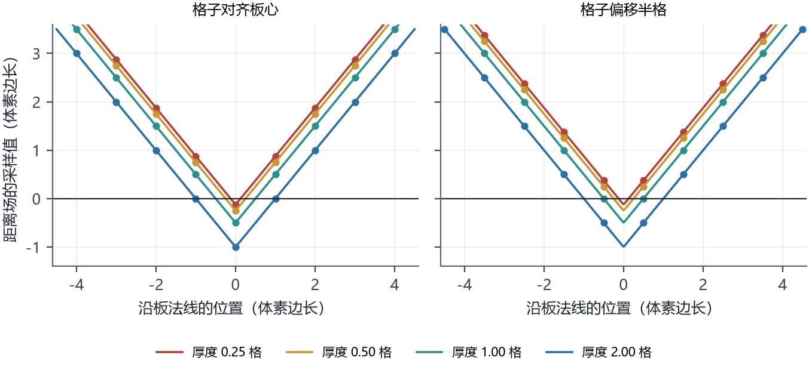

# 第 6 章 距离场与体素的混合

## 6.1 一堵不存在的隔断

办公室的模型，用距离场做全局光照的遮挡。渲染出来，开放办公区之间的玻璃隔断不见了。不是变透明，是完全没有，光从这一侧直接照到那一侧，隔断应该在的位置连阴影都没有。

隔断的厚度是十二毫米，距离场的体素是五厘米。这个比例是一比四，隔断比格子薄四倍。

换一台机器，把体素改成两厘米，隔断出现了，但只在某些位置出现，沿着隔断走了几步又断掉。断开的位置和网格对齐有关，模型挪动十厘米，断开的地方就换了一处。

这和前面几章的问题都不一样。体素化的漏面是"没标上"，锥追踪的漏光是"标上了但被平均掉"。距离场的失效是第三种，采样点根本没有采到负值，数据里就不存在这堵墙。

## 6.2 距离场是什么

有符号距离场是一个函数，定义在空间里的每个点上，值是这个点到最近表面的距离，内部为负，外部为正：

$$f(x)=\operatorname{sign}(x)\,\min_{s\in S}|x-s| . \tag{6.1}$$

这个函数有一个关键性质，Lipschitz 常数为 1。任意两点之间的函数值之差不超过它们的距离：

$$|f(a)-f(b)|\le |a-b| . \tag{6.2}$$

原因很直接，从 $a$ 到最近表面的距离，不会比从 $b$ 到最近表面的距离加上 $a$ 到 $b$ 的距离更大。这条性质保证了一件事，从任意点出发走一段不超过 $f(x)$ 的距离，一定不会穿过表面。所有的距离场算法都建立在这条性质上。

实际存的不是全空间的函数，而是格点上的采样值，中间靠插值。只在表面附近存的叫窄带，带宽以外标成"远"，因为没有表面就没有距离可言。带宽通常取三到六格，取决于后续要用它做什么，求交三格够，软阴影要更宽。

## 6.3 球体步进

球体步进是 Hart 1996 年给出的求交方法。从射线起点开始，每步走的距离等于当前点的距离场值：

$$t_{k+1}=t_k+f(p+t_k d) . \tag{6.3}$$

因为 $f$ 是到表面的距离，走这么远一定还没穿过表面，所以永远不会跳过交点。这就是它和普通步进的区别，普通步进的步长是固定的，要么慢，要么漏。

终止条件是 $f<\epsilon$ 或 $t>t_{\max}$。$\epsilon$ 的选取有讲究，太小会在掠射处打转，太大会让表面出现凹坑。常见取值是体素边长的千分之一到百分之一。

步数取决于射线与表面的夹角。正对着表面，一步就到了；掠射时，每步前进的距离很小，需要很多步。图 6-1 是球体的实测，射线到球心的距离从 0 到 0.98 倍半径，步数从 1 涨到 30 左右。

注意虚线比实线高，也就是松弛之后步数变多了。松弛的用途不是加速，是防止过冲。当距离场是插值出来的，插值可能高估距离（比如在格子中心附近），步长取满就会冲过表面。乘一个小于 1 的系数可以保证不冲过去，代价是多走几步。这个系数在文献里常取 0.8 到 0.95。

图 6-1 的纵轴是对数尺度，看起来 30 步不算多。但这是单个球的结果，复杂场景里距离场的高频成分多，每一步前进的距离变小，平均步数会上升。分层距离场就是为了解决这件事，粗层先跳过大片空白，细层再精确求交。

## 6.4 法线是梯度

距离场的法线直接取梯度：

$$n(x)=\frac{\nabla f(x)}{\left\|\nabla f(x)\right\|} . \tag{6.4}$$

在距离场精确的地方，梯度的模是 1，所以分母可以省掉。实际实现里用中心差分：

$$\nabla f\approx\frac{1}{2h}\begin{pmatrix}f(x+h\hat x)-f(x-h\hat x)\\ f(x+h\hat y)-f(x-h\hat y)\\ f(x+h\hat z)-f(x-h\hat z)\end{pmatrix} . \tag{6.5}$$

中心差分是二阶精度的，误差 $O(h^2)$。这个精度比第 3 章的面积加权平均好得多，后者是 $O(h)$。原因在于距离场本身是连续的标量场，插值和差分都在这个场上做，而占据率是二值的，二值场的梯度只有六个方向。

法线的质量直接决定高光。第 1 章算过，法线误差 45 度时 $\alpha=0.25$ 的高光峰值掉到 34%。距离场的法线误差在 $h/(2R)$ 量级，分辨率足够时只有几度，高光能保住形状。这就是为什么很多系统在体素之外单独维护一份距离场，专供着色和软阴影。

距离场法线也有失效的地方，中轴。两个表面对峙的位置，两边的距离相等，梯度不连续，法线在这里会突然跳变。中轴通常藏在物体内部，看不到，但当物体很薄时中轴会跑到表面附近，法线开始出错。这是薄结构问题的另一个表现。

## 6.5 插值误差是二阶的

距离场的好处不只是求交方便，还有精度。

格点上存的是精确距离，中间靠三线性插值。对光滑函数，三线性插值的误差是 $O(h^2)$：插值误差正比于二阶导数乘以 $h^2$。距离场的二阶导数在曲面上约为 $1/R$，所以

$$\delta x\approx C\,\frac{h^2}{R} . \tag{6.6}$$

图 6-2 是数值验证。横轴是球半径与体素边长之比，纵轴是真实球面上的点在三线性插值场里的函数值，也就是表面位置误差。曲线和 $h^2$ 的参考线平行，斜率的比值稳定。$R/h=32$ 时，误差是球半径的 $1.5\times10^{-4}$，也就是三米半径的球，误差半毫米。

对比一下占据率。占据率表面的位置误差是 $h/\sqrt{3}$，一阶。同样的体素边长，距离场的误差小一个数量级，而且下降得更快。这是距离场在存储上多花字节换来的。

这个结论有一个前提，距离场本身是精确的。如果距离场是从体素化结果算出来的（比如从占据率做距离变换），那么它的精度上限就是占据率的精度，二阶收敛就没了。这一点在混合表示里很重要。

## 6.6 薄结构为什么会消失

回到 6.1 节的隔断。

距离场是采样出来的，格点上存的是那一点的值。一堵厚度 $d$ 的板，如果 $d$ 小于格距 $h$，且格点恰好落在板的两侧，那么所有格点的值都是正的，插值出来的场里没有零等值面，板就不存在了。

图 6-3 是两个相位下的剖面。左边格点对齐板心，即使板只有 0.25 格厚，中心那个格点是负的，板仍然存在，只是被削薄了。右边格点偏移半格，0.25 格和 0.5 格厚的板，所有格点都是正的，板彻底消失。1 格厚的板刚好有一个零值，勉强存在。

这解释了 6.1 节里"挪动十厘米，断开的地方换了一处"的现象。板与格子的相对相位变了，哪些位置有负样本跟着变。

修法有几种，都不完美。

把板加厚到至少一格，这是最常用的做法，代价是几何变厚，薄的东西看起来都像厚纸板。用双向距离，同时存"到最近表面的距离"和"到最近表面的距离（反向）"，实际上是两个距离场，能表达更薄的结构，代价是存储翻倍。用混合表示，占据率负责薄结构，距离场负责法线和求交，这是下一节的内容。

还有一种是解析修补，把薄片单独拿出来，用三角形表示，不参与体素化。这是工程上最常见的妥协，代价是数据要多一份，两条路径要保持一致。

## 6.7 混合表示

实际系统很少只用一种表示。常见的是三样并存。

占据率栅格负责"这里有没有东西"，它是二值的，不怕薄，一格厚的东西只要有一个格点落在里面就是占据。距离场负责"表面在哪、法线朝哪"，它是连续的，法线质量好。辐照度或球谐负责"这里有多少光"。

三者的一致性是个工程问题。占据率说这里是空的，距离场说是负的，两者冲突时听谁的。常见规则是占据率优先用于可见性，距离场优先用于着色，冲突区域标记为不确定，用更细的层级复查。

混合表示的代价是更新。改一个物体，三份数据都要改，而且距离场要重新计算一块区域的距离变换。距离变换是局部操作，改动点周围一圈格子的距离要重算，范围是带宽的宽度。这个代价比单纯改占据率大，但在可以接受的范围内。

## 6.8 距离场上的锥追踪

距离场也可以做锥追踪，做法比体素简单。

沿射线走，每一步读距离 $d(t)$，估计这一点对射线的遮挡角度。如果一个点在离射线距离 $d$ 的地方，它遮挡的半角是 $\arcsin(d/t)$，用 $\arctan$ 或直接线性近似都行。锥追踪要做的是把所有采样点的遮挡累积起来：

$$V\approx\min_t\operatorname{clamp}\!\left(\frac{k\,d(t)}{t},\,0,\,1\right) . \tag{6.7}$$

$k$ 是软化参数，$k$ 越小阴影越硬。这个式子的含义是，射线附近有东西就遮挡，距离越远遮挡越弱，因为同样的距离在远处张开的角度更小。

这个估计是保守的，也就是说它倾向于多遮挡而不是少遮挡。原因是距离场给的是到最近表面的距离，不区分这个表面在射线的哪一侧，射线旁边有个物体，即使它不在射线和光源之间，也会被判成遮挡。这个特性导致距离场软阴影常常偏暗，尤其是凹角处。

优点也很明显。它不需要锥，只需要沿射线的一串采样，代价是 $O(\text{步数})$，与锥的宽度无关。窄带距离场只要在带宽内采样，走出带宽就当作没有遮挡，这正好对应"远处的东西遮挡角很小"。

## 6.9 性能上的差异

两种表示的性能差别不在常数上，在伸缩性上。

体素求交是树遍历，每条射线访问 $3.4L$ 个节点，节点访问有分支、有内存跳转，缓存不友好。距离场求交是步进，每步一次插值，没有分支，可以向量化，但在复杂场景里步数会上升。

粗略的结论是，几何简单、表面平滑的物体，距离场快；几何复杂、有大量薄片和高频细节的物体，体素快，因为体素的树结构能快速跳过空白，而距离场的步进在细节多的地方会被频繁截断。

内存是另一个维度。全局距离场的内存是 $N^3$ 或窄带的 $6A/h^2$，比体素少，因为它不需要存材质和光照。但全局距离场在分辨率上受限，$512^3$ 的距离场是 134 MB 到 537 MB 之间，取决于精度，而体素的稀疏结构可以做到更细的分辨率。

多数系统最后的选择是分工。距离场管软阴影、环境光遮蔽、精确求交；体素管全局光照、遮挡、多次弹射；三角形管主可见性和镜面反射。三份数据各自在最擅长的维度上工作，接口是位置和法线。

---

这一章把距离场和体素放在一起看。距离场的优势是精确求交和平滑法线，插值误差是二阶的，代价是薄结构会在采样中消失，而且中轴附近法线不连续。体素的优势是稀疏结构和二值可见性，不怕薄，代价是法线只有六个方向。

混合表示不是两者的折中，是两者的分工。下一章处理一个更基础的问题，从占据率怎么把表面和法线重建出来，以及重建出来的表面在什么情况下比原始几何更可信。
