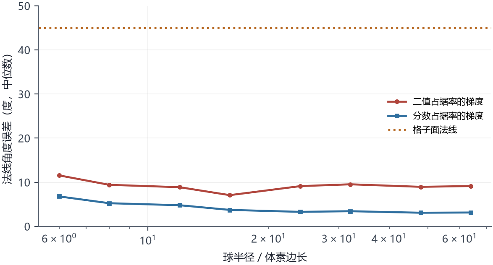
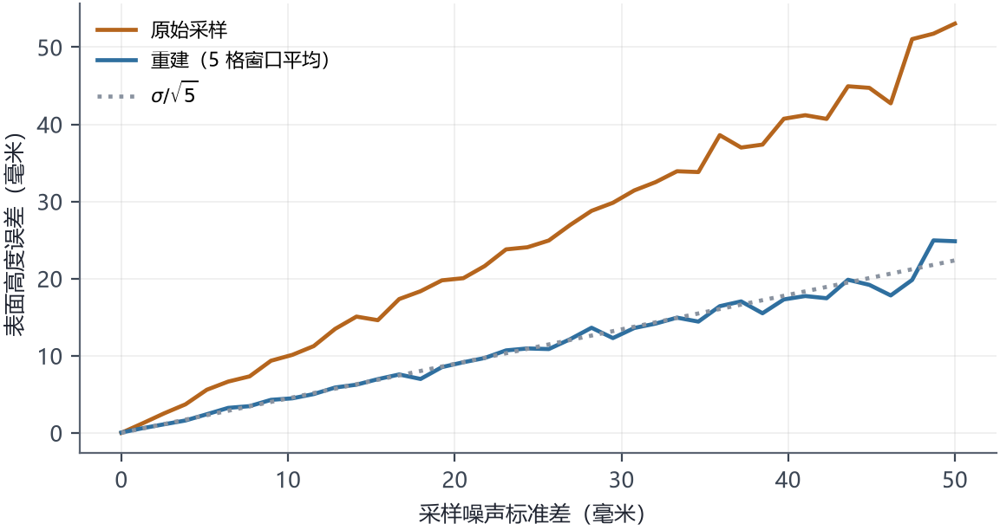
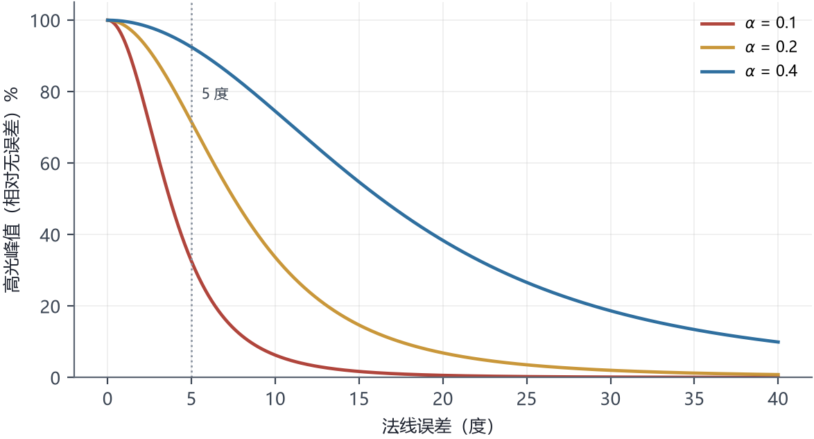

# 第 7 章 从占据率重建表面

## 7.1 一个有轮廓但没有表面的东西

体素化的雕像，从一个角度看过去，轮廓是对的，明暗也大致对，但表面没有质感。石头的凹凸不见了，衣褶的转折变成一片模糊的亮，靠近看能看出台阶，退远看像一层塑料膜。

换成扫描数据，情况反过来。扫描仪给的是点云或者体积数据，本身带噪声，表面是一层毛刺。直接渲染这些数据，满屏都是噪点。做一次表面重建之后，毛刺消失，形体还在，看起来比原始数据干净得多。

同一个操作，在两种场景里一个损失信息，一个修复信息。这一章要讲清楚这个操作做了什么，以及在什么条件下它是净收益。

## 7.2 从占据率求梯度

体素里没有表面，只有占据和空。要画出一张有法线的图，得先从占据率里造出一个连续的场。

最直接的做法是把占据率看成标量场，用三线性插值变成连续的，然后取梯度当作法线：

$$n(x)=\frac{\nabla o(x)}{\left\|\nabla o(x)\right\|},\qquad o\in\{0,1\} . \tag{7.1}$$

方向要取反，因为占据率从内部向外部是下降的，梯度指向内部。

这个做法的问题是，二值场的梯度只有有限个方向。一个格子的八个角各取 0 或 1，三个方向的差分各是 $-1$、0 或 $1$，于是梯度方向只能落在二十六个立方体方向上。分辨率再高，这个限制不变，因为限制来自二值性，不来自格子大小。

图 7-1 是这个限制的实测。二值占据率的梯度，法线误差中位数在 9 到 11 度之间，几乎不随分辨率下降。同一张图里还有另一条线，分数占据率的梯度，误差 3 到 6 度，随分辨率缓慢下降。

分数占据率是保守体素化的副产品。第 3 章讲过，保守覆盖会标记所有与三角形相交的格子，如果顺带记录相交的体积比例，就得到了一个 $[0,1]$ 的连续场。这个场等于对几何做了盒式滤波，梯度方向包含连续的角度信息。

代价是要在体素化时算体积。精确计算三角形与立方体的交体积很贵，实际多用近似，比如在格子内撒几个采样点估计比例，或者用三角形的重心到格子中心的距离做插值。近似带来的噪声会在法线上表现出来，需要后续平滑。

除了梯度，还有一条路是距离变换。占据率做欧氏距离变换得到距离场，再取梯度。这条路等价于第 6 章的距离场，精度更好，代价是要多算一遍距离变换，而且变换是全局操作，增量更新麻烦。

## 7.3 等值面

有了连续的场，表面就是等值面 $o(x)=0.5$。

提取等值面的经典算法是 marching cubes，Lorensen 与 Cline 1986 年提出。它逐个格子处理，看八个角的值大于还是小于 0.5，得到一个八位的模式，查表得到这个格子里三角形怎么连。八位模式有两百五十六种，去掉对称和旋转之后是十五种基本构型。

这个算法的优点是快，一次查表就出一个到五个三角形，而且三角形的位置由线性插值确定，比直接放在格子顶点准确。缺点是拓扑有歧义。两个对角为实体、其余为空的格子，三角形可以有三种连法，选错会在表面上留下一个洞或者一个多余的片。这个歧义在 1990 年代被反复讨论，修法有渐近判定器，也有改用对偶方法。

阈值取 0.5 有一个容易被忽略的后果，表面的位置会偏。保守体素化把边界格子整格标成占据，二值场的 0.5 等值面就落在这些格子的边界上，比真实几何向外偏了半个格子。一个十厘米的柱子，五厘米体素，重建出来是十五厘米。这个膨胀在小物体上非常明显，而且是系统性的，不是随机的。

用分数占据率能把这个偏差压下去。分数场的 0.5 等值面近似就是几何本身的位置，因为体积比例正好反映了几何切过格子的位置。这也是 7.2 节推荐分数占据率的第二个理由，第一个是法线角度更连续。

marching cubes 的三角形数量很大。一个 $N^3$ 的网格，表面格子数正比于 $N^2$，每个格子平均出两个三角形，总数是 $2N^2$。$512^3$ 的球，表面格子一百五十万，三角形三百万。这个数比原始几何多得多，它不是为了替代原始几何，是为了让体素能被光栅化器画出来。

## 7.4 surface nets：一个格子一个顶点

对偶方法换个角度。既然每个格子都跨过表面，就在每个格子里放一个顶点，然后连接相邻格子里的顶点。这个方法叫 surface nets，Gibson 1998 年给出，后来被 Ju 等人 2002 年的 dual contouring 推广到能保留尖锐特征。

顶点的位置取格子里所有边交点的平均：

$$v=\frac{1}{k}\sum_{i=1}^{k}p_i , \tag{7.2}$$

$p_i$ 是格子的十二条边里跨过 0.5 的那些边的线性插值交点。这个平均让顶点落在表面的"重心"位置，比放在格子中心准确，也比 marching cubes 的多个小三角形省。

三角形的数量少了一个数量级。每个表面格子一个顶点，四个相邻格子组成一个四边形，拆成两个三角形，总数约 $2N^2$ 的三分之一到一半。对于只需要着色和阴影的场合，这个数量级差别很重要。

连接规则是，四个相邻格子共享一条边，这条边两侧的四个格子各有一个顶点，连成一个四边形。表面穿过格子边界的每一个位置都对应一条边，所以这个连接是完整的，不会漏。边界上的格子只有三个邻居，缺的那一边不连，形成开放边界，这对封闭物体没有影响，对切割出来的局部区块要做缝合。

代价是尖锐特征被磨圆。一个立方体的角，在 surface nets 里会变成一个斜面，因为顶点被平均到了格子的中间。dual contouring 用二次误差函数把顶点往特征处拉，能恢复一部分锐利，但需要额外的信息（比如 hermite 数据，也就是每个交点处的法线）。

## 7.5 什么时候重建比原始更可信

回到 7.1 节的第二种情况，扫描数据。

扫描仪的噪声是高频的，重建是一个低通滤波。如果噪声的幅度大于表面的真实细节，滤波就是净收益；如果噪声很小，滤波会把真实细节一起抹掉。

这个权衡可以量化。一个高度场，真实起伏是低频的正弦，采样加上标准差 $\sigma$ 的高斯噪声。重建用五格窗口平均，误差是偏差加方差：

$$\text{MSE}=\underbrace{\left(\frac{h^2}{24}f''\right)^2}_{\text{偏差}}+\underbrace{\frac{\sigma^2}{5}}_{\text{方差}} . \tag{7.3}$$

图 7-2 是这个式子的数值验证。原始采样的误差随 $\sigma$ 线性增长，重建的误差是 $\sigma/\sqrt{5}$，斜率小了 2.2 倍。噪声 50 毫米时，原始误差 52 毫米，重建误差 24 毫米，差一倍多。

偏差项在噪声很小时占主导，曲线不经过原点。这意味着重建有一个精度下限，低于这个下限时它比原始数据更差。窗口越大，下限越高，降噪越强。选择窗口大小就是选择这个下限。

这条曲线解释了医学影像为什么重度依赖重建。CT 的噪声是几十个 Hounsfield 单位，细节的对比度也是几十，噪声和信号同量级，平滑是必须的。而在渲染里，几何是精确的，噪声为零，重建只会损失细节。同一套算法，两种数据，结论相反。

## 7.6 法线错误怎样变成光照错误

重建的法线有误差，误差怎样影响图像，取决于材质的粗糙度。

GGX 的法线分布集中在镜面方向附近，法线偏了 $\delta$，等于把整个高光瓣挪了 $\delta$。峰值按

$$\frac{D(\delta)}{D(0)}=\left(\frac{\alpha^2}{\alpha^2\cos^2\delta+1-\cos^2\delta}\right)^{2} \tag{7.4}$$

下降。$\alpha$ 越小，下降越快。

图 7-3 画了三条曲线。法线误差 5 度时，$\alpha=0.1$ 的表面只剩 32% 的峰值，$\alpha=0.2$ 剩 71%，$\alpha=0.4$ 还有 92%。10 度时，$\alpha=0.1$ 几乎归零。

这张图和图 7-1 放在一起看，结论很清楚。二值占据率的梯度误差 10 度，只够支撑 $\alpha$ 大于 0.4 的材质；分数占据率的 3 到 6 度，能支撑到 $\alpha$ 约 0.15；要更光滑，必须用距离场的梯度，或者干脆用三角形。

这个容忍度还和光照有关。点光源的高光瓣窄，对法线敏感；环境光的高光瓣宽，不敏感。所以同一个体素模型，在室内灯光下看起来还行，在户外天空下高光就糊了。这不是材质变了，是光源的角尺寸变了。

除了高光，法线错误还会以另一种方式出现，明暗交界的位置偏移。漫反射的亮度是 $\cos\theta$，法线偏 $\delta$ 会让明暗交界线移动 $\delta/\sin\theta$ 的弧长，靠近掠射处移动很大。表现是墙角的暗部边界抖动，看起来像低分辨率的阴影。

## 7.7 重建的代价

重建不是免费的。

顶点数正比于表面积除以 $h^2$。一个十米见方的房间，表面积 360 平方米，五厘米体素，表面格子十四万四千个，surface nets 出十四万个顶点，四十二万个三角形。这个数量在 GPU 上不算什么，但每帧重建就不行了。

所以重建通常是一次性的，几何静态时做一遍，之后只做更新。动态物体要么每帧重建局部区域，要么不重建，直接在体素上着色，接受法线的量化误差。

还有一层代价在内存。重建的表面要和体素并存，因为体素还要用于遮挡和全局光照。两份数据加起来，内存是单份的两倍多。这也是为什么很多系统干脆不重建，用法线贴图或者屏幕空间的法线来伪装。

重建还有一个边界要认清，它只解决着色，不解决可见性。射线求交仍然在体素或距离场上做，重建出来的三角形通常不进加速结构。所以一张图里同时存在两套几何，一套用来算光，一套用来画表面，两者的偏差就是图像里看到的那些轻微的错位。

---

这一章讲的是从占据率回到表面。梯度能给出法线，但二值场的梯度只有二十六个方向，误差 10 度且不随分辨率下降；分数占据率保留了连续角度，误差降到 3 到 6 度。等值面提取有两种思路，marching cubes 逐格出三角形，surface nets 每格一个顶点，后者面数少但磨圆尖锐特征。

重建的价值取决于数据。噪声大时它是净收益，噪声为零时它只损失细节。法线误差怎样变成光照误差由粗糙度决定，5 度的误差足以让 $\alpha=0.1$ 的高光掉七成。

下一章把尺度放大，讲一个房间变成一座城市时，内存和带宽怎么管。
