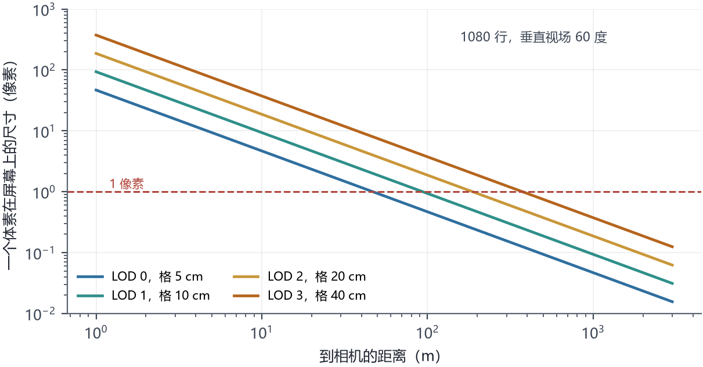
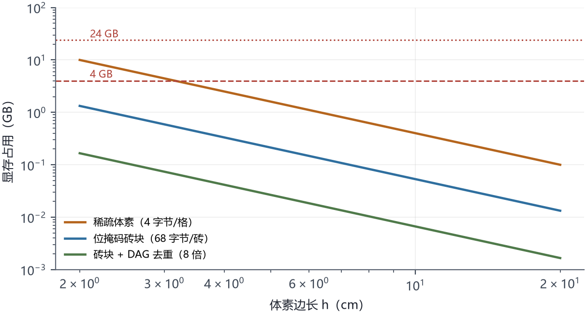
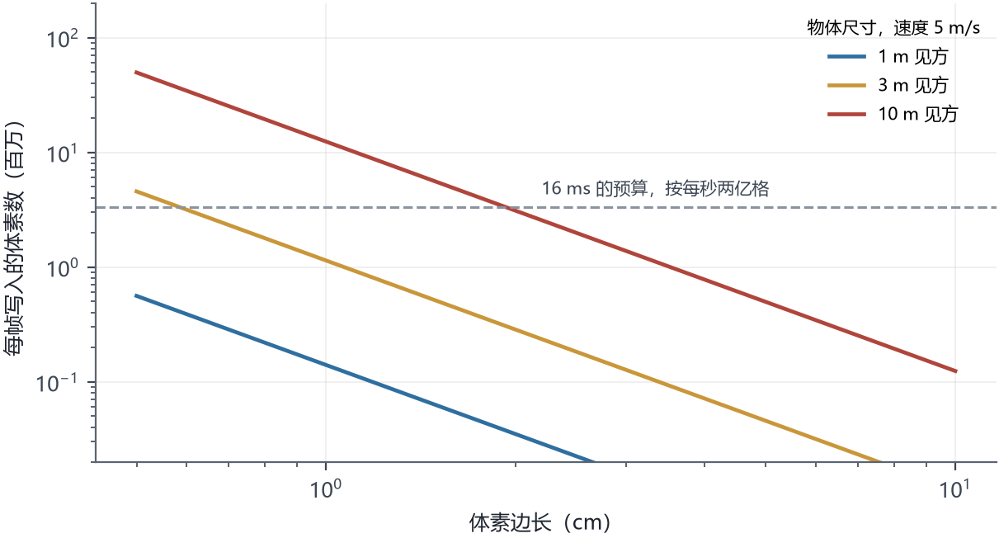

# 第 8 章 大规模场景的分块与流式

## 8.1 一座城市

一个街区的体素化，五厘米边长，跑了三分钟，显存里有一亿五千万个格子。场景换成整座城市，同样的边长，需要的内存是几百 GB。

这个数不是算错的。城市的建筑表面积比一个街区的几千倍，体素数随面积线性增长，五厘米边长下每平方米要四百个表面格子（两层壳），五十万平方米就是两亿个，四字节一格是 800 MB。听着还行，但那是只有表皮的时候。加上材质、法线、光照、mip 链，实际是四到六倍。再加上你要同时容纳相机周围的高精度区域和远处的低精度区域，总量再翻一番。

一台显卡 24 GB，一个城市 4 TB。这中间的差距只能靠三件事补，压缩、分层、按需加载。这一章讲这三件事各自能省多少，以及它们互相冲突的地方。

## 8.2 分块

第一个决定是数据单元的大小。

不分块，整棵树是一个巨大的数组，改一个格子要锁住整棵树。分成砖块，一个砖块是一个独立分配的 $8^3$ 或 $16^3$ 数组，改一个砖块只锁一个砖块。

砖块的大小有讲究。太小，指针开销占比高，树的层数多；太大，分配的粒度粗，空砖块浪费多，换出时的传输粒度也粗。$8^3$ 是常见选择，2 KB 一块，正好是几个缓存行，也正好是一次 DMA 传输的经济尺寸。

分块还有一个附带的好处，可以做"块级 LOD"。同一块区域按不同分辨率存几份，视距远时用粗的那份。这比整棵树切 LOD 简单，因为每一块独立决定，不需要保证相邻块的层级一致。

分块还决定了压缩的边界。压缩算法以块为单位工作，zstd 或者 LZ4 压一个 2 KB 的砖块，压缩率通常在三到五倍，解压速度几百 MB/s。这个压缩是无损的，和位掩码的压缩可以叠加，先位掩码再通用压缩，实际能到六到八倍。代价是随机访问要解压整块，所以只在换入时解压，运行时保持解压状态。

代价是接缝。相邻两块如果层级不同，边界上的格子对不齐，光照和遮挡会出现一条线。修法有几种，最简单的是让粗块的边界保留一圈细格，代价是存储；更常见的是在边界做插值，用细块的值约束粗块。

## 8.3 位掩码与 DAG

砖块里的数据可以压得很狠。

一个 $8^3$ 砖块的占据率是 512 个二进制值，用位掩码只要 64 字节。这比每个格子一字节省了八倍，而且解压免费，一次位运算就能取出任意格子。位掩码是体素压缩里性价比最高的一招。

再进一步是稀疏体素 DAG，Kämpe 等人 2013 年的工作。DAG 的观察是，建筑场景里有大量重复的局部结构，同样的窗框、同样的墙段，在树里是相同的子树。把这些子树合并成一份，用哈希去重，节点数可以少一个数量级。

DAG 的限制是节点不能存"每个实例不同的数据"。占据率可以共享，光照不能共享，因为每个位置的光不同。所以 DAG 通常只压缩几何，光照存在另一套结构里，用位置索引去查。

GVDB 的做法不一样，它不追求极致压缩，而是把几何和光照放在同一个砖块里，用统一的索引访问。压缩率不如 DAG，但更新方便，因为改一个砖块不影响别的实例。

## 8.4 LOD 与屏幕误差

远处的东西不需要细。

一个体素在屏幕上的尺寸是

$$s=\frac{h\,2^{l}}{2d\tan(\text{fov}/2)}\,H , \tag{8.1}$$

$h$ 是最细体素，$l$ 是 LOD 层级，$d$ 是距离，$H$ 是屏幕高度。当 $s$ 小于一个像素时，再细也没有意义。

反过来解出每一层能用到多远：

$$d_{\max}(l)=\frac{h\,2^{l}H}{2\tan(\text{fov}/2)} . \tag{8.2}$$

图 8-1 是这条曲线的数值。五厘米体素、1080 行、60 度视场，第 0 层能用到 45 米，第 1 层到 90 米，第 2 层到 180 米，每一层翻倍。

这个翻倍关系说明 LOD 的层级数和场景尺度是对数关系。城市 3 公里见方，从 5 厘米到 20 米要 9 层。九层意味着树的深度是 9，遍历代价 3.4 乘 9 等于 30 个节点，和单机场景差不多。这是 LOD 的一个好处，深度不随场景尺寸线性增长。

LOD 的代价是切换时的跳变。相机移动，某块区域从第 2 层切到第 1 层，细节突然出现。缓解的办法是滞后，进入更细的层级用更近的阈值，退出用更远的阈值，两个阈值之间留一段缓冲。

## 8.5 内存预算怎么估

把前面的东西合起来，可以估一个场景需要多少显存。

设建筑表面积 $A$，最细体素 $h$，两层表面壳。四种方案的公式分别是

$$\begin{aligned}
M_{\text{sparse}}&=\frac{8A}{h^2},\\
M_{\text{bits}}&=\frac{A}{64h^2}\times 68,\\
M_{\text{dag}}&\approx \frac{M_{\text{bits}}}{8},\\
M_{\text{sdf}}&=\frac{6A}{h^2}\times 2 . 
\end{aligned} \tag{8.3}$$

图 8-2 把前三条画了出来，横轴是体素边长，纵轴是 GB。场景取城市建筑表面积五十万平方米。

五厘米时，未压缩的稀疏体素是 1.6 GB，位掩码砖块 210 MB，DAG 26 MB。两厘米时，三个数变成 10 GB、1.3 GB 和 166 MB。4 GB 的线在 3.2 厘米附近被未压缩方案越过，位掩码方案要到 1.2 厘米才越线。

光照的存储要单独算。每个表面体素存六向辐照度是六个字节，加上 mip 链的 1/7，是每格七字节。五十万平方米、五厘米边长、八百万个表面格子，五十六 MB。这个数不大，但如果存球谐二阶，九个系数每个两字节，就是一百五十 MB。方向信息和几何信息一样值钱。

这张图给出的结论很直接，压缩不是优化，是能不能跑的前提。同分辨率下差了八倍和一整个数量级。

## 8.6 按需加载

压缩解决的是"放得下"，流式解决的是"放不全"。

Crassin 等人 2009 年的 GigaVoxels 是这个思路的起点。它的做法是让射线驱动加载，一条射线走进一个还没加载的区域，就为这个区域发一个加载请求，请求的层级由锥的足迹决定。相机不动时不加载，相机移动时只加载新出现的区域。

这套机制的难点在调度。一条射线发现缺数据，它不能等，只能先用粗层的数据，等细层到了下一帧再用。于是每一帧的图像都是"用现有数据能做到的最好"，随着数据到齐逐步变清楚。这个渐进的性质在交互里很重要，因为它不会卡住。

带宽是硬约束。PCIe 4.0 大约 25 GB/s，一块 4 TB 的场景要在 30 秒内走一遍，平均带宽 130 GB/s，不可能。所以必须保证同时加载的量很小，也就是视野内的高精度区域有限，远处一律用粗层。

这也解释了为什么体素系统喜欢视锥裁剪和遮挡剔除。不只是为了省渲染时间，也是为了省加载量。一个被墙挡住的大厅，不需要加载它的细节。

## 8.7 动态更新

动的物体要重新体素化，预算怎么算。

一个物体移动，它扫过的体积是表面积乘以位移，近似为 $A+Pv\Delta t$，$P$ 是周长方向的长度。每帧需要写的格子数是

$$N_{\text{frame}}\approx\frac{2\left(A+Pv\Delta t\right)}{h^2} . \tag{8.4}$$

系数 2 是清除旧位置和写入新位置各一遍。

图 8-3 是三个尺寸的物体在 5 m/s 下的曲线。三米见方的建筑块，一厘米体素，每帧一百一十万格；两厘米降到二十八万；四厘米七万。

十六毫秒的预算按每秒两亿格算是三百三十万格。三米的块在一厘米下勉强够，十米的块在两厘米下就超了。所以动态物体的体素分辨率通常比静态场景低一档，或者用更粗的更新频率（每两帧更新一次），接受一点延迟。

更新还有一个并发的坑。渲染和更新通常不在同一个队列里，如果更新把一块砖块写到一半，渲染读到的是半新半旧的数据，会出现一帧的几何撕裂。修法是双缓冲，写入新的砖块，写完再原子地换指针；或者用 copy-on-write，旧砖块留着给这一帧的渲染用，下一帧释放。两种办法都要额外的显存，量级是正在更新的那部分的两倍。

还有一个省法，只更新变化的部分。一个刚体平移，它内部的格子和表面的相对关系没变，理论上可以整体搬移而不是重算。实际实现里这很难，因为砖块的分配不是连续的，搬移等于重新分配。多数系统选择重算，因为重算的代码简单，而且可以完全并行。

## 8.8 视角之外的数据

还有一类数据不在视野里，却不能不处理，就是反射和间接光用的那部分场景。

屏幕空间反射只能看到屏幕里的东西，屏幕外的场景要靠预过滤的环境贴图或者体素来补。体素的好处是可以用粗层覆盖很大的范围，代价是粗层的数据必须常驻。一个城市的最粗三层加起来只有几百兆，可以全放显存，这构成了"远景"的底座。

这个底座的质量决定了间接光的整体色调。远景太粗，反射里的大楼会变成一块模糊的色板，光照的颜色渗透也会偏。实践中粗层通常做法线和平均反照率，不做法线方向上的细节，因为远处的高光本来就被过滤掉了。

## 8.9 多份数据的一致性

最后是一个容易被低估的问题，多份表示之间的一致性。

静态几何有体素、距离场、三角形三份。动态物体有体素和三角形两份。LOD 之间还有粗细两份。任何一份没跟上，图像里就会出现错位。

错位的表现形式有几种。阴影和几何对不上，因为阴影用的是上一帧的体素。反射里出现已经移走的物体，因为反射用的是粗层的缓存。LOD 切换的瞬间，光照突然变，因为光照是按旧层级算的。

这些都不是算法错误，是同步问题。修法是给每份数据打上时间戳，渲染时检查版本，不一致的地方退回粗层或者用上一帧的结果。代价是代码复杂度，收益是不出现明显的错误。

---

这一章把尺度放大。压缩的三个层次是位掩码、DAG 和分块，分别省八倍、一个数量级和一个管理上的自由度；LOD 的层级数与场景尺度是对数关系，每层翻倍；流式加载的关键是让请求量远小于场景总量，这要求视野内的高精度区域有限；动态更新的预算由表面积和体素边长的平方决定，三米的物体在一厘米下已经接近一帧的极限。

下一章把体素放回路径追踪器里，讲两者混合时的偏差从哪来。
