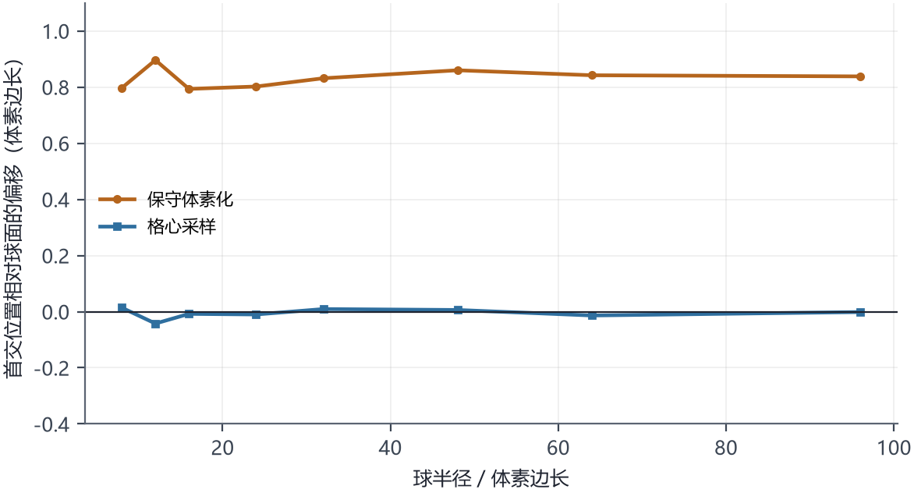
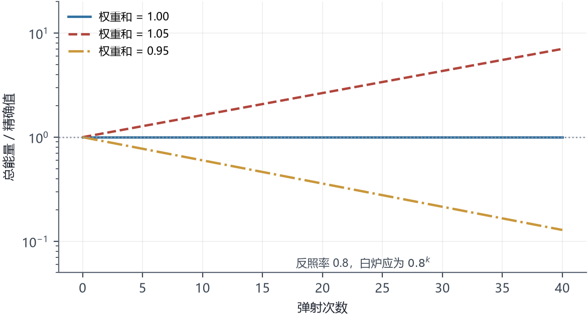
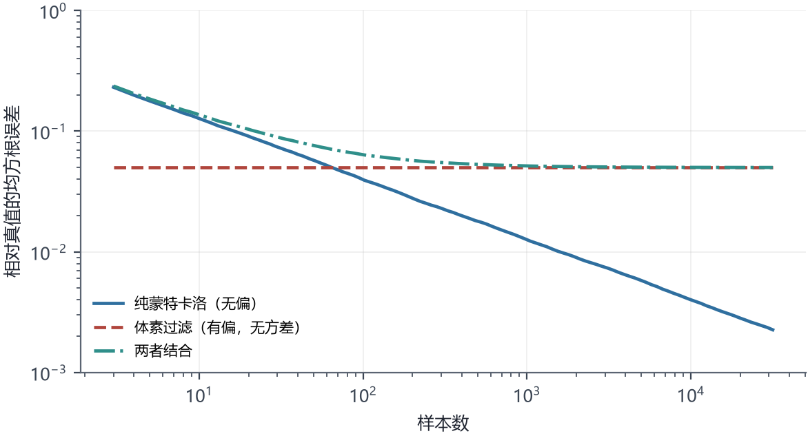

# 第 9 章 体素与路径追踪的接缝

## 9.1 一张图里的两种几何

一个会议室，玻璃幕墙，长桌，天花板是深色的吸音板。用路径追踪渲染，画面干净，反射清晰，玻璃的折射是对的。切换成混合模式，间接光改用体素，直接光和主可见性仍然用三角形，速度从每帧两秒降到每帧十六毫秒。

图像大体没变，但有三处看着不舒服。桌腿和地面的接触处，阴影边缘有一圈不该有的亮。玻璃幕墙的反射里，桌子边缘多了一条模糊的亮边。幕墙投在地上的影子，边界的位置比参考图向外偏了两三厘米。

三处都是接缝问题，成因各不相同。第一处是体素的几何比三角形大了一圈，遮挡算多了又算少了。第二处是反射用的粗层体素把桌子边缘糊开了。第三处是两次表示之间的表面位置不一致。

这一章要把这些错位一个一个对上号，并且给出验证的方法。

## 9.2 体素求交与表面的位置

体素求交的流程是，先沿射线找到第一个非空格子，再判定这个格子是否真的被表面对穿。

树的遍历用 DDA 的思路，只是每一层的步长不同。在第 $l$ 层，步长是一个第 $l$ 层的格子，遇到空节点就整块跳过，遇到非空节点就下降到下一层。到最细层之后，用一次三线性采样判断表面在格子的哪一侧。

问题出在"第一个非空格子"的位置上。保守体素化把与表面相交的格子都标成占据，这些格子的边界在真实表面之外。射线碰到第一个占据格子时，距离真实表面还有一段距离，平均是

$$\bar\Delta\approx 0.8\,h . \tag{9.1}$$

图 9-1 是这个偏移的实测。保守体素化，射线首交位置比真实球面平均向外 0.8 个体素；格心采样的偏移均值接近零，但散布是 0.3 个体素。

0.8 个体素的偏移在混合渲染里就是几厘米。阴影会外扩，接触阴影会消失（因为遮挡体比实际大，接触处反而被"填满"了），两个相邻物体之间的缝隙会被封死。这些在形状上是系统性的，不是噪声。

还有一个更隐蔽的后果，两层表示的深度不一致会让深度测试打架。三角形画出来的表面在体素表面之内，如果先用体素写深度，三角形的片元会被判成被遮挡，出现一片一片的缺失；反过来，体素算出来的接触阴影会落在三角形表面之外，看起来像悬浮。这类错误在画面上表现为斑点，很容易被误判成采样噪声。

修法有几种。用格心采样代替保守覆盖，偏移降到零但会出现漏面和缝隙，两害相权。在求交时把命中点沿法线推回半个格子，简单有效但法线不准时会把点推到表面里。用距离场做求交，偏移是二阶的，但薄结构会消失。三个方案各自对应第 3 章和第 6 章讨论过的问题。

## 9.3 偏差的四个来源

混合渲染的偏差不是一种，是四种叠加。

**过滤核偏差。** 体素锥追踪用的 mip 层是一个盒式滤波，滤波核跨过遮挡物时会把遮挡物平均掉。第 4 章算过，20 厘米的板在 4 米外漏掉 92% 的能量。这个偏差随距离增长，随核宽度增长，不随采样数减少。

**方向性偏差。** 体素里存的辐照度如果没有方向信息，就等于假设光各向同性。第 5 章算过，方向性光下单标量的误差可以到 130%。混合渲染里这个偏差会以"间接光颜色过于均匀"的形式出现。

**双重计数。** 同一个光路被算了两遍。比如体素算了一遍反弹，路径追踪又追了一条相同的光路，两者的贡献加起来超过实际。这类偏差最难发现，因为图像看起来只是"偏亮"，没有明显的形状错误。

**几何错位。** 9.2 节讲的表面偏移，以及不同 LOD 层之间的错位。它导致阴影和几何对不上，接触处的遮挡判断错误。

分离这四种来源有一个简单的办法，逐项开关。只开体素间接光、关掉路径追踪的间接光，图像和参考的差就是体素那一份；反过来只开路径追踪，差就是被丢掉的那一份；两者都开，如果总亮度超过参考，多出来的部分就是双重计数。这个流程需要三张图，成本很低，但能把问题定位到某一项。

四种偏差的量级差别很大。过滤核和方向性可以到几十个百分点，双重计数可以是几倍，几何错位通常是几厘米的位置误差。混合的时候要先知道哪一种占主导，否则会花时间修错的东西。

## 9.4 白炉测试

能量守恒是唯一一个不需要参考图就能做的检验。

白炉测试的做法是把场景放进一个所有表面反照率都是 $\rho$ 的封闭盒子里，不放任何光源，只放一个单位的初始能量。经过 $k$ 次弹射之后，剩下的能量应该是

$$E_k=\rho^k . \tag{9.2}$$

这个式子对任何几何、任何形状都成立，只依赖反照率。所以它可以检验传播算子的能量性质。

体素传播的传播算子是每个格子向邻居的加权和。如果权重之和恰好是 1，能量严格守恒；如果和是 1.05，每次弹射多 5%，四十次之后是 7 倍。

图 9-2 画了三种权重和的结果。1.05 的曲线在四十次弹射后偏离到 7 倍，0.95 的曲线衰减到 0.13 倍。5% 的权重误差在单次弹射里看不出来，在多次弹射里是指数放大。

这个测试的价值在于，它能测出你在别的地方看不出来的错误。一张正常的图，5% 的能量误差肉眼看不出来，但白炉测试一眼就能看到曲线在飘。

做这个测试要注意三点。盒子必须封闭，边界上的格子要正确处理。初始能量要归一，否则只能看趋势不能看绝对偏差。弹射次数要够，至少二十次，否则误差还没放大。

## 9.5 偏差与方差的权衡

体素给的是低方差有偏估计，路径追踪给的是无偏高方差估计。这两者的取舍可以算。

误差由两部分组成，偏差加方差：

$$\text{RMSE}=\sqrt{b^2+\frac{\sigma^2}{N}} . \tag{9.3}$$

$b$ 是偏差，$\sigma^2$ 是单样本方差，$N$ 是样本数。

图 9-3 用一个具体例子算这条曲线。被积函数是一个带台阶的函数（模拟可见性），真值是 0.6。纯蒙特卡洛的误差按 $1/\sqrt{N}$ 下降；体素过滤的偏差是 0.05，方差为零；两者结合的误差在样本少时跟体素走，样本多时跟蒙特卡洛走。

交叉点在样本数一百左右。样本少于一百，体素更准；多于这个数，路径追踪更准。这个结论可以推广，判断标准是"体素的偏差平方"与"路径追踪的方差除以可用样本数"谁更小。

实际的渲染器里，这个判断是按像素、按光路做的。粗糙的间接光（大面积漫反射）偏差小，体素划算；镜面反射的偏差大，必须用路径追踪或者屏幕空间。焦散这类高方向性的现象，体素的偏差是灾难性的，根本不能用。

## 9.6 一个能用的配置

把前面的结论收成一个配置。

主可见性用三角形，因为轮廓和镜面反射对几何精度最敏感。直接光用三角形，阴影贴图或者光线求交都行，体素在这里没有优势。

间接光的第一次弹射用体素锥追踪，因为这一次贡献最大、方向最分散，体素的偏差相对小。第二次以后的弹射用更粗的体素，或者干脆截断，因为能量已经衰减到几个百分点。

环境光遮蔽用距离场，它比体素准，而且自带软阴影。接触处的暗部靠它。

镜面反射用屏幕空间加粗层体素做补充，手机和桌面都能接受。要准确的反射，只能上路径追踪。

焦散不做。体素表达不了焦散，硬做只会得到一团模糊的亮斑，比不做更难看。

## 9.7 时间上的接缝

还有一类错位发生在帧与帧之间，看不出来但会让画面发闷。

体素的更新通常比渲染慢一帧或者几帧。角色移动，三角形位置立刻更新，体素里它还在上一帧的位置，于是它的影子慢半拍。单帧看是个几厘米的偏移，连续看就是影子跟在脚后面拖着走。

更麻烦的是时间抗锯齿。TAA 会把相邻几帧混合，如果体素内容和三角形内容的更新时间不同步，混合出来的结果是一团抖动的半影，比不混合更难看。修法是把体素的更新放在渲染之前，或者给体素也做一套运动矢量，让 TAA 知道这部分内容已经移动了。

这类问题没有算法层面的解法，只有同步策略。代价是延迟，收益是画面不抖。多数引擎选择接受一两帧的延迟，因为人的眼睛对影子滞后不敏感，对抖动敏感。

## 9.8 怎么验证

验证分三层。

第一层是能量，白炉测试，检查传播算子的权重和。这一层不需要参考图，几分钟就能跑。

第二层是单点，选几个已知解析解的位置（角落、球心、平面中心），和解析值对比。这一层能定位偏差是来自过滤核还是方向性。

第三层是图像，和路径追踪的参考图对比，看误差的空间分布。如果误差集中在遮挡边界，是过滤核；如果集中在方向性强的区域，是方向性；如果整体偏亮，是双重计数。

三层都过了，这套混合才算能用。三层里最容易被跳过的是第二层，因为它需要构造解析场景，比较麻烦。但它是唯一能告诉你"错在哪一项"的一层，跳过它，后面所有的调参都是盲调。

---

这一章讲混合。体素的表面比三角形外扩 0.8 个体素，这是几何错位的来源；过滤核、方向性、双重计数、几何错位四种偏差叠加，量级差好几个数量级；白炉测试能在不看图的情况下抓出 5% 的能量错误；偏差与方差的交叉点决定了什么时候该用体素、什么时候该用路径追踪。

体素不是路径追踪的替代品，它是路径追踪在时间和带宽上的一个近似。知道近似在哪一步失效，比知道它有多快更重要。
