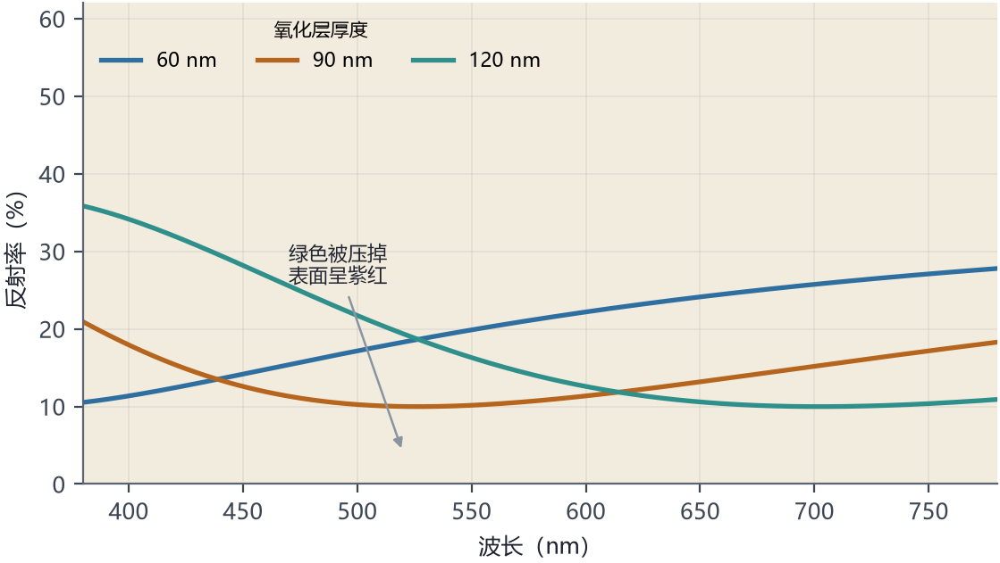
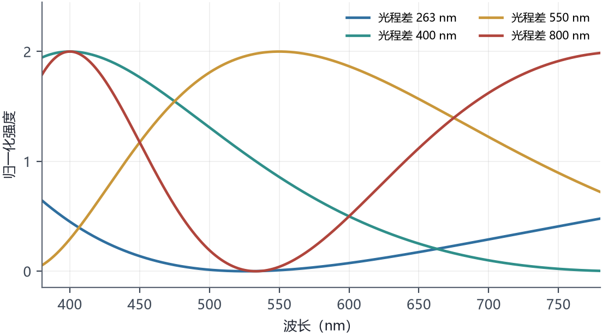
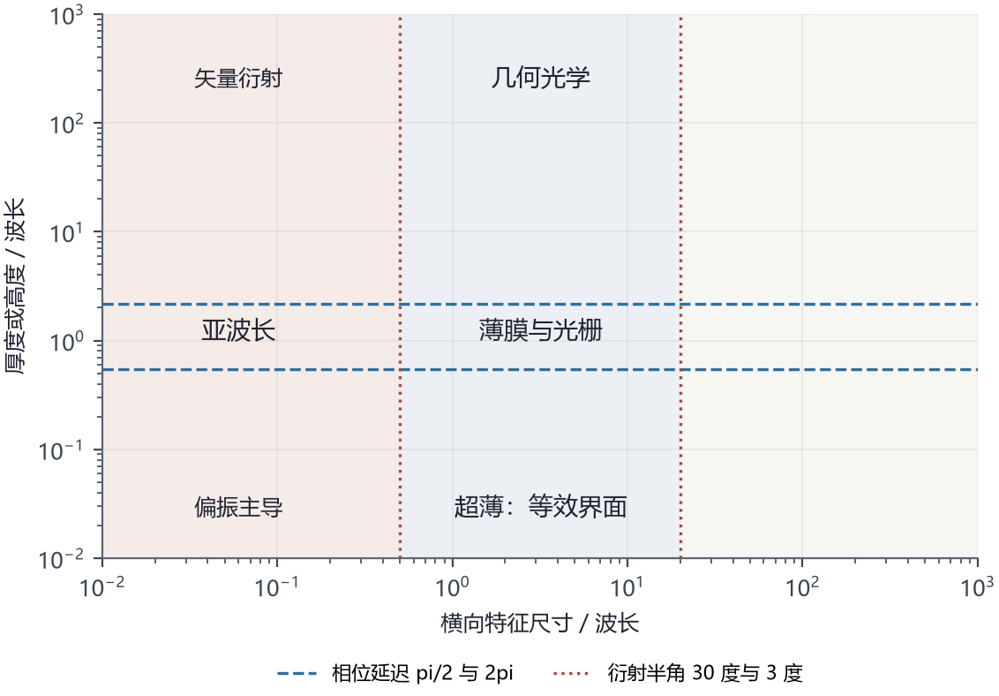

# 第 1 章 当尺度接近波长

## 1.1 一块九十几纳米的氧化层

取一片抛光的硅片，在表面热氧化一层二氧化硅，厚度控制在 90 纳米左右。肉眼看上去它是紫红色的，转个角度看，颜色几乎不变，只是亮度变了一点。

把同一块硅片放进一个按几何光学写成的渲染器。硅的折射率取 4.1，二氧化硅取 1.46，空气取 1。氧化层是透明的，光在空气与氧化层界面上反射 4%，在氧化层与硅界面上再反射一部分，两次反射的光都进入相机。渲染器给出的是一个淡灰色的表面，亮度不高，颜色中性。

真实的紫红色来自两个界面反射光的叠加。光在氧化层里多走了一个来回，光程是

$$\Delta L=2n_{\mathrm{ox}}d=2\times 1.46\times 90\ \mathrm{nm}=263\ \mathrm{nm}. \tag{1.1}$$

这个光程差对不同波长意味着不同的事。两个界面都是从低折射率进入高折射率，各带一次半波损失，两次抵消，于是相位差就是

$$\delta=\frac{2\pi}{\lambda}\Delta L=\frac{2\pi\times 263}{\lambda}. \tag{1.2}$$

在 $\lambda=526$ nm 处，$\delta=2\pi\times263/526=\pi$，两束光恰好反相，反射被压到最低，图 1-1 里 90 纳米那条曲线的谷底就在这个位置。往短波方向走，$\delta$ 增大，到 $\lambda=263$ nm 时 $\delta=2\pi$，两束光重新同相，反射回到极大，这个极大落在紫外。

可见光范围是 380 到 780 纳米。谷底在 526 纳米，正对绿光中心，所以绿光被削得最狠；450 纳米处 $\delta=3.7$ 弧度，仍然接近反相；650 纳米处 $\delta=2.5$ 弧度，也偏离同相但没那么远，反射开始回升。绿被削掉，红与蓝保留得多一些，混合起来就是紫红。厚度换成 120 纳米，光程差变成 350 纳米，谷底挪到 700 纳米，绿和蓝都被保留，表面偏黄绿。

图 1-1 把这件事画了出来。三条曲线的形状几乎一样，只是沿波长轴平移。厚度在这里扮演的角色不是"吸收某个颜色"，而是"选择哪个波长被抵消"。这就是干涉与吸收的根本区别：吸收是光被吃掉，干涉是光被送到别的方向去，两者在光谱上的表现都是某个波段变弱，但前者与厚度是指数关系，后者与厚度是周期关系。

渲染器给出的灰色没有算错，它算的是"两个界面各自反射多少能量，加起来"。错的地方在于，它把两束光的强度直接相加了。真实的物理是两束光的振幅相加，相加时相位决定符号。

## 1.2 几何光学到底假设了什么

把上面那段话讲清楚，需要回到波动方程。在无源、无磁、折射率缓变的介质里，标量场 $U$ 满足

$$\nabla^{2}U-\frac{n^{2}}{c^{2}}\frac{\partial^{2}U}{\partial t^{2}}=0 . \tag{1.3}$$

对单色光 $U(\mathbf{r},t)=\tilde U(\mathbf{r})e^{-i\omega t}$，代入得到亥姆霍兹方程

$$\nabla^{2}\tilde U+k^{2}n^{2}\tilde U=0,\qquad k=\frac{2\pi}{\lambda_{0}} . \tag{1.4}$$

现在做一个假设，把解写成振幅乘相位的形式：

$$\tilde U(\mathbf{r})=A(\mathbf{r})\,e^{ikS(\mathbf{r})} , \tag{1.5}$$

$A$ 是实值振幅，$S$ 是实值相位函数，量纲是长度，通常叫程函（eikonal）。这个写法没有损失一般性，任何复函数都能这样分解。

把它代回 (1.4)。先算梯度和拉普拉斯：

$$\nabla\tilde U=e^{ikS}\left(\nabla A+ikA\nabla S\right), \tag{1.6}$$

$$\nabla^{2}\tilde U=e^{ikS}\left[\nabla^{2}A+2ik\nabla A\cdot\nabla S+ikA\nabla^{2}S-k^{2}A|\nabla S|^{2}\right]. \tag{1.7}$$

代入 (1.4)，两边除以 $e^{ikS}$，把含 $k^{2}$ 的项和不含 $k$ 的项分开：

$$k^{2}A\left(n^{2}-|\nabla S|^{2}\right)+ik\left(2\nabla A\cdot\nabla S+A\nabla^{2}S\right)+\nabla^{2}A=0 . \tag{1.8}$$

$A$、$S$、$n$ 都是实量，所以实部和虚部必须分别为零：

$$|\nabla S|^{2}=n^{2}+\frac{1}{k^{2}}\frac{\nabla^{2}A}{A}, \tag{1.9}$$

$$2\nabla A\cdot\nabla S+A\nabla^{2}S=0 . \tag{1.10}$$

(1.9) 右端第二项带 $1/k^{2}$。当 $k$ 很大，也就是波长远小于振幅变化的特征长度时，这一项可以丢掉，剩下

$$|\nabla S|^{2}=n^{2} , \tag{1.11}$$

这是程函方程。它的解 $S$ 的等值面就是波前，而 $\nabla S$ 是波前的法线方向，长度等于 $n$。光线沿 $\nabla S$ 走，这条曲线满足 Fermat 原理。(1.10) 可以改写成守恒形式

$$\nabla\cdot\left(A^{2}\nabla S\right)=0 , \tag{1.12}$$

它说的是：沿一根由光线围成的细管，$A^{2}|\nabla S|$ 乘上截面积不变。$A^{2}$ 是强度，$\nabla S$ 是方向，两者合起来就是能流密度。几何光学的"能量沿射线管守恒"，正是这句话。

被丢掉的那一项有多大？它的量级是 $(\lambda/2\pi L)^{2}$，$L$ 是振幅在一个波长范围内变化的尺度。取 $L=10\lambda$，相对误差是 $0.25\%$，可以忽略。取 $L=\lambda/4$，也就是振幅在四分之一个波长内就显著改变，误差到 $40\%$，几何光学彻底失效。

这个推导给出了全书最重要的一句话：**几何光学的适用条件不是"物体比波长大"，而是"振幅和相位在一个波长内变化很小"。** 一块一厘米厚的玻璃板远大于波长，几何光学完全够用；一层 90 纳米的膜，虽然也是"均匀介质"，但因为折射率在两个界面上突变、光来回走一圈的相位正好落在 $\pi$ 的量级，就必须用波动光学。尺度判据真正起作用的地方是相位，不是厚度。

## 1.3 相位差的量级感

把 (1.2) 反过来读：在 550 纳米处，1 纳米的光程差对应

$$\frac{360^{\circ}}{550}\approx 0.65^{\circ}. \tag{1.13}$$

这个换算很好用。一个镀膜工艺的厚度公差如果是 5 纳米，对应 3.3 度的相位误差，颜色上几乎看不出来；公差 50 纳米，对应 33 度，颜色已经能看出偏移；公差 100 纳米，65 度，颜色跳到另一个色相。

反过来，同一个厚度对不同波长的相位差不同，这就是色散的来源。90 纳米的膜在 400 纳米处相位差是 $2\pi\times263/400=1.31\times2\pi$，在 700 纳米处是 $0.75\times2\pi$。两个波长的相位差差了 0.56 个周期，正好对应"一个颜色被加强、另一个被削弱"。

图 1-2 用 $\cos\delta$ 画了这件事。光程差小的时候，整条可见光范围落在同一个瓣里，表面呈现单色；光程差到 800 纳米时，可见光范围里有三个完整的周期，红绿蓝各落在不同的相位上，表面呈现的是一种混合的、随角度急剧变化的颜色。这就是肥皂膜厚处出现"高级次颜色"（higher-order colors）的原因，也是为什么厚膜的颜色看起来脏。

## 1.4 四分之一波长规则

干涉项的系数是 $\cos\delta$。当 $\delta$ 从 0 涨到 $\pi$，干涉项从 $+1$ 掉到 $-1$。$\delta=\pi/2$ 时它是 0，此时两束光的强度直接相加，干涉效果完全消失。$\delta=\pi/2$ 对应的光程差是 $\lambda/4$。

这条 $\lambda/4$ 的线在光学里反复出现，叫 Rayleigh 四分之一波长规则。它的意思是：光程差的变化如果小于 $\lambda/4$，那么相位差在一个 $\pi/2$ 的范围内摆动，干涉图样还能被分辨；一旦超过，不同部位的光程差跨越了半个周期以上，条纹就互相叠加、平均掉了。

对高度随机起伏的表面，这个规则给出一个可以算的粗糙度判据。反射光的相位是 $2kh\cos\theta_i$，$h$ 是局部高度，前面乘 2 是因为光进出各走一趟。高度起伏的标准差 $\sigma_h$ 对应的相位标准差是

$$\sigma_{\phi}=2k\sigma_h\cos\theta_i=\frac{4\pi\sigma_h\cos\theta_i}{\lambda}. \tag{1.14}$$

要求 $\sigma_{\phi}<\pi/2$，得到

$$\sigma_h<\frac{\lambda}{8\cos\theta_i}. \tag{1.15}$$

垂直看时 $\sigma_h<0.125\lambda$，550 纳米对应 69 纳米。掠射时判据迅速收紧：入射角 80 度，$\cos\theta_i=0.17$，上限变成 40 纳米；85 度时只剩 20 纳米。这意味着同一块表面，正面看是镜面，掠着看就开始散射和显色。金属高光在掠射角边缘那条彩色亮边，一部分原因就在这里。

## 1.5 复振幅的加法

从这一节开始，把强度换成复振幅来算，这是后面所有章节的工作语言。

单色光的复振幅记作 $\tilde U(\mathbf{r})$，物理场是它的实部乘上时间因子：

$$U(\mathbf{r},t)=\mathrm{Re}\left[\tilde U(\mathbf{r})e^{-i\omega t}\right]. \tag{1.16}$$

强度取时间平均。在 $\tilde U$ 不含时间的情况下，

$$I=\left\langle U^{2}\right\rangle_{t}=\frac{1}{2}\left|\tilde U\right|^{2}. \tag{1.17}$$

常数 $1/2$ 在所有线性运算里都会被约掉，实际计算可以令 $I=|\tilde U|^{2}$，只要前后一致。

两束光同时到达一点，场相加：

$$\tilde U=\tilde U_1+\tilde U_2=A_1e^{i\varphi_1}+A_2e^{i\varphi_2}. \tag{1.18}$$

取模平方：

$$I=A_1^{2}+A_2^{2}+2A_1A_2\cos\left(\varphi_1-\varphi_2\right). \tag{1.19}$$

这就是干涉的完整表达式。前两项是两个强度，第三项是干涉项，它的大小和符号完全由相位差 $\delta=\varphi_1-\varphi_2$ 决定。

现在能看清几何光学是怎么从 (1.19) 里出来的。真实光源不是单色的，相位差随时间抖动；探测器也有积分时间。只要 $\delta$ 在观测窗口内跑过好几个 $\pi$，$\cos\delta$ 的平均值就是零，第三项消失，剩下 $I=I_1+I_2$。几何光学的加法规则，是干涉项被平均掉的极限情形。

反过来，要让干涉项留下，需要两个条件。相位差在观测时间内稳定，这叫时间相干；两束光的偏振不互相正交，否则干涉项还要再乘一个偏振因子。前一个条件给出相干长度的概念，下一章专门处理。

## 1.6 一张尺度地图

图 1-3 把这本书覆盖的范围画成了一张二维图。两个轴分别是横向尺寸与厚度相对波长的比，因为它们控制的是不同的物理：横向决定光被送向哪个方向，纵向决定相位差累积了多少。

横向尺寸决定衍射。特征宽度 $a$ 远大于波长时，光在结构上的弯折很小，可以用几何光学加微扰；$a$ 与波长同量级时，衍射角 $\lambda/a$ 到了几十度，光被送到完全不同的方向；$a$ 只有波长的十分之一时，结构本身不能用"表面"来描述，需要有效介质近似或者严格的矢量求解。

纵向尺寸决定干涉。厚度 $d$ 的相位是 $2nkd\cos\theta$，$d$ 到 $\lambda/4n$ 时相位差就到 $\pi/2$，干涉开始主导；$d$ 远小于 $\lambda/4n$ 时薄膜退化成一层"相位几乎不变"的薄层，它的作用变成一个等效的界面，可以用有效折射率描述。

两个轴一起切出九个格子，其中有意义的几个是这些。横向小于半个波长、纵向也不到四分之一波的左下角，是亚波长结构，标量理论完全失效，需要严格耦合波分析一类的矢量方法，偏振效应也在这里最强。横向在半个波长到二十个波长之间、纵向在一百纳米上下的中间一排，是薄膜与光栅的地盘，也是这本书的主战场。纵向超过一个波长的右上方，光在结构内部走完一个完整周期，干涉变成多光束的复杂图样，通常改用多层膜或者体散射处理。横向超过二十个波长、纵向也大的右上角，是常规表面，几何光学加微表面模型足够。

渲染器默认待在右上角。这本书要做的事，是把中间这一大块补上。

## 1.7 为什么三个通道不够

到这里可以回答一个工程问题：既然渲染器用 RGB，能不能把干涉的结果直接算成三个数？

能，但有条件。干涉的反射率是波长的函数 $R(\lambda)$，RGB 渲染器真正想要的其实是三个积分

$$C_{c}=\int R(\lambda)\,S(\lambda)\,b_{c}(\lambda)\,d\lambda,\qquad c\in\{r,g,b\}, \tag{1.20}$$

其中 $S$ 是光源谱，$b_c$ 是某个颜色匹配函数的线性组合。多数渲染器把这件事简化成"在三个代表波长上取值再乘权重"，等于用三个点采样这个积分。

三个点采样一个平滑函数没问题。金属的反射谱在可见光范围内变化缓慢，几十纳米尺度上几乎是常数，三个点足够。薄膜的反射谱不是这样，它在 $\lambda/4n$ 的尺度上就有一次完整的振荡，40 纳米的峰宽很常见。三个采样点如果恰好落在两个峰之间的谷里，渲染器会认为这个表面很暗；而真实情况是这个表面在 550 纳米附近有一个亮峰，只是峰宽 30 纳米，被三个点整个跳过了。

这种错误比"颜色偏一点"严重，因为它会随厚度跳变。厚度从 240 纳米变到 250 纳米，光谱移动了几个纳米，三个固定采样点的读数可能从谷底跳到峰顶，图像的某个区域突然从暗变亮。这种跳变在动画里是闪的，在实际拍摄里不存在。

解决办法只有两条。要么把 $R(\lambda)$ 在可见光上分成十几个到几十个波段积分，要么把 $R(\lambda)$ 预先投影到一组基函数上，在渲染时只算基函数的系数。两条路都需要先有一个能算 $R(\lambda)$ 的模型，也就是从第 4 章开始的内容。

---

这一章给出了一个判据和一套语言。判据是：振幅或相位在一个波长内变化显著的地方，几何光学失效，失效的程度由 $\lambda/4$ 这条线标定。语言是复振幅与相位差，强度是振幅和的模平方，几何光学是干涉项被平均掉的极限。

下一章处理"平均"这件事本身。相位差在什么条件下会被平均掉，平均得不彻底时剩下多少，答案由相干长度给出。
