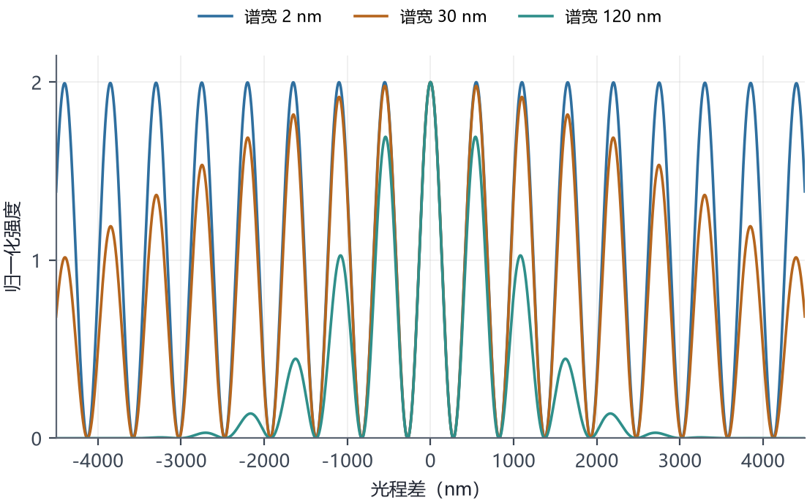
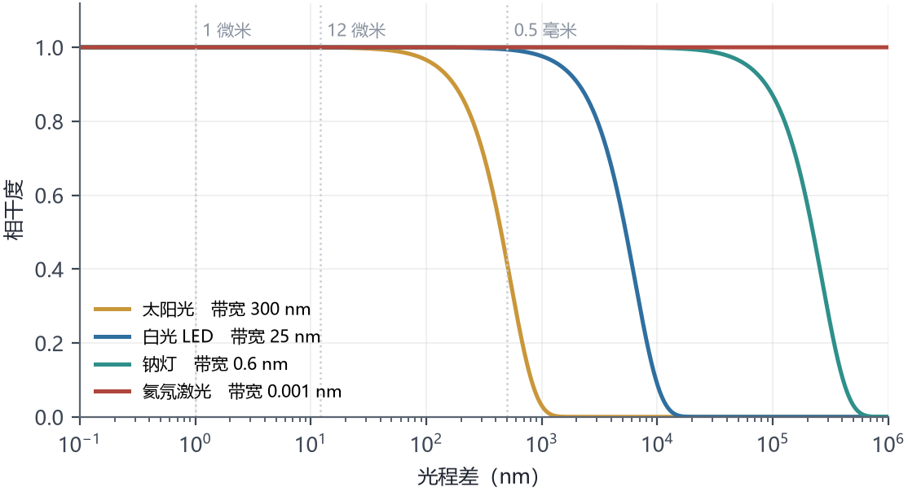
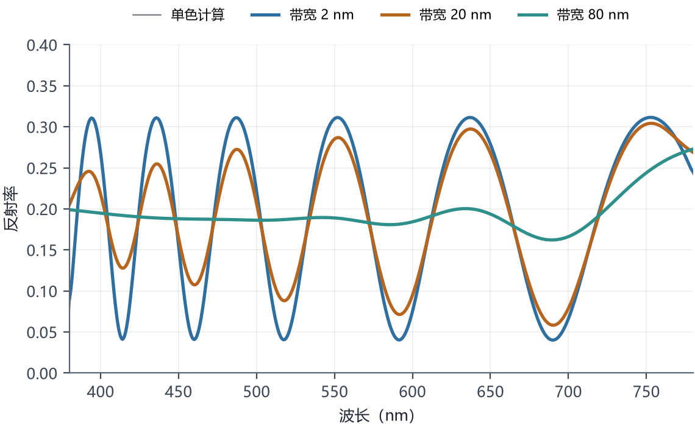

# 第 2 章 相位、相干与干涉

## 2.1 同一层膜，两种灯

把第 1 章那块 90 纳米的氧化硅片放在两种灯下看。

第一种是高压钠灯，谱线在 589 纳米附近，宽度不到 1 纳米。硅片呈现出干净的紫红，颜色饱和度很高，边缘的过渡锐利。

第二种是白光 LED，光谱是一整条连续带，半高宽三十纳米左右。同一块硅片，紫红还在，但明显发灰，像是蒙了一层。

第三种是太阳光。紫红变成一种很淡的、说不清是什么的灰紫色，几乎看不出"彩色"。

样品的结构没变，几何没变，折射率没变。变的只有光源的谱宽。这说明第 1 章那套"两束光按相位相加"的说法还缺一个条件：两束光的相位差必须在一段可观测的时间或空间里稳定，否则叠加的结果会被平均掉。这个稳定性就是相干性。

这一章要给出一个可以算的量，把"稳定到什么程度"变成数字，并且说清它在渲染里意味着什么。

## 2.2 干涉项的严格写法

第 1 章的推导假设光是严格单色的，场写成 $Ae^{i(\mathbf{k}\cdot\mathbf{r}-\omega t+\varphi)}$，振幅和相位都是常数。真实的场不是这样，它是众多频率成分的叠加，相位随时间抖动。

把某一点的光场写成复解析信号 $U(t)$，强度是 $I=\langle|U(t)|^{2}\rangle$，尖括号表示对时间取平均，平均窗口由探测器决定。两个不同的点（或者同一点经过不同延迟的两束光）分别记作 $U_1(t)$ 和 $U_2(t)$，叠加后

$$I=\left\langle\left|U_1(t)+U_2(t)\right|^{2}\right\rangle=I_1+I_2+2\,\mathrm{Re}\left\langle U_1(t)U_2^{*}(t)\right\rangle . \tag{2.1}$$

交叉项里出现的是一个平均值，定义互相干函数

$$\Gamma_{12}(\tau)=\left\langle U_1(t+\tau)U_2^{*}(t)\right\rangle . \tag{2.2}$$

$\tau$ 是两束光到达时间之差，对应光程差 $\Delta L=c\tau$。$\Gamma_{12}$ 是一个复数，量纲是强度。把它归一化：

$$\gamma_{12}(\tau)=\frac{\Gamma_{12}(\tau)}{\sqrt{I_1I_2}} , \tag{2.3}$$

$\gamma$ 叫复相干度（complex degree of coherence）。它满足 $0\le|\gamma|\le1$，$|\gamma|=1$ 表示两束光完全相干，$|\gamma|=0$ 表示完全不相干。

代入 (2.1)：

$$I=I_1+I_2+2\sqrt{I_1I_2}\left|\gamma_{12}(\tau)\right|\cos\left[\arg\gamma_{12}(\tau)\right]. \tag{2.4}$$

和 (1.19) 相比，多了因子 $|\gamma|$，相位也换成了 $\gamma$ 的辐角。干涉项被 $|\gamma|$ 直接缩放，这就是相干性的全部作用。

定义条纹可见度（visibility）

$$V=\frac{I_{\max}-I_{\min}}{I_{\max}+I_{\min}} . \tag{2.5}$$

把 (2.4) 代进去，取 $I_1=I_2$，得到 $V=|\gamma|$。条纹对比度与相干度是同一个量的两种叫法。测条纹可见度，等于测相干度。

## 2.3 相干长度从哪来

要算 $|\gamma|$，需要知道场的时间统计。从谱出发比较方便，因为有 Wiener–Khinchin 定理：互相干函数与功率谱密度互为傅里叶变换。对同一点的自相干 $\Gamma(\tau)=\langle U(t+\tau)U^*(t)\rangle$，有

$$\Gamma(\tau)=\int_{0}^{\infty}S(\nu)\,e^{i2\pi\nu\tau}\,d\nu , \tag{2.6}$$

$S(\nu)$ 是光源的功率谱。归一化之后 $\gamma(0)=1$，这与"零延迟时自己和自己完全相干"一致。

(2.6) 说明一件事：$\gamma$ 的衰减速度由 $S(\nu)$ 的宽度决定。谱越窄，$\gamma$ 衰减越慢。取一个宽度为 $\Delta\nu$ 的谱，$\gamma$ 在 $\tau\sim1/\Delta\nu$ 的尺度上衰减到零附近，于是定义相干时间

$$\tau_c\approx\frac{1}{\Delta\nu} , \tag{2.7}$$

对应的空间长度是相干长度

$$l_c=c\tau_c\approx\frac{c}{\Delta\nu} . \tag{2.8}$$

用 $\nu=c/\lambda$ 微分，$|\Delta\nu|=c\Delta\lambda/\lambda^{2}$，代入得到

$$l_c\approx\frac{\lambda^{2}}{\Delta\lambda} . \tag{2.9}$$

这个式子很好记，也很好用。它说：相干长度与谱宽成反比，与波长的平方成正比。长波长的光对同一绝对带宽有长得多的相干长度，因为相对带宽更小。

代入几种真实光源。太阳光的可见光部分是 400 到 700 纳米，$\Delta\lambda\approx300$ 纳米，在 550 纳米处 $l_c\approx1$ 微米。白光 LED 的 $\Delta\lambda$ 约 25 纳米，$l_c\approx12$ 微米。高压钠灯的谱线宽约 0.6 纳米，$l_c\approx0.5$ 毫米。氦氖激光的线宽可以做到 $10^{-3}$ 纳米，$l_c$ 到几十厘米。

图 2-1 把这个对比画了出来。三角函数的振荡是相位 $\arg\gamma$ 造成的，包络是 $|\gamma|$ 造成的。谱宽的差别只改变包络，不改变振荡周期。这解释了 2.1 节的现象：90 纳米膜产生的光程差是 263 纳米，远小于 12 微米，所以 LED 下条纹包络几乎还是 1；但 90 纳米膜的反射光不是单一光程差，表面粗糙度、入射角的分布、膜厚的横向起伏都会让光程差在一个范围内摊开，摊开的宽度一旦接近 $l_c$，可见度就掉下来了。太阳光下 $l_c$ 只有 1 微米，任何几十纳米量级的平整度误差都会把条纹洗掉。

## 2.4 双缝的完整表达式

把双缝的具体几何代进去，可以看清包络与条纹的分工。

缝间距 $d$，屏距 $L$，屏上坐标 $x$。两缝到屏上同一点的光程差是

$$\Delta L\approx\frac{xd}{L} , \tag{2.10}$$

用的是旁轴近似，$\theta=x/L$ 很小，$\sin\theta\approx\theta$。严格写法是 $\Delta L=d\sin\theta$，对本书关心的小角度没有区别。

两缝的光强相等，各为 $I_0$，则

$$I(x)=2I_0\left[1+\left|\gamma\left(\frac{xd}{cL}\right)\right|\cos\left(\frac{2\pi xd}{\lambda L}\right)\right]. \tag{2.11}$$

条纹间距是

$$\Delta x=\frac{\lambda L}{d} , \tag{2.12}$$

条纹的包络宽度由 $|\gamma|$ 衰减到零的 $\Delta L$ 决定，换算到屏上是 $\Delta x_{\mathrm{env}}=l_cL/d$。两者的比

$$\frac{\Delta x_{\mathrm{env}}}{\Delta x}=\frac{l_c}{\lambda}=\frac{\lambda}{\Delta\lambda} . \tag{2.13}$$

这个比值就是"能看到多少条条纹"。太阳光在 550 纳米，$\lambda/\Delta\lambda\approx1.8$，只能看到中央一两条，所以白光双缝的样子是中央一条白线，两侧各一条彩边，再外面就是均匀的照明。钠灯能看几百到上千条。激光能看几万条，实际受限的是光学元件的口径和震动。

两束光的强度不等时，可见度还有一个上限。把 $I_1=rI_2$ 代入 (2.5) 算一遍，得到

$$V=\frac{2\sqrt{r}}{1+r}\left|\gamma\right| . \tag{2.14}$$

$r=1$ 时前因子为 1，$r=9$ 时降到 0.6，$r=100$ 时只剩 0.2。所以干涉要看得清，两束光的强度必须可比。这一条对薄膜很重要：单层膜的两个界面反射率都是百分之四量级，$r\approx1$，条纹对比度接近满值；而一个高反膜系的第一个界面反射率可以到 90\% 以上，后面几个界面的贡献叠在一起才抵得上，$r$ 很大，于是虽然选择性反射依然存在，但它在能量上的表现不再是一个漂亮的余弦，而是一条被削出窄谷的谱线。

## 2.5 空间相干

上面所有讨论都假设两束光来自同一个点源，只有时间延迟不同。真实的扩展光源有面积，不同发光点到达两个缝的光程差不同，条纹互相错开，叠加之后可见度下降。这是空间相干。

van Cittert–Zernike 定理给出定量结果：一个强度分布为 $I_s(\boldsymbol{\xi})$ 的非相干扩展光源，在远处平面上产生的复相干度，等于 $I_s$ 的傅里叶变换。对一个角直径 $\alpha$ 的均匀圆盘光源，相干度在间距

$$d_{c}\approx\frac{\lambda}{\alpha} \tag{2.15}$$

处第一次降到零。$d_c$ 叫相干宽度。

代入太阳，$\alpha=0.53^{\circ}=9.3\times10^{-3}$ 弧度，$\lambda=550$ 纳米，$d_c\approx59$ 微米。这个数字很小，意味着在太阳光下，相距超过 60 微米的两点已经不相干了。餐桌上的两个杯子、一片叶子的两端、一根头发的两侧，相距都远超 60 微米，所以它们反射的光互不相干，强度直接相加。

结论很干脆：**除激光和极窄带光源之外，真实场景的光在宏观尺度上永远是非相干的。**

这个结论有一个可以直接观察的推论。用激光笔照一面粗糙的墙，墙上出现颗粒状的明暗斑点，那是相干光在粗糙表面上形成的散斑；换成白光 LED，斑点消失。散斑不是墙的性质，是光源的性质：相干长度越长，散斑越明显。渲染器里如果模拟激光照明，必须处理散斑，而散斑的统计由表面的相位分布决定，也就是第 7 章的相位屏。 这就是为什么路径追踪器可以放心地把 radiance 当标量相加，而不需要追踪相位。相位只在结构内部几十纳米到几微米的范围内还保持得住，那正是薄膜和光栅的尺度。

## 2.6 谱宽如何改变颜色

回到渲染。上面这些对结构色有一个直接的后果：反射谱必须被光源谱卷积，而不是取一个波长算完就完事。

浸在折射率 $n$、厚度 $d$ 的膜里的反射率 $R(\lambda)$ 在第 4 章会给出精确形式，现在只需要知道它随波长振荡，峰谷间隔约 $\lambda^{2}/(2nd)$。光源有一定的带宽 $\Delta\lambda$，相机也有一定的响应宽度，两者合起来相当于对 $R(\lambda)$ 做一次低通滤波。滤波核的宽度如果与 $R$ 的振荡周期可比，峰谷就被抹平，颜色从饱和的彩色退化为灰调。

图 2-3 是一层 900 纳米厚的膜，折射率 2.3，衬底是折射率 1.5 的玻璃。光学厚度 4140 纳米，在可见光里跨过三个完整的振荡周期，峰在 0.31 附近，谷在 0.04 附近。带宽 20 纳米时峰谷已经被削掉三成，带宽 80 纳米时只剩下一个缓慢的起伏，颜色接近中性。振荡的周期是 $\lambda^{2}/(2nd)$，在 550 纳米处约 112 纳米，与 20 纳米的带宽相差五倍，所以 20 纳米带宽只能削平峰顶，不会把整个结构抹掉。

这件事有一个容易被忽略的推论。渲染结构色时，如果光源模型是一个理想的 RGB 三色三角形，那么带宽为零，颜色饱和度会算得过高。真实的 LED 带宽二十纳米以上，荧光灯有尖锐的谱线，太阳是连续谱。同一个蝴蝶翅膀在这三种光下看起来不一样，渲染器要还原这一点，光源就必须带谱宽信息。

反过来说，薄膜的振荡周期 $\lambda^{2}/(2nd)$ 在可见光里是 100 到 300 纳米，比常见光源的带宽大得多，所以只要不做极厚膜（超过 2 微米）或者极高分辨的光谱，带宽的影响是可控的。第 10 章会给出一个量化标准：膜的光学厚度超过多少时，必须把带宽纳入采样。

## 2.7 相干在什么尺度上还有用

把这一章的数字收拢成一张判断表。

结构内部的光程差在 $\lambda/4$ 到几个 $\lambda$ 的量级，远小于任何真实光源的相干长度，所以结构内部的干涉总是成立的，这就是薄膜和光栅能用波动光学算的原因。

结构之间的光程差（两个不同物体的反射光到达同一点）通常是毫米到米，远大于相干长度，所以不同物体之间不会干涉，路径追踪的强度加法成立。

介于两者之间的是薄层叠加，比如两层膜的间距、鳞片之间的空隙、泡沫的相邻薄膜。这些距离在几微米到几十微米，正好落在 LED 与太阳的相干长度附近，会出现部分相干的现象，比如肥皂泡上大片的彩色斑块，那是相邻薄膜反射光的弱相干叠加。这类现象在当前的渲染器里基本没有处理，做结构色需要它的时候要专门建模。

还有一类情形值得单独提一句。两束光的偏振方向如果正交，干涉项会再乘一个偏振因子，正交时该因子为零，条纹彻底消失。这个因子在 Born 与 Wolf 的《Principles of Optics》里有完整讨论，它的后果在偏振那一篇会用到：两束正交线偏振光可以叠加出圆偏振，但没有强度的干涉条纹。

---

这一章补上了几何光学缺的那个量，并给出了它的有效范围。相位在结构内部（纳米到微米）稳定，在结构之间（毫米以上）随机；相干长度 $\lambda^{2}/\Delta\lambda$ 是这两段的界线。干涉的强度由 $|\gamma|\cos(\arg\gamma)$ 决定，谱宽只压包络不改周期。

下一章处理另一个方向的偏离：即使完全相干，光遇到一个边缘、一个孔、一个障碍物时，也不会沿直线走。这就是衍射。
