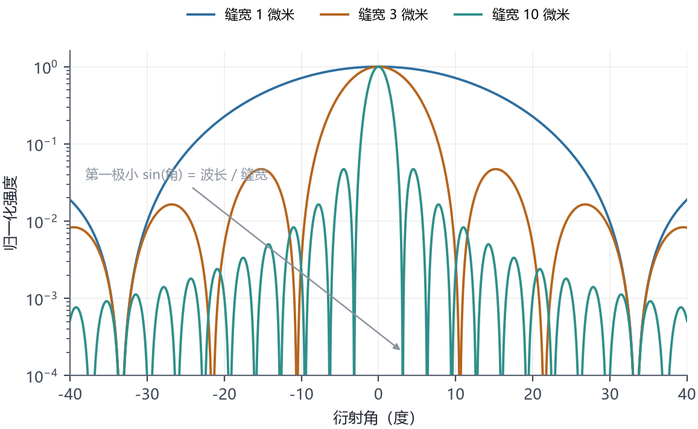
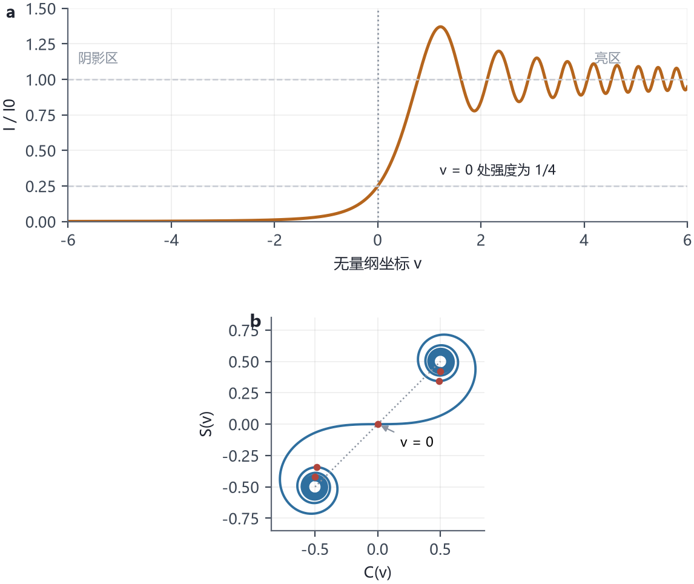

# 第 3 章 标量衍射与 Kirchhoff 近似

## 3.1 刀刃的影子

把一片刮胡刀片立在台灯和白墙之间，让它的影子落在墙上。退后几步看，影子边界是一条清晰的直线，几何光学的说法完全成立。凑近墙，把眼睛放到离墙十厘米的地方，边界变了：亮的一侧紧贴边缘有一条暗带，暗带外面又是一条亮带，暗亮交替几次之后才归于均匀；暗的一侧紧贴边缘则有一小段并不全黑，越靠近边缘越亮。

这个现象在 1818 年让巴黎科学院很为难。Fresnel 提交了一篇用波动理论解释衍射的论文，评委 Poisson 认为他的积分必然导出一个荒谬结论：一个圆形障碍物的影子中心应该有一个亮点。另一位评委 Arago 动手做了实验，亮点真的存在，现在叫 Poisson 亮斑或者 Arago 斑。

亮点的存在说明一件事：光绕过了障碍物的边缘，而且绕过去的光在影子中心重新同相。几何光学里没有"绕过去"这个动作。这一章处理的就是它，以及它在渲染里值不值得算。

## 3.2 从惠更斯原理到 Kirchhoff 积分

惠更斯在 1678 年提出一个图像：波前上的每一点都可以看作新的次波源，下一时刻的波前是这些次波的包络。这个图像能解释折射和反射的方向，但解释不了强度，因为它没说次波的振幅和相位是多少。

Fresnel 在 1818 年补上了这两样：次波的振幅正比于入射振幅和面积元，相位取入射波在该点的相位，再加上一个随方向缓慢衰减的倾斜因子。这个组合叫惠更斯–菲涅尔原理，它能算出条纹的位置和强度对比，是第一个定量的衍射理论。

Kirchhoff 在 1882 年给了它一个从波动方程出发的推导。做法是用格林定理把区域内的场用边界上的场表示。取格林函数为从观察点到边界点的球面波 $G=e^{ikr}/r$，格林定理给出

$$U(P)=\frac{1}{4\pi}\oint_{S}\left[U\frac{\partial G}{\partial n}-G\frac{\partial U}{\partial n}\right]dS . \tag{3.1}$$

$n$ 是边界的外法线。对 $G$ 求导，$\partial G/\partial n=\cos\theta\,(ik-1/r)e^{ikr}/r$，在 $kr\gg1$ 时保留 $ik$ 项：

$$\frac{\partial G}{\partial n}\approx ik\cos\theta\,\frac{e^{ikr}}{r} . \tag{3.2}$$

把这个代入，并用入射波在孔径上的法向导数近似 $\partial U/\partial n\approx ik\cos\theta_i U$，得到

$$U(P)=\frac{1}{i\lambda}\iint_{\Sigma}U(P_0)\,\frac{e^{ikr}}{r}\,\frac{\cos\theta_i+\cos\theta_d}{2}\,dS . \tag{3.3}$$

$\Sigma$ 是孔径（或者 openings 之外的屏），$\theta_i$ 是入射方向与法线的夹角，$\theta_d$ 是衍射方向与法线的夹角，最后那个分式是倾斜因子。

(3.3) 就是 Kirchhoff 衍射积分，它的结构值得看清楚。$U(P_0)$ 是孔径上的场，$e^{ikr}/r$ 是从孔径上一点到观察点的球面波，$1/i\lambda$ 是一个归一化系数（它保证了无遮挡时 $U(P)$ 还原成自由传播的波），倾斜因子管的是斜方向的衰减。

推导里做了四个近似，每一条都划定了适用范围。

标量近似。$U$ 是一个标量，真实的光是矢量。忽略偏振在两种情况下无害：孔径远大于波长，且观察角不大。孔径与波长同量级时，场在边界附近的偏振方向会明显改变，标量结果开始偏差。

基尔霍夫边界条件。假设屏完全不透明，孔径上的场等于无屏时的入射场，屏背后的场严格为零。真实屏的边缘有电流，场会渗过去一点。这个假设在孔径尺寸远大于波长时误差很小。

无限薄的屏。厚度远小于波长。

观察点不太近。用了 $kr\gg1$，也就是距离远大于 $\lambda/2\pi$。

## 3.3 菲涅尔近似

(3.3) 里的 $r$ 是孔径坐标与观察点坐标的距离，直接积分很贵。在旁轴的条件下可以展开。

设孔径在 $z=0$ 平面，观察点在 $(x,y,z)$，孔径上一点 $(x_0,y_0,0)$。距离是

$$r=\sqrt{z^{2}+(x-x_0)^{2}+(y-y_0)^{2}}=z\sqrt{1+\frac{(x-x_0)^{2}+(y-y_0)^{2}}{z^{2}}} . \tag{3.4}$$

用 $\sqrt{1+\epsilon}\approx1+\epsilon/2-\epsilon^{2}/8$ 展开：

$$r\approx z+\frac{(x-x_0)^{2}+(y-y_0)^{2}}{2z}-\frac{\left[(x-x_0)^{2}+(y-y_0)^{2}\right]^{2}}{8z^{3}} . \tag{3.5}$$

相位里的 $kr$ 必须精确到 $2\pi$ 的一小部分，所以第三项不能随便丢。要求它的贡献小于 $\pi/2$：

$$\frac{k}{8z^{3}}\left[(x-x_0)^{2}+(y-y_0)^{2}\right]^{2}<\frac{\pi}{2} , \tag{3.6}$$

整理得到菲涅尔近似成立的条件

$$z^{3}>\frac{\pi}{4\lambda}\left[(x-x_0)^{2}+(y-y_0)^{2}\right]_{\max}^{2} . \tag{3.7}$$

分母里的 $r$ 只影响振幅，可以近似成 $r\approx z$。于是 (3.3) 变成

$$U(x,y)=\frac{e^{ikz}}{i\lambda z}\iint_{\Sigma}U(x_0,y_0)\,
e^{i\frac{k}{2z}\left[(x-x_0)^{2}+(y-y_0)^{2}\right]}dx_0dy_0 . \tag{3.8}$$

核函数 $e^{ik(x^{2}+y^{2})/2z}$ 是一个二次相位，也叫 chirp 函数。(3.8) 是一个卷积：出射场等于孔径场与 chirp 核的卷积。卷积可以用 FFT 算，这是所有菲涅尔衍射数值方法的来源。

## 3.4 夫琅禾费近似与单缝

把 (3.8) 里的平方展开：

$$(x-x_0)^{2}+(y-y_0)^{2}=x^{2}+y^{2}+x_0^{2}+y_0^{2}-2xx_0-2yy_0 . \tag{3.9}$$

$x^{2}+y^{2}$ 与积分变量无关，可以提到积分号外，它只是相位因子，不影响强度。剩下 $x_0^{2}+y_0^{2}$ 和 $-2(xx_0+yy_0)$。当前者对应的相位在整个孔径上小于 $\pi/2$ 时，它可以丢掉，条件写成

$$z\gg\frac{k a^{2}}{2}=\frac{\pi a^{2}}{\lambda} , \tag{3.10}$$

$a$ 是孔径的半径。满足之后

$$U(x,y)\propto\iint_{\Sigma}U(x_0,y_0)\,e^{-i\frac{2\pi}{\lambda z}(xx_0+yy_0)}dx_0dy_0 , \tag{3.11}$$

这就是孔径场的二维傅里叶变换，空间频率是 $(x/\lambda z,\,y/\lambda z)$，也就是 $\sin\theta/\lambda$。夫琅禾费衍射与傅里叶变换是同一件事。

(3.11) 还有一个含义值得记住：孔径的远场图样就是孔径形状的傅里叶变换。想让光斑集中，孔径就要大；想让光斑成某种形状，孔径就是那个形状的逆变换。这个关系在成像系统里体现为点扩散函数，系统的响应等于光瞳函数的傅里叶变换，图像等于目标与它的卷积。渲染器做镜头模糊时用的卷积核，物理上就是这个东西，只是把衍射效应换成了几何像差。

取一条宽 $a$、无限长的缝，一维情形：

$$U(\theta)\propto\int_{-a/2}^{a/2}e^{-i\frac{2\pi}{\lambda}x_0\sin\theta}dx_0
=a\,\frac{\sin\left(\frac{\pi a\sin\theta}{\lambda}\right)}{\frac{\pi a\sin\theta}{\lambda}} . \tag{3.12}$$

强度

$$I(\theta)=I_0\left[\frac{\sin\beta}{\beta}\right]^{2},\qquad
\beta=\frac{\pi a\sin\theta}{\lambda} . \tag{3.13}$$

$\beta$ 是孔径两端到观察点的相位差的一半。极小值出现在 $\beta=m\pi$，即

$$a\sin\theta=m\lambda ,\quad m=\pm1,\pm2,\dots \tag{3.14}$$

中央亮斑的宽度（两个一级极小之间）对应 $\sin\theta=\lambda/a$。缝越窄，亮斑越宽，这就是衍射展宽。

图 3-1 里三条曲线的面积基本相同，宽度差了十倍。能量守恒要求如此：缝窄了，通过的能量少了，但通过的那部分被摊到更宽的角度范围里。

圆孔的结论类似，只是积分换成贝塞尔函数。强度是

$$I(\theta)=I_0\left[\frac{2J_1(ka\sin\theta/2)}{ka\sin\theta/2}\right]^{2} , \tag{3.15}$$

第一暗环在

$$\sin\theta=1.22\frac{\lambda}{D} , \tag{3.16}$$

$D$ 是孔径直径。这个 $1.22$ 来自 $J_1$ 的第一个零点，是所有圆形光瞳的共同特征。

## 3.5 菲涅尔衍射：刀刃与 Cornu 螺线

夫琅禾费要求很远，实际上多数情形落在菲涅尔区，即 (3.7) 满足但 (3.10) 不满足。刀刃是这一区最干净的例子，因为它是一维的、半无限的，积分可以化简成两个特殊函数。

刀刃挡住 $x_0<0$，孔径是半平面 $x_0>0$。把 (3.8) 里的变量换掉，定义无量纲坐标

$$v=x\sqrt{\frac{2}{\lambda z}} , \tag{3.17}$$

积分变成

$$U(v)\propto\int_{0}^{\infty}e^{i\frac{\pi}{2}(t^{2}-2vt)}\,dt , \tag{3.18}$$

其中的两个积分是菲涅尔积分

$$C(v)=\int_{0}^{v}\cos\frac{\pi t^{2}}{2}\,dt,\qquad
S(v)=\int_{0}^{v}\sin\frac{\pi t^{2}}{2}\,dt . \tag{3.19}$$

整理之后

$$I(v)=\frac{I_0}{2}\left\{\left[C(v)+\frac{1}{2}\right]^{2}+\left[S(v)+\frac{1}{2}\right]^{2}\right\} . \tag{3.20}$$

把 $(C,S)$ 作为参数曲线画出来，就是 Cornu 螺线。它从原点出发，绕着 $(\pm0.5,\pm0.5)$ 螺旋收敛，$v\to+\infty$ 时趋于 $(0.5,0.5)$，$v\to-\infty$ 时趋于 $(-0.5,-0.5)$。

这个螺线让 (3.20) 变得直观。观察点的场正比于螺线上 $v$ 到渐近点之间的弦长。$v=0$（正好在几何阴影边界上）时，弦是从原点到 $(0.5,0.5)$，长度是 $\sqrt{2}/2$，强度是 $I_0/2\times(1/4+1/4)=I_0/4$。**几何边界上的强度恰好是自由场的四分之一，而不是二分之一。** 这是一个可以直接测量的预测，也是波动光学与几何光学最干净的差别。

图 3-2 的上半部分画了 (3.20)。阴影区深处强度趋于零，亮区深处趋于 $I_0$，中间有三到四个次极大。前三个次极大的强度约是 $1.17I_0$、$1.06I_0$、$1.03I_0$，位置在 $v=1.22,2.34,3.08$ 附近。条纹的密度由 $v$ 与 $x$ 的换算决定：$v$ 每增加 1，$x$ 增加 $\sqrt{\lambda z/2}$。距离 $z=1$ 米，波长 550 纳米，这个长度是 0.52 毫米；$z=10$ 厘米时是 0.17 毫米。

菲涅尔数把距离分成几档：

$$N_F=\frac{a^{2}}{\lambda z} , \tag{3.21}$$

$a$ 是孔径或障碍物的特征尺寸。$N_F\ll1$ 是夫琅禾费区，$N_F\sim1$ 是菲涅尔区，$N_F\gg1$ 是几何区。刀刃的影子在 $N_F\gg1$ 时看起来是硬的，只有边缘一条宽度约 $a/N_F$ 的区域里有条纹。这条宽度就是"几何光学的误差带"。

## 3.6 渲染里哪些地方用得上

衍射在渲染里出现的位置比想象的多，但多数情况下它的量级很小，可以不管。分清哪些必须管。

**镜头的衍射极限。** 一个圆形光瞳的成像系统，点光源的像不是一个点，是一个 Airy 斑，直径约 $2.44\lambda N$，$N$ 是 f 数。$N=8$，$\lambda=550$ 纳米，直径 10.7 微米。全画幅传感器的像素间距约 4 到 6 微米，所以 f/8 时衍射斑已经跨了两三个像素；f/22 时直径 29 微米，跨六七个像素，画面整体发软。渲染器如果只做几何模糊，会在大 f 数时把画面算得过于锐利。

**抗锯齿的下限。** 一个像素覆盖的立体角如果小于 $\lambda^{2}$ 量级，物理上已经不能分辨。这不是渲染器的现实约束（像素远大于这个），但做显微镜、望远镜之类的模拟时是硬约束。

**景深与衍射的权衡。** 景深随 f 数平方增长，越收缩光圈，清晰范围越大；但衍射斑随 f 数线性增长，越收缩越模糊。两者在某个 f 数相交，此时一个物点的模糊量最小。对一个 24 毫米宽的传感器、2000 像素宽，像素间距 12 微米，取允许模糊一个像素，$2.44\lambda N=12$ 微米给出 $N\approx9$；再小光圈就只剩衍射模糊了。这个权衡在真实的相机上可以测到，渲染器如果要做可信的镜头模拟，两边的项都得写进同一个模糊核。

**亚像素细节。** 一根直径 0.3 微米的头发丝、一片 100 纳米厚的膜边缘、一块织物的单根纤维，这些几何在屏幕上都可能小于一个像素，但它们的衍射图样覆盖好几个像素。正确做法是把这些几何当成一个衍射孔径，用 (3.8) 算出它的贡献，而不是按覆盖率混一个平均色。这在当前的渲染器里几乎没有实现，属于研究课题。

**结构色与光栅。** 第 6 章会讲，周期结构的颜色完全由衍射决定。这一章的夫琅禾费公式是它的基础。

**测量仪器的模拟。** 光谱仪、干涉仪、光学相干层析，这些设备的响应就是衍射积分。要做可信的仪器模拟，必须算 (3.3)。

## 3.7 标量近似的边界

用 (3.3) 之前要确认它还有效。三条经验边界。

孔径尺寸。特征尺寸小于两三个波长时，标量结果与严格解（比如严格耦合波分析）的差别开始明显，特别是在偏振分量上。一条 300 纳米宽的缝对 550 纳米的光，标量理论给出的透射率会有百分之十几的误差，而且它给不出偏振依赖。

折射率对比。孔径本身是一块介质而不是真空中的洞时，边界上的场分布偏离基尔霍夫假设。高折射率（比如硅、金属）的结构必须用矢量方法。

共振。金属结构在等离激元共振附近，场被局域在几十纳米的尺度里，标量理论完全失效。

反过来，孔径大于十个波长、材料是电介质、观察角在三十度以内，标量 Kirchhoff 的误差通常在百分之几，对渲染足够。

---

这一章给出了波动光学第一个可计算的模型：孔径上的场按球面波向各方向传播，叠加时相位决定强弱。菲涅尔近似把它变成卷积，夫琅禾费近似把它变成傅里叶变换，两者都是实现时真正会用到的东西。

下一章把这个工具用在一个具体的结构上：一层厚度只有几百纳米的膜。那里不需要积分整个孔径，只需要把两个界面上的反射光加起来，但加的方式和这一章完全一样。
