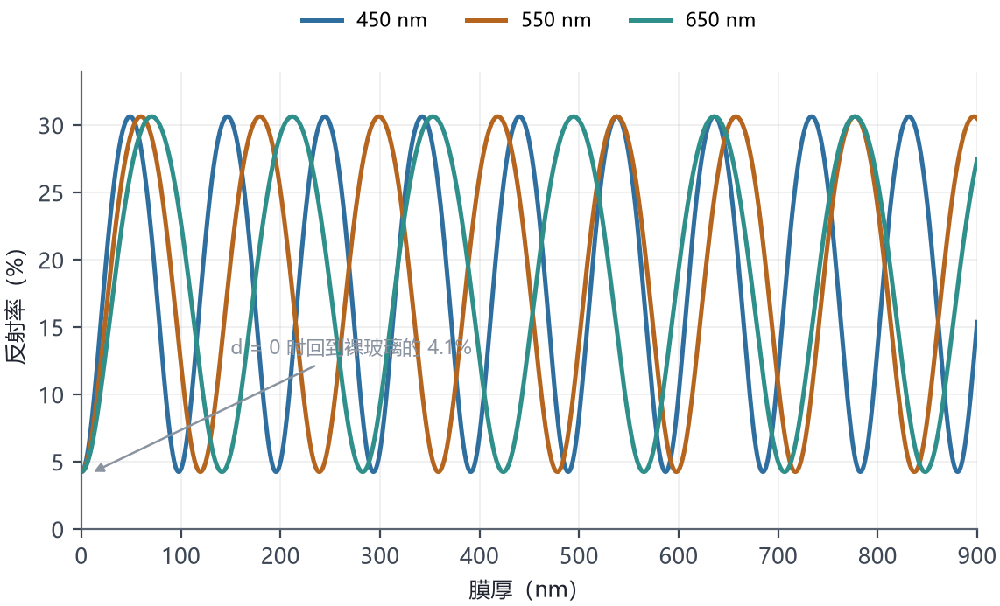
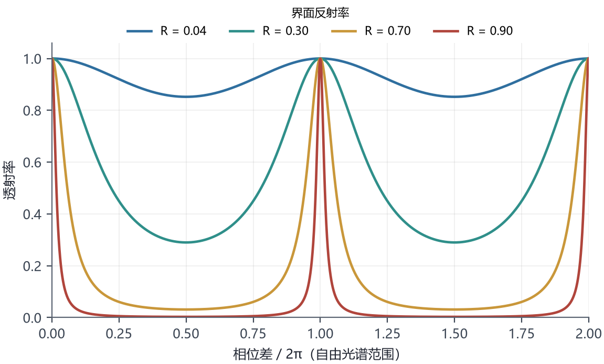
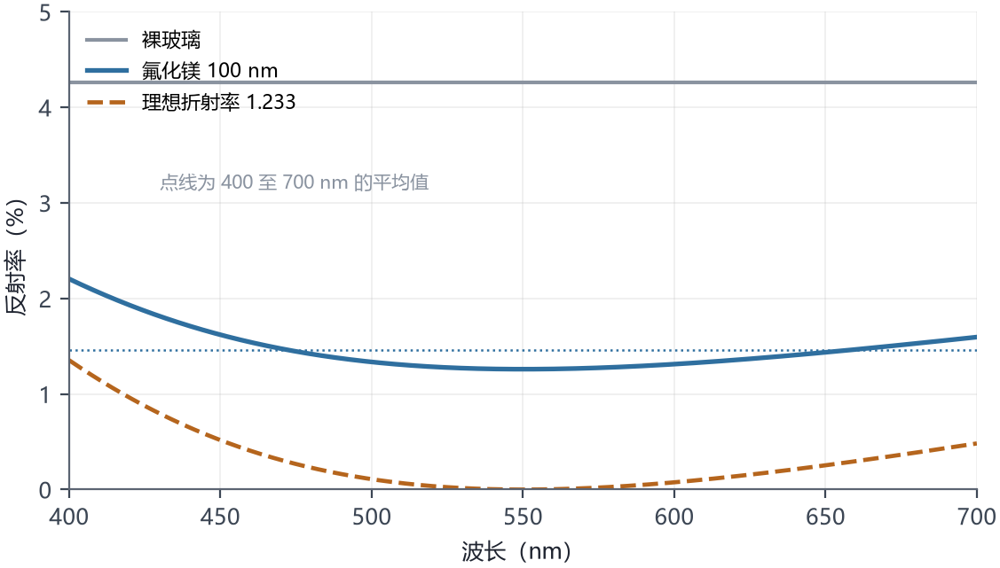

# 第 4 章 单层薄膜干涉与 Airy 公式

## 4.1 最薄的地方是黑的

肥皂膜挂在一个环上，竖直放着。顶上几分钟后变得很薄，薄到几乎看不见，颜色先褪成灰，然后彻底变黑，像一块脏斑。往下走，颜色依次是黄、品红、青、蓝，越来越密，最底下几乎看不出条纹，只剩一片浑浊的彩色。

厚度为零的地方应该是镜面最强的反射：光在两个界面上走的路程差为零，两束反射光完全同相，按第 2 章的规则应该加强到最大。可事实相反，那里是全黑的。

这个矛盾在 19 世纪初就让人困惑，Thomas Young 在 1802 年用"半波损失"解释过它：光从光疏介质射向光密介质时，反射波的相位会翻转 $\pi$。肥皂膜的两个界面，一个是从空气进膜，一个是从膜出到空气，只有前一个翻转。两束光本来就同相，加上这个额外的 $\pi$，变成反相，于是相消。

这个解释是对的，但它只是一句话。真正把它变成一个可以算的函数，需要把无数次反射都算进去，而不只是头两次。这一章就做这件事，结果叫 Airy 公式，得名于 George Biddell Airy 1838 年关于多层膜反射的论文。

## 4.2 光程差

先算几何。入射光从折射率 $n_0$ 的介质以角 $\theta_0$ 打到厚度 $d$、折射率 $n_1$ 的膜上，折射进入膜内，角度 $\theta_1$，由 Snell 定律给出

$$n_0\sin\theta_0=n_1\sin\theta_1 . \tag{4.1}$$

膜下面是折射率 $n_2$ 的基底。

一条光线在膜的上表面 $A$ 点反射，返回 $n_0$。另一条在 $A$ 点折射进入膜，走到下表面 $B$，反射后回到上表面 $C$，再从 $C$ 折射出去。两条出射光线互相平行，方向都是镜面反射方向。

第二束光在膜内多走的距离是 $AB+BC=2d/\cos\theta_1$。但从 $A$ 到第二条光线的出射垂足 $C'$ 还有一段几何差：第一束光从 $A$ 出发，第二束光相当于从 $C'$ 出发，两者在 $n_0$ 里相差 $AC\sin\theta_0$。而 $AC=2d\tan\theta_1$，所以

$$\Delta L=2n_1\frac{d}{\cos\theta_1}-2n_0 d\tan\theta_1\sin\theta_0 . \tag{4.2}$$

用 (4.1) 把 $n_0\sin\theta_0$ 换成 $n_1\sin\theta_1$：

$$\Delta L=2n_1d\left[\frac{1}{\cos\theta_1}-\frac{\sin^{2}\theta_1}{\cos\theta_1}\right]=2n_1d\cos\theta_1 . \tag{4.3}$$

这个结果很干净。垂直入射时退化成 $2n_1d$，就是光在膜里走一个来回。斜入射时多一个 $\cos\theta_1$，膜的等效厚度变薄，颜色向短波移动。这就是为什么倾斜一层膜时颜色会变蓝。

另一个有用的写法是把 $\theta_1$ 换成 $\theta_0$。由 (4.1)，$\cos\theta_1=\sqrt{1-\sin^{2}\theta_1}=\sqrt{1-(n_0/n_1)^{2}\sin^{2}\theta_0}$，于是

$$\Delta L=2d\sqrt{n_1^{2}-n_0^{2}\sin^{2}\theta_0} . \tag{4.4}$$

这个形式把膜外的量都放在题干里，做角度扫描时不用先解 Snell 定律。注意根号里的量必须为正，否则没有传播的折射波，那是全反射的情形。

对应的相位差

$$\delta=\frac{2\pi}{\lambda}\Delta L=\frac{4\pi n_1d\cos\theta_1}{\lambda} . \tag{4.5}$$

习惯上把 $\delta/2\pi$ 叫干涉级次 $m$，$m=n_1d\cos\theta_1/\lambda$。厚度为零对应零级，厚度每增加 $\lambda/(2n_1\cos\theta_1)$ 就升一级。中级次的膜（比如厚度几微米）看起来颜色混浊，因为可见光范围内同时存在好几个级次，不同波长的峰谷均匀地摊在一个周期里。

## 4.3 半波损失不是额外的损失

(4.4) 缺了 $\pi$。补它的办法有两种，一种是把 $\pi$ 硬加进相位里，另一种是从反射系数自带的符号得到，后者更清楚也更不容易出错。

第 3 章给过振幅反射系数

$$r_{ij}=\frac{n_i\cos\theta_i-n_j\cos\theta_j}{n_i\cos\theta_i+n_j\cos\theta_j} , \tag{4.6}$$

垂直入射时化简为 $(n_i-n_j)/(n_i+n_j)$。当 $n_j>n_i$ 时它是负的，意味着反射波的相位相对入射波差了 $\pi$。这个负号不是近似，也不是某种"损失"，它就在 Fresnel 公式里。

所以整层膜的反射系数是

$$r=r_{01}+t_{01}t_{10}r_{12}e^{i\delta}+t_{01}t_{10}r_{10}r_{12}^{2}e^{2i\delta}+\cdots , \tag{4.7}$$

其中 $\delta$ 由 (4.4) 给出，每一项对应光在膜里多走一个来回。半波损失已经含在 $r_{01}$ 和 $r_{12}$ 的符号里，不需要额外加。

验证一下肥皂膜。两侧都是空气，$n_0=n_2=1$，$n_1=1.33$。垂直入射，$r_{01}=(1-1.33)/2.33=-0.1416$，$r_{12}=+0.1416$。$d\to0$ 时 $\delta\to0$，(4.8) 里所有项都是同一个相位，求和之后 $r=r_{01}+r_{12}=0$。反射严格为零，这就是 4.1 节的黑斑。它不需要"半波损失"这个名字，只需要承认 $r_{01}$ 是负的。

反过来，如果膜是空气里的高折射率层，底下是玻璃（$n_0=1,n_1=1.5,n_2=1.52$），$r_{01}=-0.2$，$r_{12}=-0.0066$，两者同号，$d\to0$ 时 $r=-0.2066$，反射加强。同样是"薄到零"，一个变黑一个变亮，区别只在折射率的排列顺序。

## 4.4 Airy 公式

(4.8) 是一个等比级数。公比是 $r_{10}r_{12}e^{i\delta}$，$|r_{10}r_{12}|<1$，级数收敛，求和得

$$r=\frac{r_{01}+r_{12}e^{i\delta}}{1+r_{01}r_{12}e^{i\delta}} . \tag{4.8}$$

这一步用到 Stokes 关系 $t_{01}t_{10}=1-r_{01}^{2}$，它是能量守恒在界面上的直接推论，可以用 (4.7) 直接验证。

取模平方。分子分母同乘分母的复共轭：

$$R=\frac{r_{01}^{2}+r_{12}^{2}+2r_{01}r_{12}\cos\delta}{1+r_{01}^{2}r_{12}^{2}+2r_{01}r_{12}\cos\delta} . \tag{4.9}$$

这就是单层膜的反射率。它是 $\cos\delta$ 的函数，所以对厚度是周期为 $\lambda/(2n_1\cos\theta_1)$ 的振荡。

透射率用同样的办法。透射的振幅是

$$t=\frac{t_{01}t_{12}e^{i\delta/2}}{1+r_{01}r_{12}e^{i\delta}} , \tag{4.10}$$

其中 $e^{i\delta/2}$ 是光在膜内单程传播的相位，它不影响强度。取模平方：

$$T=\frac{t_{01}^{2}t_{12}^{2}}{1+r_{01}^{2}r_{12}^{2}+2r_{01}r_{12}\cos\delta} . \tag{4.11}$$

把 $t_{01}^{2}=1-r_{01}^{2}$ 与 $t_{12}^{2}=1-r_{12}^{2}$ 代入，逐项展开分子，与分母相减，剩下

$$R+T=1 . \tag{4.12}$$

这个恒等式在数值上可以用来检查实现。任何一层不含吸收的膜，$R+T$ 必须严格等于 1，误差只应该来自浮点。如果算出来是 0.98 或者 1.03，那一定有 bug，最常见的是漏了某个界面的 $t$ 或者把 $n_2$ 的投影因子弄错。

## 4.5 极值在哪里

(4.10) 的最大最小值出现在 $\cos\delta=\pm1$。$\delta=2m\pi$ 时

$$R_{\max}=\left(\frac{r_{01}+r_{12}}{1+r_{01}r_{12}}\right)^{2} , \tag{4.13}$$

$\delta=(2m+1)\pi$ 时

$$R_{\min}=\left(\frac{r_{01}-r_{12}}{1-r_{01}r_{12}}\right)^{2} . \tag{4.14}$$

$R_{\min}$ 可以是零，条件是 $r_{01}=r_{12}$，也就是

$$n_1^{2}=n_0n_2 , \tag{4.15}$$

这是单层膜能完全消除反射的唯一条件（垂直入射）。

$R$ 随 $d$ 的振荡在图 4-1 里。三条曲线对应三个波长，周期不同，所以同一个厚度在三个波长上的相位不同。这种"周期性 + 波长依赖"是所有薄膜颜色的来源：一个固定厚度的膜，在某个波长上处于极大，在另一个波长上处于极小，出射光就带上了颜色。

图 4-1 里三条曲线的周期分别是 98、120、141 纳米，正好是 $\lambda/(2n_1)$。厚度为零处三条曲线都落在 4.1% 附近，这与裸玻璃的 Fresnel 反射一致，也是 (4.10) 在 $d=0$ 时的值

$$R(0)=\left(\frac{n_0-n_2}{n_0+n_2}\right)^{2} . \tag{4.16}$$

一个零厚度的膜不该改变任何东西，这个自检很有用。

## 4.6 Airy 函数的锐度

(4.10) 可以改写成更常见的形式，把变量换成 $\sin^{2}(\delta/2)$、把结果写成相对最大值的比例。对两侧对称的膜（$n_0=n_2$，$r_{12}=-r_{01}$），记 $R_{f}=r_{01}^{2}$：

$$T=\frac{T_{\max}}{1+F\sin^{2}\frac{\delta}{2}},\qquad F=\frac{4R_{f}}{\left(1-R_{f}\right)^{2}} . \tag{4.17}$$

$F$ 叫精细度系数（coefficient of finesse），它决定透射峰的锐度。$R_f=0.04$（玻璃界面）时 $F=0.17$，峰非常宽，$\delta$ 从 0 变到 $\pi$ 只降了一半左右。$R_f=0.9$ 时 $F=360$，峰变成一根尖线，$\delta$ 偏离 $2m\pi$ 不到 0.1 弧度就掉到一半。

图 4-2 用了 (4.18)，横轴是 $\delta/2\pi$。峰的间隔恒为 1，这叫一个自由光谱范围。峰的宽度决定了这台标准具能分辨多细的谱线，它的分辨率正比于 $F$。这个图放在这里是提醒一件事：单层膜的公式不是一条余弦，当反射率高起来之后，它给出的是一排尖峰，用余弦去近似会完全错。

自由光谱范围换算成波长是 $\Delta\lambda_{FSR}=\lambda^{2}/(2n_1d\cos\theta_1)$。一个 10 微米的空气间隔，在 550 纳米处得到 15 纳米，比可见光窄得多，它会把可见光切成一条条窄带；一层 1 微米的膜，同样位置是 151 纳米，可见光里能装下两三个周期。这个比值也是判断一层膜看起来是不是彩色的依据：$\Delta\lambda_{FSR}$ 远大于 100 纳米时，可见光只跨过一两个周期，颜色干净；远小于 100 纳米时，多个周期叠在一起，颜色发浑。

## 4.7 两束光近似够不够用

很多渲染器只存两个数，第一界面的反射率和第二界面的反射率，然后把两束光加起来。这等价于把 (4.8) 的分母展开成级数，只留首阶：

$$\frac{1}{1+r_{01}r_{12}e^{i\delta}}\approx1-r_{01}r_{12}e^{i\delta}+\cdots , \tag{4.21}$$

得到的强度是 $r_{01}^{2}+r_{12}^{2}+2r_{01}r_{12}\cos\delta$。误差来自被丢掉的无穷多项，量级是 $|r_{01}r_{12}|^{2}$。

玻璃上的氟化镁膜，$|r_{01}r_{12}|=0.0077$，误差不到万分之一，两束光近似完全够。硅片上的氧化层，衬底反射很强，$r_{12}\approx0.55$，$|r_{01}r_{12}|\approx0.09$，误差到了百分之一量级。金属基底上盖一层膜，$r_{12}$ 接近 0.9，$|r_{01}r_{12}|$ 到 0.15，两束光近似会明显低估反射峰、高估反射谷。

判据可以定在 $|r_{01}r_{12}|<0.05$。低于这个值时只取两束，误差不超过 5%，对一张图可以接受；超过就必须算完整级数。一个廉价的实现办法是把反射率预计算成一张以厚度和波长为坐标的表，运行时双线性插值，精度和速度都能兼顾。

## 4.8 四分之一波长的减反射膜

光学里最常见的一层膜是镜头上的镀膜。目标是把玻璃表面的 4% 反射降到接近零。

由 (4.15)，$R_{\min}=0$ 需要 $r_{01}=r_{12}$，即 $n_1=\sqrt{n_0n_2}$。这个位置的相位条件是 $\delta=\pi$，也就是

$$d=\frac{\lambda}{4n_1\cos\theta_1} . \tag{4.18}$$

垂直入射时 $d=\lambda/(4n_1)$，所以叫四分之一波膜。物理图像很清楚：光在膜里走一个来回，光程是 $\lambda/2$，两束反射光差半个波长，再加上两个界面反射系数的符号关系，正好反相。

玻璃 $n_2=1.52$，理想折射率 $n_1=\sqrt{1.52}=1.233$。自然界没有这么低折射率的固体材料，最低的可用材料是氟化镁，$n=1.38$。用它做四分之一波膜，550 纳米处

$$d=\frac{550}{4\times1.38}=99.6\ \mathrm{nm} , \tag{4.19}$$

此时的反射率由 (4.15) 算出

$$R_{\min}=\left(\frac{-0.1597+0.0483}{1-0.0077}\right)^{2}=0.0126 , \tag{4.20}$$

也就是 1.26%，只有裸玻璃那 4.26% 的十分之三。剩下的这点反射是材料折射率不理想造成的，它无法靠调厚度消除。

图 4-3 暴露了单层膜的两个短板。一是带宽窄，只在 550 纳米附近有效，到 450 纳米反射已经回到 1.6%，到 700 纳米也差不多；二是斜入射会偏移，因为 (4.19) 里有个 $\cos\theta_1$，入射角增大时等效厚度变小，最低点向短波移动。镜头从正面看泛紫、从侧面看泛绿，原因就是这个偏移，不是镀膜坏了。

$s$ 偏振与 $p$ 偏振的最低点位置也不一样，因为 $\cos\theta_1$ 相同但两个偏振的 $r$ 不同。斜入射时 (4.10) 里的 $r_{01}$、$r_{12}$ 要分别用 (4.7) 的 $s$ 和 $p$ 版本，算出来两条曲线在角度上是分开的，$p$ 偏振的谷更浅。这一点在第 8 章会重新出现。

## 4.9 什么时候这一章够用

单层膜的公式适用范围比想象中宽。一层厚度均匀、两侧介质各向同性的膜，只要材料没有吸收，Airy 公式就是精确解，不是近似。它不需要孔径远大于波长，也不需要小角度，唯一的前提是界面足够平、足够平行。

真实膜偏离这个理想的地方有四处。表面粗糙，等效于膜厚在局部起伏，条纹被平均，颜色饱和度下降；界面互扩散，形成一层折射率渐变的过渡区，理想阶跃模型失效；材料有吸收，$n$ 要换成复折射率，$R+T<1$；膜层不均匀，厚度在横向变化。

后两条在实现里必须处理。吸收的处理在第 5 章的传输矩阵里自然完成，只要把 $n$ 写成复数。厚度不均匀可以用一个分布去积分 $R(d)$，或者把膜拆成多层近似。

在渲染里，单层膜的实现通常只存两个数，膜厚与折射率，剩下的每一次求值都要重算 Airy 公式。这个开销对单层膜可以接受，因为它只是几次三角函数；层数上去之后就不行了，必须换成矩阵法和查表，那是下一章的内容。

一层膜的例子讲完了，真实的结构色材料往往有十几层。下一章把 (4.9) 推广到任意层数，方法不是继续叠级数，而是换一个思路，从边界条件直接写出矩阵。
