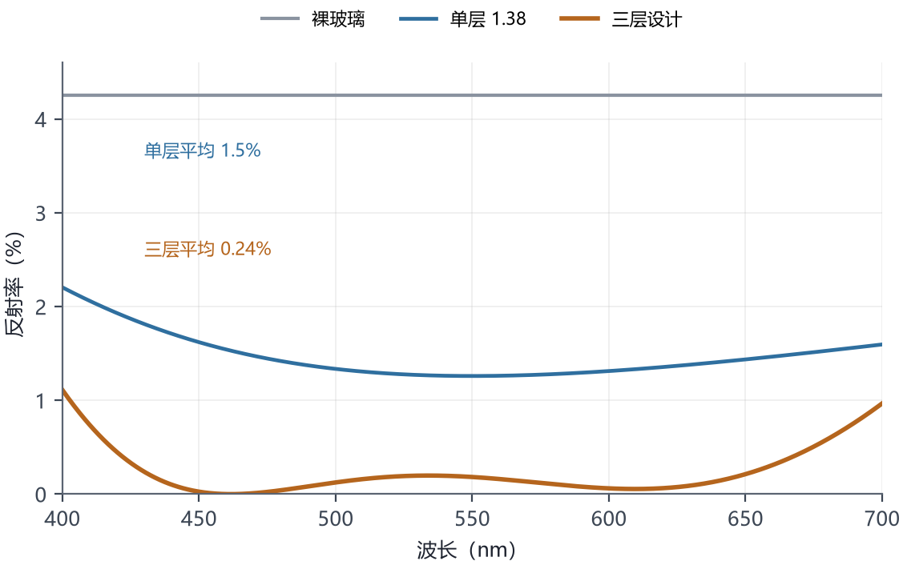
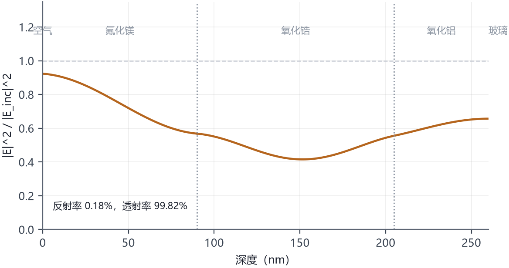
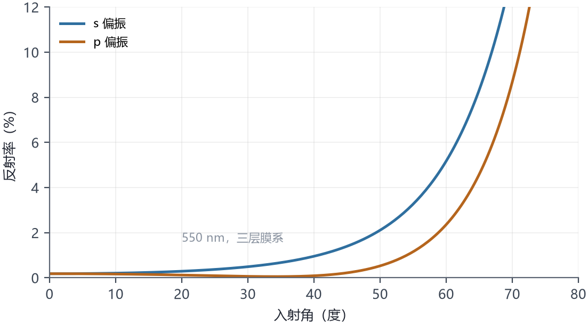

# 第 5 章 多层膜传输矩阵

## 5.1 单层膜做不到的事

第 4 章的单层减反射膜只在 550 纳米附近有效，两侧很快回到百分之一点几以上。真实的镜头要覆盖 400 到 700 纳米整个可见光，甚至加上近红外，单层膜根本不够。

工程上的办法是叠层。一台相机镜头上的镀膜是六到十二层，氟化镁、二氧化钛、氧化铝交替堆上去，总厚度一两微米。膜系设计要回答的问题是：给定一组可用材料和想要的反射谱，每一层该多厚。

这个问题不能靠继续手算级数。第 4 章把反射写成无穷级数的求和，两层就是二重求和，十层是十重求和，每一项还要记清是从哪个界面反射、在几层里走过。这个写法在数学上正确，在实现上不可用。

换一个视角。不问"有几条路径、每条多长"，只问"在每个界面两侧，电场和磁场必须连续"。这个条件对任意层数都成立，而且它是线性的，线性条件可以用矩阵表示，矩阵可以连乘。这就是特征矩阵法（characteristic matrix method），也叫传输矩阵法。它的来源是 Abeles 在 1950 年代的工作，Born 与 Wolf 的《Principles of Optics》第一章有完整推导，MacLeod 的《Thin-Film Optical Filters》把它写成了工程手册。

## 5.2 一个偏振约定

先固定约定，否则矩阵的符号会到处出错。

时间因子取 $e^{-i\omega t}$，波向 $+z$ 传播写作 $e^{ikz-i\omega t}$。

平面波斜入射到一个分层结构上，界面都是平行平面。每一层里的波可以分解成一个向下的和一个向上的平面波。取 $z$ 轴垂直界面向下，界面法线方向。在层 $j$ 内，

$$E_j(z)=a_j\,e^{i\beta_j z}+b_j\,e^{-i\beta_j z},\qquad
\beta_j=\frac{2\pi}{\lambda}n_j\cos\theta_j , \tag{5.1}$$

$a_j$ 是向下传播的振幅，$b_j$ 是向上传播的振幅，两者都相对该层顶面取相位。

磁场需要小心。对 $s$ 偏振（电场垂直入射面），$E$ 沿 $x$，$H$ 沿 $y$，由法拉第定律 $\nabla\times\mathbf{E}=-\partial\mathbf{B}/\partial t$ 得

$$H_y=\frac{1}{i\omega\mu_0}\frac{\partial E_x}{\partial z} , \tag{5.2}$$

代入 (5.1) 得到 $H_y=\frac{\beta_j}{\omega\mu_0}(a e^{i\beta z}-b e^{-i\beta z})=\frac{n_j\cos\theta_j}{Z_0}(a e^{i\beta z}-b e^{-i\beta z})$，其中 $Z_0=\sqrt{\mu_0/\varepsilon_0}$ 是真空波阻抗。

对 $p$ 偏振（电场平行入射面），磁场垂直入射面，同样的推导给出 $H=\frac{n_j/\cos\theta_j}{Z_0}(a e^{i\beta z}-b e^{-i\beta z})$。

两种偏振的差别只在一个因子。定义层 $j$ 的等效导纳

$$\eta_j=\begin{cases}n_j\cos\theta_j, & s\ \text{偏振}\\[2pt] n_j/\cos\theta_j, & p\ \text{偏振}\end{cases} \tag{5.3}$$

（这里省掉了 $1/Z_0$，它会在最后的比值里抵消）。有了它，两种偏振用同一套矩阵，只是 $\eta$ 的算法不同。

界面上的边界条件是切向 $E$ 连续、切向 $H$ 连续。对 $s$ 偏振就是 $E_x$ 和 $H_y$ 连续，对 $p$ 偏振是 $H_y$ 和 $E_x$ 连续，两者形式一样。所以下面只写一对量 $(E,H)$，它代表 (5.1) 中的 $E$ 与 (5.2) 中的 $H$。

## 5.3 一层的传输矩阵

考虑层 $j$，顶面 $z=0$，底面 $z=d_j$。用顶面的 $(E_0,H_0)$ 表示底面的 $(E_d,H_d)$。

由 (5.1) 和导纳定义，在 $z=0$ 处

$$E_0=a+b,\qquad H_0=\eta(a-b) . \tag{5.4}$$

反解出两个行波振幅：

$$a=\frac{1}{2}\left(E_0+\frac{H_0}{\eta}\right),\qquad
b=\frac{1}{2}\left(E_0-\frac{H_0}{\eta}\right). \tag{5.5}$$

在 $z=d_j$ 处，记 $\varphi_j=\beta_j d_j$：

$$E_d=a e^{i\varphi}+b e^{-i\varphi},\qquad
H_d=\eta\left(a e^{i\varphi}-b e^{-i\varphi}\right). \tag{5.6}$$

把 (5.5) 代入：

$$E_d=\frac{1}{2}\left(E_0+\frac{H_0}{\eta}\right)e^{i\varphi}
+\frac{1}{2}\left(E_0-\frac{H_0}{\eta}\right)e^{-i\varphi}
=E_0\cos\varphi+i\frac{H_0}{\eta}\sin\varphi , \tag{5.7}$$

$$H_d=\frac{\eta}{2}\left(E_0+\frac{H_0}{\eta}\right)e^{i\varphi}
-\frac{\eta}{2}\left(E_0-\frac{H_0}{\eta}\right)e^{-i\varphi}
=i\eta E_0\sin\varphi+H_0\cos\varphi . \tag{5.8}$$

两式写成矩阵，得到"用顶层场表示底层场"的关系：

$$\begin{bmatrix}E_d\ H_d\end{bmatrix}=M_j
\begin{bmatrix}E_0\ H_0\end{bmatrix},\qquad
M_j=\begin{bmatrix}\cos\varphi_j & \dfrac{i}{\eta_j}\sin\varphi_j\[6pt]
i\eta_j\sin\varphi_j & \cos\varphi_j\end{bmatrix}. \tag{5.9}$$

矩阵的行列式是 $\cos^{2}\varphi+\sin^{2}\varphi=1$，所以它的逆存在，而且极容易写：把 $i$ 换成 $-i$。

$$M_j^{-1}=\begin{bmatrix}\cos\varphi_j & -\dfrac{i}{\eta_j}\sin\varphi_j\[6pt]
-i\eta_j\sin\varphi_j & \cos\varphi_j\end{bmatrix}. \tag{5.10}$$

这个矩阵有两个极限值得看。$\varphi\to0$（厚度为零）时它退化成单位矩阵，符合直觉。$\varphi=\pi/2$（四分之一波）时它变成纯虚的非对角矩阵，$E$ 与 $H$ 两个分量互换，这就是四分之一波膜能把一层的高导纳"变换"成低导纳的原因。

## 5.4 整个膜系的导纳

设膜系有 $N$ 层，从上到下编号 1 到 $N$，下面是折射率 $n_s$ 的基底，上面是折射率 $n_0$ 的入射介质。

基底里没有向上的波（假设它足够厚），所以基底的场由单个向下传播的波描述：

$$E_s=E,\qquad H_s=\eta_sE . \tag{5.11}$$

界面两侧的 $(E,H)$ 连续，而 (5.9) 是从上往下写的，所以从基底往上走要用逆矩阵，逐层乘回去：

$$\begin{bmatrix}E_0\ H_0\end{bmatrix}=M_1^{-1}M_2^{-1}\cdots M_N^{-1}
\begin{bmatrix}1\ \eta_s\end{bmatrix}E . \tag{5.12}$$

记

$$\begin{bmatrix}B\ C\end{bmatrix}=M_1^{-1}M_2^{-1}\cdots M_N^{-1}
\begin{bmatrix}1\ \eta_s\end{bmatrix}, \tag{5.13}$$

则 $E_0=B E$，$H_0=C E$。比值 $Y=C/B$ 叫膜系的输入导纳（admittance），它把整个 $N$ 层结构压缩成一个等效界面。

反射系数就是单界面的公式，只是把基底的导纳换成输入导纳：

$$r=\frac{\eta_0-Y}{\eta_0+Y}=\frac{\eta_0B-C}{\eta_0B+C} , \tag{5.14}$$

$$R=\left|r\right|^{2} . \tag{5.15}$$

透射系数由顶面的场与入射场的关系给出。入射振幅取 1，反射振幅 $r$，顶面的 $E_0=1+r$，而 $E_0=BE$，所以

$$t=\frac{E}{1}=\frac{1+r}{B}=\frac{2\eta_0}{\eta_0B+C} , \tag{5.16}$$

透射率

$$T=\frac{\mathrm{Re}(\eta_s)}{\mathrm{Re}(\eta_0)}\left|t\right|^{2}
=\frac{4\,\mathrm{Re}(\eta_0)\mathrm{Re}(\eta_s)}{\left|\eta_0B+C\right|^{2}} . \tag{5.17}$$

对无吸收的膜系，$R+T=1$ 仍然成立，可以用来做数值自检。有吸收时 $R+T<1$，差值就是被吸收的能量。

(5.12) 是这一章的全部内容。它把一个"有无穷多条路径"的问题变成了 $N$ 次 2×2 矩阵乘法，计算量是 $O(N)$，对任何层数都稳定。

实现完了先做三个自检。第一，$R+T$ 对无吸收膜系必须等于 1，误差在 $10^{-12}$ 量级。第二，把 $n_0$ 与 $n_s$ 对调、把所有膜层倒序，算出的 $R$ 必须相同，这是互易性。第三，把某一层的导纳换成与相邻层相同，结果应该与少一层完全一致，因为厚度对该层变得无效。三个检查各自针向一类错：能量算错、边界条件用反、矩阵乘序反了。

## 5.5 三层减反射膜

用一个具体的例子把流程走完。

基底是 $n_s=1.52$ 的玻璃，入射介质是空气，目标是在 400 到 700 纳米上把反射压到 1% 以下。可用材料三种：氟化镁 $n=1.38$，氧化锆 $n=2.05$，氧化铝 $n=1.70$。

层数定三层，顺序取低–高–低，$1.38/2.05/1.70$。厚度是三个待定的数，先给一个起点，把每层都取成四分之一波，中心波长 550 纳米：

$$d_1=\frac{550}{4\times1.38}=99.6\ \mathrm{nm},\quad
d_2=\frac{550}{4\times2.05}=67.1\ \mathrm{nm},\quad
d_3=\frac{550}{4\times1.70}=80.9\ \mathrm{nm}. \tag{5.18}$$

用 (5.14) 算出来，这组厚度的反射率在 550 纳米处只有 0.55%，但两端翘得很高：400 纳米 8.1%，700 纳米 2.9%，400 到 700 的平均是 2.1%，比单层膜的 1.5% 还差。四分之一波堆是窄带的，把它当成宽带方案直接搬过来会得到更糟的结果。

宽带设计需要让三层的相位在可见光范围内错开，而不是在同一个波长上同时满足条件。做法是扫厚度。三层三个参数，网格扫描的代价很小，每算一个组合只是一次 2×2 连乘。

扫出来的一个好设计是 90、115、55 纳米。用 (5.14) 算它的谱：400 纳米 1.1%，450 纳米 0.03%，550 纳米 0.18%，650 纳米 0.21%，700 纳米 0.97%，400 到 700 的平均 0.24%。



图 5-1 把三条曲线放在一起。单层膜的谷很窄，两侧陡升；三层膜系的谷宽而平，四个极值点在 400 到 700 之间被压成了一片。这个形状不是靠某一层的四分之一波条件，而是三层相位互相补偿的结果：某一层在短波处偏离条件时，另一层刚好补上。

代价也有。三层膜的最低点（0.03%）比单层的 1.26% 低得多，但它对厚度误差更敏感，因为补偿关系是靠精确的相位搭起来的。工艺上三层膜的厚度公差通常要求 1% 到 2%，单层膜可以放宽到 5%。

## 5.6 膜内的场

矩阵法不只给出反射率。把 (5.12) 乘回去，可以复原每一层里的行波振幅，进而得到膜内任意深度的场强。

从基底向上，逐层用 (5.5) 的反变换：已知某层底面的 $(E_d,H_d)$，先用 (5.10) 的逆矩阵反解顶面的 $(E_0,H_0)$，再由 (5.5) 得到 $a$、$b$。有了 $a$、$b$，层内任意位置的场就是 (5.1)。



图 5-2 画的是 550 纳米垂直入射时的 $|E|^{2}$。表面处 0.92，进入第一层后单调下降，在第一层底降到 0.57；第二层（氧化锆）里继续降到 0.41，在层的中部取到最小值；第三层回升，到出射面是 0.55，进入玻璃后稳定在 0.65。

没有出现深的节点，这正是反射被压掉的标志。一层高反膜会在表面附近形成强驻波，场强峰值比入射场高好几倍；而这个减反射膜系的场是从入射侧的 1 平滑地过渡到出射侧的 0.65，中间的最低点是 0.41，全段的场强都不超过入射场。能量几乎全部穿过，所以哪里有吸收，哪里就整层均匀发热，而不是某个界面附近烧穿。

这张图在工程上有两个用处。一是找吸收集中的位置：如果某一层有微弱吸收，能量损耗正比于该层的 $|E|^{2}$ 积分，场强最大的地方发热最多，这就是激光镜损伤阈值的来源。二是判断工艺误差的敏感度：场强梯度大的位置，厚度误差的影响也大。



图 5-3 给了 550 纳米处的两条曲线。s 偏振从 0.18% 单调上升，20 度时 0.2%，60 度时 5.5%，70 度时 12%；p 偏振先降后升，在 25 度附近几乎为零，这是单层膜的布儒斯特角在三层结构里的残留，之后重新上升，但整段都低于 s 偏振。

这个差别在渲染里有实际后果。同一个镀膜表面，从正面看反射 0.2%，从掠射角看反射到百分之十几，三十倍的变化；两个偏振的比例也随之改变。标量渲染器把两者平均，在中等角度上误差不大，在 60 度以外会把掠射反射算低一半以上，边缘的亮度就错了。

## 5.7 吸收与金属

把 $n_j$ 换成复折射率 $\tilde n_j=n_j+ik_j$，整套矩阵不用改一个字。$\beta_j$ 变成复数，$\cos\theta_j$ 由复数的 Snell 定律给出：

$$\sin\theta_j=\frac{n_0\sin\theta_0}{\tilde n_j},\qquad
\cos\theta_j=\sqrt{1-\sin^{2}\theta_j} , \tag{5.19}$$

开方要取虚部为正的分支，保证波沿 $+z$ 方向衰减。

$\eta_j$ 也就成了复数。$B$、$C$ 都复，$Y=C/B$ 复，$R=|r|^{2}$ 照旧算。$T$ 用 (5.17) 时取导纳的实部，这是能流密度的正确写法。

金属膜的一个特征是相位变化快。铝在 550 纳米处 $\tilde n=0.96+6.7i$，$|\tilde n|$ 大，$\beta$ 大，几十纳米厚就积累了可观的相位，同时衰减也快，穿透深度只有十几纳米。半透明的金属膜（比如 10 纳米厚的银）既能反射又能透射，颜色偏中性，这类膜在有吸收的传输矩阵里能算得很准，用几何光学的 Fresnel 公式则完全算不了，因为它忽略了膜内的多次反射与相位。

## 5.8 实现

下面是完整的多层膜求解器，只依赖 NumPy。

```python
import numpy as np

def eta(n, theta):
    """s 偏振导纳；p 偏振把 cos 改成 1/cos。"""
    return n * np.cos(theta)

def multilayer(lam, n_list, d_list, n_sub, n0=1.0,
               theta0=0.0, pol="s"):
    """lam 与 d 用同一单位（建议 nm）。返回 R, T。"""
    st = n0 * np.sin(theta0)
    th = [np.emath.arcsin(st / n) for n in n_list]
    th_s = np.emath.arcsin(st / n_sub)

    def adm(n, t):
        c = np.cos(t)
        return n * c if pol == "s" else n / c

    M = np.eye(2, dtype=complex)
    for n, d, t in zip(n_list, d_list, th):
        e = adm(n, t)
        phi = 2 * np.pi * n * d * np.cos(t) / lam
        # 逆矩阵：从基底往上乘，负号不能丢
        M = M @ np.array([[np.cos(phi), -1j * np.sin(phi) / e],
                          [-1j * e * np.sin(phi), np.cos(phi)]])

    e0 = adm(n0, theta0)
    es = adm(n_sub, th_s)
    B, C = M @ np.array([1.0, es])
    r = (e0 * B - C) / (e0 * B + C)
    T = 4 * np.real(e0) * np.real(es) / abs(e0 * B + C) ** 2
    return abs(r) ** 2, T
```

几个容易踩的坑。

用 `np.emath.arcsin` 而不是 `np.arcsin`，后者对超出 $[-1,1]$ 的实数输入返回 NaN，而全反射和吸收层都会越界。

厚度与波长用同一单位。混用纳米和米会得到看起来"很平滑"的谱，因为相位被压成了零，这种错误很难从图上发现。

四分之一波条件在斜入射时要除以 $\cos\theta_j$，不是 $\cos\theta_0$。

层数很多（比如 100 层）时，直接连乘会因为 $\cos\varphi$ 与 $\sin\varphi$ 的振荡累积误差。工程上的做法是把每层的 $\varphi$ 对 $2\pi$ 取模后再算，或者用导纳递推的形式（把每层的作用表示成一次分式线性变换），数值上更稳。

性能上，一次 10 层膜的计算大约是两百次复数乘加，单看很便宜；但一张 1080p 的图有 200 万像素，每个像素平均两次着色，再乘 32 个采样波长，总数到了 $10^{11}$ 量级。所以在实现里通常不会逐像素重算，而是把反射率预积分成一张以厚度、入射角、波长为坐标的查找表，运行时双线性或三线性插值。查表的误差可以用加密网格的办法直接量化，不需要额外推导。

## 5.9 什么时候可以退回几何光学

多层膜的计算量随层数线性增长，但真正的开销在于它对每个波长、每个角度都要重算一次。渲染器要判断哪些表面可以退回几何光学。

判据和第 1 章一致：相位是否稳定。如果膜厚的横向起伏 $\sigma_d$ 使得 $4\pi n\sigma_d/\lambda>\pi/2$，也就是 $\sigma_d>\lambda/(8n)$，不同位置的干涉条纹互相错开，宏观上看到的是平均效果。对 550 纳米、$n=1.5$ 的膜，这个阈值是 46 纳米。

超过阈值的表面，用几何光学的 Fresnel 反射加一个平均颜色就够了，因为再精细地算也没有可分辨的结构。低于阈值，尤其是结构色的场合（鳞片、薄膜干涉颜料），必须逐波长算矩阵。

---

这一章把单层膜的级数求和换成了矩阵连乘。矩阵的每一层只由两个量决定，相位 $\varphi$ 和导纳 $\eta$，界面连续性保证它们可以相乘，基底无反射波这一条给出边界条件，剩下的就是解一个 2×2 线性方程组。

这套方法能处理任意层数、任意角度、任意复折射率，是薄膜光学的标准工具。下一章换一个方向，结构不是沿深度堆叠，而是沿表面周期排列。那时矩阵法不再适用，需要用衍射的语言。
