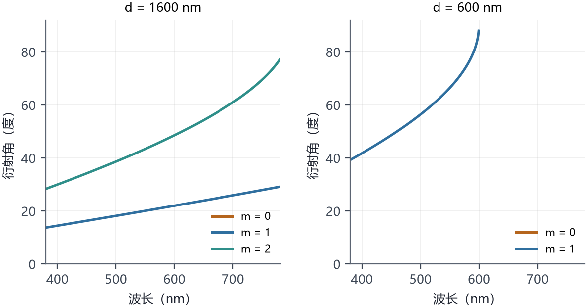
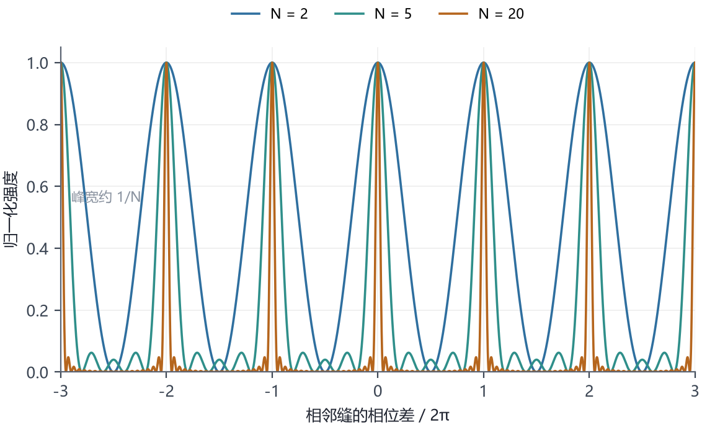
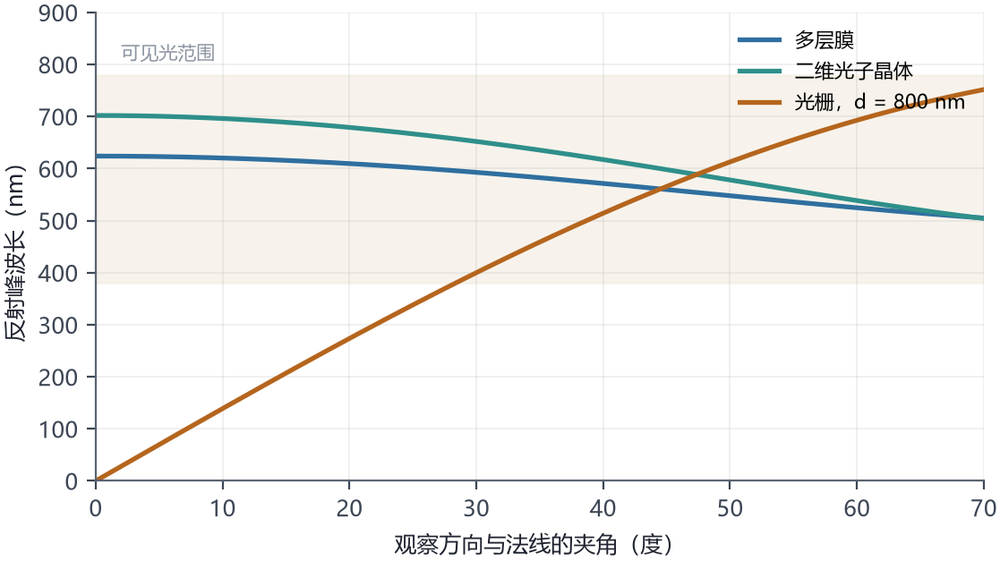

# 第 6 章 衍射光栅与结构色

## 6.1 一张光盘的背面

把一张光盘翻过来，让灯照在数据面上。整个面是一条扇形的彩虹，红色在外，紫色在内，从盘心向外扫开。你把盘转一个角度，彩虹跟着转，位置几乎不变；你把头偏一下，颜色却大幅移动，从红一下跳到蓝。

前四章的结构都是沿深度堆叠的，光在同一个横向位置上被多次反射。光盘不是这样，它的结构沿表面周期性排列：一圈圈间距 1.6 微米的螺旋轨道，轨道之间是平的镜面，轨道本身是凹坑。光打上去，相邻轨道反射的光有一个由轨道间距决定的相位差，这个相位差随观察方向变化，于是不同波长在不同的方向上同相。

这个机制叫衍射，比薄膜多了一个横向维度。本章先把光栅方程推出来，再把它和另外两种结构色机制放在一起比较，最后讨论渲染器怎么处理它。

## 6.2 光栅方程

设表面上有周期为 $d$ 的沟槽，光线以角 $\theta_i$ 入射，向 $\theta_m$ 方向衍射。两个角度都相对表面法线，且取同一侧的符号约定：入射与衍射在法线两侧时符号相反。

取相邻两个沟槽上对应的两点 $A$、$A'$，间距 $d$。入射光到达 $A'$ 比到达 $A$ 少走 $d\sin\theta_i$；衍射光从 $A'$ 出发到达远处观察点，比从 $A$ 出发多走 $d\sin\theta_m$。两条路径的总差是

$$\Delta L=d\left(\sin\theta_i+\sin\theta_m\right) . \tag{6.1}$$

要产生主极大，这个差必须是波长的整数倍：

$$d\left(\sin\theta_i+\sin\theta_m\right)=m\lambda,\qquad m=0,\pm1,\pm2,\dots \tag{6.2}$$

这就是光栅方程。$m$ 叫衍射级次。

这个式子的结构值得看清。$m=0$ 时 $\sin\theta_m=-\sin\theta_i$，也就是镜面反射方向，与波长无关，所以零级是白色的。$m\neq0$ 时，同一个级次在不同波长上的衍射角不同，这就是色散的来源：一束白光进去，出来是一排按波长排开的光束。

光盘的 $d=1.6$ 微米，垂直入射时第一级满足

$$\sin\theta_1=\frac{\lambda}{d} . \tag{6.3}$$

$\lambda=400$ 纳米给出 14.5 度，$\lambda=700$ 纳米给出 26 度。两者之间就是那条彩虹，张角十一度。第二级在 $\sin\theta_2=2\lambda/d$，700 纳米时已经超出 1，只有短波能出现，所以第二级彩虹只有紫蓝色的一小段。这就是为什么光盘上的彩虹是"红在外紫在内"的一条，而不是均匀铺开的一片。

图 6-1 把两种间距画在一起。1600 纳米的光栅在可见光范围内能给出三个级次，级次之间分得很开；600 纳米的光栅只剩第一级落在可观测范围内，角度从 39 度一路冲到 90 度，几乎贴着表面，第二级在可见光里根本没有解。间距越小，色散越大，这是光栅器件设计的基本权衡。

## 6.3 N 条缝的叠加

光栅方程只告诉主极大在哪里，没告诉峰有多宽、有多亮。这两个量由缝数决定。

设光栅有 $N$ 条等间距的缝，每条缝的衍射振幅相同（忽略单缝衍射包络），相邻缝之间的相位差是

$$\delta=\frac{2\pi}{\lambda}d\left(\sin\theta_i+\sin\theta_m\right) . \tag{6.4}$$

总振幅是等比级数求和：

$$U=U_0\sum_{n=0}^{N-1}e^{in\delta}=U_0\frac{1-e^{iN\delta}}{1-e^{i\delta}}
=U_0\,e^{i(N-1)\delta/2}\frac{\sin(N\delta/2)}{\sin(\delta/2)} . \tag{6.5}$$

前面的相位因子不影响强度，取模平方：

$$I=I_0\left[\frac{\sin(N\delta/2)}{\sin(\delta/2)}\right]^{2} . \tag{6.6}$$

这个函数在 $\delta=2m\pi$ 处取极大，极大值是 $N^{2}I_0$，正好对应光栅方程。在两个极大之间，分子分母都比零大但分子振荡得快，于是出现 $N-1$ 个次极大和 $N-2$ 个零点。

零点出现在 $N\delta/2=k\pi$ 而 $\delta/2\neq m\pi$，也就是

$$\delta=2\pi\frac{k}{N},\qquad k\ \text{不是}\ N\ \text{的整数倍}. \tag{6.7}$$

第一个零点离主极大的距离是 $\delta=2\pi/N$。换算成角度：

$$\Delta\theta\approx\frac{\lambda}{Nd\cos\theta_m} . \tag{6.8}$$

缝数越多，峰越窄。这个窄度带来分辨本领。两个波长差 $\Delta\lambda$ 的峰刚好分开（一个的极大落在另一个的第一个零点上）时，

$$\frac{\lambda}{\Delta\lambda}=mN . \tag{6.9}$$

一块 1 厘米宽、间距 1.6 微米的光栅有 6250 条缝，第一级的分辨本领是 6250，在 550 纳米处能分辨 0.09 纳米。这就是光谱仪用光栅而不用棱镜的原因。

图 6-2 里三条曲线的主极大都在整数位置，高度归一化后相同。$N=2$ 时是两个宽峰之间的平滑过渡；$N=20$ 时峰窄得像一根针，两侧各有一串逐渐衰减的次极大。彩虹的"纯度"由这个峰宽决定：峰越窄，同一个方向上混进来的波长越少，颜色越饱和。

## 6.4 三种结构色机制

到这里可以把结构色分成三类。它们的共同点是"颜色来自几何而不是色素"，区别在于周期性的方向数。

**多层膜。** 周期沿深度方向，横向是均匀的。反射峰的位置由 Bragg 条件给出，第 4、5 章的公式直接适用。周期 100 到 200 纳米，层数 8 到 20。角度依赖中等，倾角增大时峰向短波移动，移动量正比于 $\cos\theta$。

**光子晶体。** 周期在三个方向上都有（三维光子晶体），或者在两个方向上有（二维，比如孔雀羽毛的黑色素棒阵列）。周期 150 到 400 纳米，需要足够大的折射率对比才能打开完全带隙。三维结构的颜色对角度极其敏感，因为三个方向的周期性同时参与。

**衍射光栅。** 周期只在一个方向上，表面起伏。周期 300 纳米到 2 微米，衍射角由 (6.2) 给出，色散很强。颜色随观察角的变化是三者中最剧烈的，因为角度直接进入光栅方程而不是通过 $\cos$ 缓变。

蝴蝶翅膀是一个把前两种混在一起的例子。Morpho 的蓝色来自翅膀鳞片上的脊状结构，每根脊上叠着十几层片层，片层之间是空气，周期约 200 纳米（Vukusic 与 Sambles 2003 年综述了这类结构）。这本质上是一个多层膜，但因为片层只在脊上、脊之间有空隙，光在横向也会被调制，于是反射带比纯多层膜更宽、角度容忍度更大。孔雀羽毛更接近二维光子晶体，黑色素棒埋在角蛋白里，周期约 140 纳米，两个横向方向周期性排列（Zi 等 2003 年在 PNAS 上给出了这个结构）。

图 6-3 的差别很大。多层膜从 0 度到 60 度，峰只从 624 纳米移到 524 纳米，掉了 100 纳米；800 纳米周期的光栅在同一个角度范围里，从 0 纳米一路扫到 693 纳米，正对时根本没有可见光，到了 30 度才出现 400 纳米的紫，再到 70 度变成 750 纳米的红。这就是为什么薄膜干涉的颜色"动一动才变"，而光盘的彩虹"一动就换色"。

## 6.5 Bragg 条件与角度

多层膜的峰位有一个简单公式，值得单独写出来，因为它是判断结构色的第一把尺子。

一束光以角 $\theta$ 入射到周期为 $D$、平均折射率为 $n_{\mathrm{eff}}$ 的层状结构上，相邻周期的光程差是 $2n_{\mathrm{eff}}D\cos\theta'$，其中 $\theta'$ 是结构内部的角度。要产生相长干涉，这个差等于 $\lambda$：

$$\lambda=2D\sqrt{n_{\mathrm{eff}}^{2}-\sin^{2}\theta} . \tag{6.10}$$

这一步用了 Snell 定律把 $\cos\theta'$ 换算成外部角度。这个式子叫 Bragg–Snell 公式，它同时说明了两件事：垂直入射时峰在 $2n_{\mathrm{eff}}D$；角度增大时 $\sqrt{n_{\mathrm{eff}}^{2}-\sin^{2}\theta}$ 单调下降，峰向短波移动。

拿一个具体数字检验一下。Morpho 蝴蝶的片层周期约 195 纳米，片层材料是几丁质，折射率 1.56，空隙里是空气，取平均折射率 1.2，垂直入射时 (6.10) 给出 468 纳米，正落在蓝色区。倾斜到 60 度，根号里的量从 1.44 降到 0.69，峰移到 324 纳米，已经在紫外，可见光里只剩下反射带的尾巴。这就是为什么这种蝴蝶从正上方看是亮的钴蓝，从很斜的角度看变成深紫再变黑，而不是简单地变成另一种颜色。

反解出角度依赖：

$$\frac{d\lambda}{d\theta}=-\frac{D\sin\theta\cos\theta}{\sqrt{n_{\mathrm{eff}}^{2}-\sin^{2}\theta}} . \tag{6.11}$$

在 0 度附近导数为零，所以正对着看时颜色对角度不敏感，这就是为什么结构色材料在正面看时颜色最纯。到了 45 度以上，导数迅速变大。

对光栅，峰位随角度是

$$\lambda=\frac{d\left(\sin\theta_i+\sin\theta_m\right)}{m} , \tag{6.12}$$

对 $\sin\theta_m$ 是线性的，没有 $\cos$ 的缓冲，所以变化快得多。

## 6.6 把光栅做成 BSDF

渲染器要画一块光盘或者一片蝴蝶翅膀，得把上面的内容写成一个 BSDF。光栅的 BSDF 与普通 BRDF 有三点不同。

散射方向是离散的。能量只出现在满足 (6.2) 的几个方向上，中间没有分布。所以 BSDF 是一组 delta 函数，每个级次一个，位置由光栅方程给出，权重由衍射效率给出。

每个级次的效率依赖波长、偏振和入射角。这个效率不能用标量理论算准，因为它取决于沟槽的具体形状（闪耀角、槽深、占空比）。严格做法是严格耦合波分析（rigorous coupled-wave analysis，RCWA），由 Moharam 与 Gaylord 在 1981 年提出，把光栅分成很多薄层，每层内做傅里叶展开，再匹配边界条件。工程上更常见的是查表：把效率预计算成一张以波长、角度为坐标的表。

能量必须守恒。所有级次的效率加上吸收必须等于 1：

$$\sum_m \eta_m(\lambda,\theta_i)+A(\lambda,\theta_i)=1 . \tag{6.13}$$

无吸收的光栅，反射级次效率之和等于 1。实现时如果直接抄一组效率数据而没有归一化，很容易在掠射角出现总能量大于 1，图像就会在边缘过曝。

光栅满足一个互易关系：把入射方向与某个级次的出射方向对调，能量走的是 $-m$ 级，两级的效率相等。这个关系可以直接拿来检查实现，如果对调之后效率对不上，多半是角度符号或者级次索引弄错了。

采样要按级次而不是按方向。给定入射方向，级次方向是确定的，不需要在半球上随机采样。实现上可以把每个级次当成一个"镜面一样的"出口：按概率选一个级次（概率等于该级次的效率），然后把光线送向那个方向，pdf 就是这个概率。这样方差很小，因为每个样本都落在有能量的方向上。

## 6.7 什么时候几何光学还成立

光栅的判断比薄膜简单。看 $d/\lambda$。

$d>10\lambda$ 时，第一级的衍射角小于 6 度，能量集中在零级附近，光栅的作用相当于一个带微弱边带的镜面。用几何光学的镜面反射加一个模糊项，误差可以接受。

$d$ 在 $1\lambda$ 到 $10\lambda$ 之间，衍射角从 6 度到 90 度，能量分散到几个级次上，必须用光栅模型。这是结构色的主战场。

$d<0.5\lambda$ 时，除了零级没有传播的级次，光栅退化成一层等效介质，这时它不再产生颜色，而是改变偏振和相位，属于超表面的范畴，需要矢量方法。

这三个区间与图 1-3 的分区一致，只是把"横向尺寸"具体化成了光栅周期。

---

这一章把结构从一个维度扩展到了两个。光栅方程给出方向，N 缝公式给出峰宽，Bragg–Snell 给出层状结构的角度依赖，三者合起来能解释大部分结构色的现象。

剩下一个没处理的情形是微表面与衍射同时起作用。一个粗糙的金属表面，微观起伏的横向尺寸与波长同量级，纵向起伏也在几十纳米，这时既不是纯镜面，也不是纯光栅。下一章处理它。
