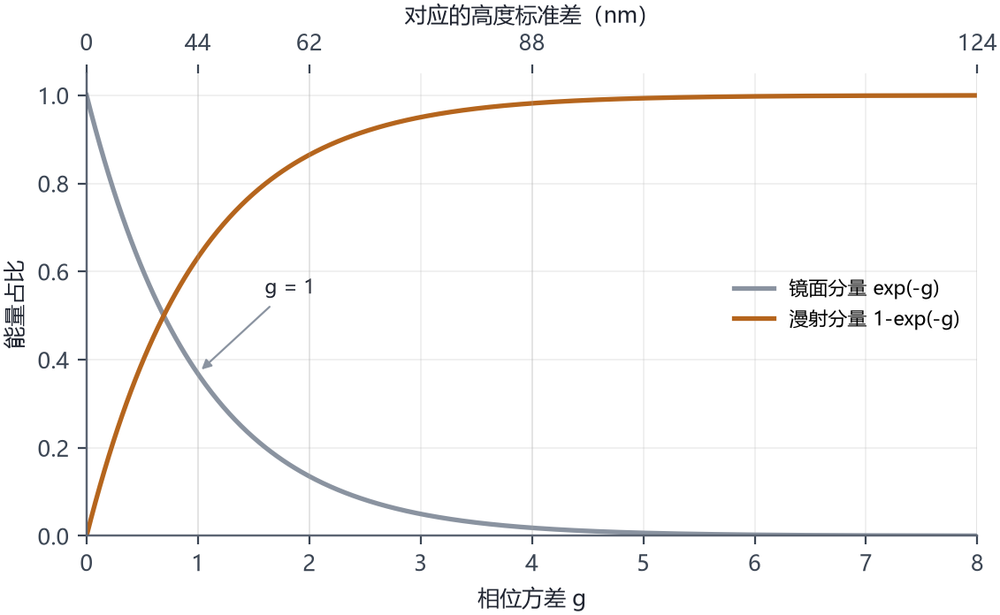
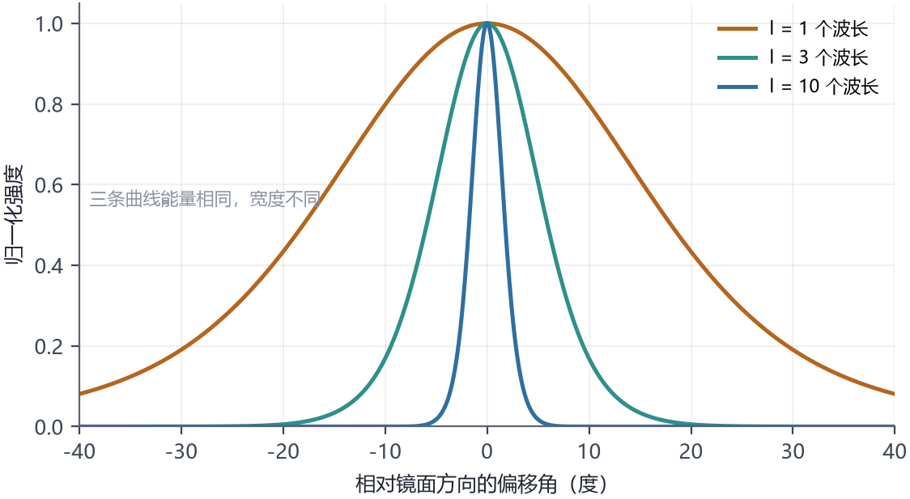

# 第 7 章 微表面与衍射的结合

## 7.1 一条不该出现的彩边

找一个拉丝不锈钢的水龙头，用一只白光 LED 从侧面照它，把眼睛放到接近掠射的位置。高光带的边缘不是干净的亮暗过渡，那里有一条很窄的彩色条纹，靠外偏蓝，靠内偏红。换个角度，彩条的位置动一点，颜色顺序不变。

微表面模型给不出这条彩边。它把表面看成一堆小平面镜，每个微面按 Fresnel 反射，反射方向由微面法线决定，整个高光是这些镜面反射的加权平均。这个图像里所有波长走同一条几何路径，反射率只随波长缓慢变化（材料色散），不可能出现"靠外偏蓝、靠内偏红"这种按角度分开的色序。

彩边的来源和第 6 章一样：衍射。微面的尺寸不是无限小，当它到波长的量级时，每个微面本身就是一个小孔径，把光按 $\lambda/a$ 的角宽散开。不同的波长散开的宽度不同，于是高光边缘出现色散。

这一章要处理的就是这个交界处：表面既有宏观的倾斜分布（微表面），又有与波长可比的微观结构（衍射）。这里没有精确的解析解，只有几个层次的近似，每个近似都有自己的适用区间。

## 7.2 两个尺度的分离

描述一个粗糙表面，最少需要两个数：高度的标准差 $\sigma_h$，和横向的相关长度 $l$（高度在多大距离上失去相关性）。

这两个数把问题分成四种情形。

$l\gg\lambda$、$\sigma_h\ll\lambda$：表面几乎是平的，微小的起伏只让反射稍微展宽。几何光学加一个小的模糊就够了。

$l\gg\lambda$、$\sigma_h\gg\lambda$：经典的微表面情形。每个微面都远大于波长，可以当成平面镜，反射方向由法线决定，遮蔽与阴影由几何决定。这就是入门篇第 4 到 6 章的模型。

$l\sim\lambda$、$\sigma_h\sim\lambda$：两个尺度都与波长可比，几何和衍射同时起作用。这一章的主题。

$l\ll\lambda$：结构比波长还小，不能用"表面"描述，需要有效介质或严格的矢量方法。第 1 章的图 1-3 把这一块标成了"亚波长"。

真实的表面常常横跨几个区间。拉丝金属在拉丝方向上的相关长度是毫米级，垂直方向上是微米级，而拉丝留下的细微划痕只有几十纳米宽。这就是为什么它的高光在一个方向上是长条，在另一个方向上带彩边。

这两个量在渲染里通常不是直接给定的。美术面板上只有一个粗糙度，它对应的是斜率的标准差，而对高斯高度场，斜率标准差约等于 $\sqrt{2}\,\sigma_h/l$；GGX 的 $lpha$ 大致就是这个数。反推出 $\sigma_h$ 和 $l$ 需要额外假设两者的比，常见做法是固定 $l$（比如取 1 微米），由 $lpha$ 解出 $\sigma_h$。这个假设没有物理依据，但在没有测量数据时是唯一的选择，代价是同一个 $lpha$ 下衍射瓣的宽度会被固定住。

## 7.3 相位屏

先做一个简化：把表面看成一面有起伏的镜子，忽略多次散射和遮蔽，只保留相位的影响。这个模型叫相位屏（phase screen），在自适应光学和粗糙面散射里都用它。

入射光在表面上一点的高度是 $h(\mathbf{r})$，反射后相位多出

$$\varphi(\mathbf{r})=\frac{4\pi}{\lambda}h(\mathbf{r})\cos\theta_i , \tag{7.1}$$

系数 2 来自光进出各走一趟，$\cos\theta_i$ 是把高度投影到入射方向上。这个式子假设局部斜率很小，光近似垂直地打在局部表面上。

远场（夫琅禾费）的复振幅是孔径场的傅里叶变换，(3.11) 在这里变成

$$U(\mathbf{q})\propto\int A(\mathbf{r})\,e^{i\varphi(\mathbf{r})}\,e^{-i\mathbf{q}\cdot\mathbf{r}}\,d\mathbf{r},
\qquad \mathbf{q}=k\left(\sin\theta_s-\sin\theta_i\right) . \tag{7.2}$$

$\mathbf{q}$ 是散射矢量在表面上的投影，$\theta_s$ 是观察方向。

强度是 $|U|^{2}$，取统计平均：

$$\left\langle I(\mathbf{q})\right\rangle=\iint \left\langle e^{i\left[\varphi(\mathbf{r})-\varphi(\mathbf{r}')\right]}\right\rangle
e^{-i\mathbf{q}\cdot(\mathbf{r}-\mathbf{r}')}\,d\mathbf{r}\,d\mathbf{r}' . \tag{7.3}$$

整个问题归结为一个量：相位差的特征函数 $\langle e^{i\Delta\varphi}\rangle$，$\Delta\varphi=\varphi(\mathbf{r})-\varphi(\mathbf{r}')$。

若 $h$ 是高斯随机场，$\Delta\varphi$ 也是高斯的，方差记作 $\sigma_{\Delta}^{2}$，则

$$\left\langle e^{i\Delta\varphi}\right\rangle=e^{-\sigma_{\Delta}^{2}/2} . \tag{7.4}$$

于是 (7.3) 变成

$$\left\langle I(\mathbf{q})\right\rangle=\iint e^{-\sigma_{\Delta}^{2}(\mathbf{r}-\mathbf{r}')/2}\,
e^{-i\mathbf{q}\cdot(\mathbf{r}-\mathbf{r}')}\,d\mathbf{r}\,d\mathbf{r}' . \tag{7.5}$$

互相干函数 $e^{-\sigma_\Delta^2/2}$ 的横向衰减尺度就是相关长度 $l$，所以它的傅里叶变换是一个宽度约为 $\lambda/l$ 的峰。这个峰就是散射瓣，它的宽度由相关长度决定，与高度无关。高度只决定峰的强度。

这个分离很好用：**横向结构决定瓣宽，纵向高度决定瓣的强弱。**

相位屏有一个前提：表面斜率要足够小。推导里只让高度改变相位，没让它改变振幅，这等价于假设光在每个点上都近似垂直打在局部表面上，没有相邻点的遮挡。斜率的标准差是 $\sigma_h/l$，经验上小于 0.3 时相位屏够用，超过这个值就必须在振幅项里加遮蔽因子，否则掠射角下的强度会算高。

## 7.4 相干分量与漫射分量

把 (7.5) 拆成两部分。$\mathbf{r}$ 与 $\mathbf{r}'$ 相距很远时，$\sigma_\Delta^{2}$ 趋于 $2\sigma_\varphi^{2}$（两点的相位完全独立），互相干函数趋于 $e^{-\sigma_\varphi^{2}}$，这是一个非零常数。它贡献一个 delta 函数：

$$I_{\mathrm{coh}}(\mathbf{q})=I_0\,e^{-g}\,\delta(\mathbf{q}),\qquad
g=\sigma_\varphi^{2}=\left(\frac{4\pi\sigma_h\cos\theta_i}{\lambda}\right)^{2} . \tag{7.6}$$

这一项在 $\mathbf{q}=0$，也就是镜面反射方向，强度是入射的 $e^{-g}$ 倍。它就是"看起来像镜面"的那部分。

剩下的部分在 $\mathbf{q}\neq0$ 处铺开，叫漫射分量：

$$I_{\mathrm{diff}}(\mathbf{q})=I_0\,e^{-g}\sum_{n=1}^{\infty}\frac{g^{n}}{n!\,n}
\exp\left(-\frac{q^{2}l^{2}}{4n}\right) . \tag{7.7}$$

这个级数来自 Beckmann 与 Spizzichino 1963 年的经典处理，每一项对应"光在表面上被散射了 $n$ 次"的贡献。$n=1$ 项是主项，宽度 $\sim2/l$；$n$ 越大，项越宽，因为多次散射把方向记得更少。

两个分量加起来守恒：

$$e^{-g}+\left(1-e^{-g}\right)=1 . \tag{7.8}$$

镜面分量随 $g$ 指数衰减，衰减掉的部分全部进入漫射，一点没丢。

图 7-1 是 (7.8)。$g=1$ 时镜面分量还剩 37%，$g=3$ 时剩 5%，$g=9$ 时剩万分之一。用 $g=(4\pi\sigma_h/\lambda)^{2}$ 换算，$g=1$ 对应 $\sigma_h=\lambda/(4\pi)=0.08\lambda$，在 550 纳米处是 44 纳米；$g=9$ 对应 131 纳米。所以一个表面只要起伏到几十纳米，镜面反射就明显削弱，到一百多纳米就基本消失。

## 7.5 微表面丢失的能量去哪了

入门篇讲过微表面的能量问题：单次散射的 GGX 模型在高粗糙度下会丢掉一部分能量，粗糙度越大丢得越多，因为被遮蔽的微面既没有反射也没有透射，能量凭空消失。工程上的补救办法是加一个多重散射项，把丢掉的部分补回去。

从这一章的角度看，那部分能量有两个去处，而微表面模型只承认其中一个。

去处一是多次散射：光在微面之间弹了两次以上才离开。这在 $\sigma_h\gg\lambda$、$l\gg\lambda$ 时占主导，也就是经典的几何粗糙面。多重散射补偿项（比如 Kulla 与 Conty 2017 年给出的形式）处理的就是这一块。

去处二是衍射：光被微面散到镜面方向之外。这在 $\sigma_h\sim\lambda$ 时占主导，因为此时 $g$ 到 1 到 10 的量级，镜面分量还剩不少，其余全部进了漫射瓣。微表面模型把它算成"没有反射"，实际上它只是去了别的方向。

把这两块分开算，是这个领域最近十年的主要进展。多重散射那一块已经有了工程上可用的解，做法是把丢失的能量预先算成一张以粗糙度和角度为坐标的表，渲染时查表补偿，这就是 Kulla 与 Conty 2017 年那套做法。衍射那一块还没有同等成熟的结果，因为它的形状依赖相关长度和表面的具体统计，而这些量在美术流程里根本不存在。

这两个去处可以用 $g$ 和 $l/\lambda$ 区分：

$$g\gg1,\ l\gg\lambda\ \Rightarrow\ \text{多次散射为主},\qquad
g\sim1,\ l\sim\lambda\ \Rightarrow\ \text{衍射为主} . \tag{7.9}$$

中间地带两者都有，这就是为什么现在的模型在这里都不准。

图 7-2 用了 (7.7) 的前三项，横轴换成角度。$l=10\lambda$ 时瓣宽只有几度，看起来像个模糊的镜面；$l=1\lambda$ 时瓣宽到三十度，整个半球都被照亮。总能量在三条曲线上相同（都是 $1-e^{-g}$），只是分布不同。这个图解释了同一个粗糙度下两种截然不同的外观：细密的划痕给出宽而柔的散射，粗大的橘皮给出窄而亮的瓣。

还有一件事需要澄清：相位屏给出的是平均强度，不给出单个表面的具体散射图样。真实的一块拉丝金属，划痕分布是确定的，散射图样也是确定的，表现为一条条具体的亮纹；相位屏给的是大量同统计表面对应的平均。渲染器要的正是后者，因为一个像素覆盖的表面里包含了大量不同的微观实现。这一点与 Monte Carlo 的精神一致，平均比单个实现更重要。

## 7.6 与微表面模型拼接

工程上要的不是这套散射理论本身，而是一个能和现有微表面 BRDF 拼起来的模型。拼法有三种，各有代价。

**叠加法。** 把微表面 BRDF 与衍射瓣相加，用 $e^{-g}$ 和 $1-e^{-g}$ 加权：

$$f=f_{\mathrm{micro}}\cdot e^{-g}+f_{\mathrm{diff}}\cdot\left(1-e^{-g}\right) . \tag{7.10}$$

这是最容易实现的，也是大多数实时实现采用的形式。它的缺点是两个分量各自独立归一化，叠加后可能不严格守恒，需要在最后做一次归一化。

**卷积法。** 把每个微面的反射当成一个小孔径，它的远场是微面形状的傅里叶变换，然后对所有微面朝向积分。这在数学上更正确，但计算量随微面数平方增长，只能用于离线。

**广义 Harvey–Shack。** 把散射分布写成散射矢量 $\mathbf{q}$ 的函数，与入射角无关（在标量近似下）。这个模型在光学工程里用了几十年，优点是角度和波长可以分离，缺点是不能处理遮蔽与偏振。

拿一个真实材料对一下数。拉丝不锈钢的 $\sigma_h$ 约 30 纳米，$l$ 约 2 微米，正对着看时 $g=(4\pi	imes30/550)^{2}=0.47$，镜面分量还剩 62%，瓣宽 $\lambda/l=0.28$ 弧度，也就是 16 度。这与肉眼看到的拉丝金属一致：一条被拉伸的高光，外面裹着一层十六度宽的柔雾。

Velinov、Werner 与 Hullin 在 2019 年给出的波光学 BSDF 属于第一类的精细版本：他们把微表面的统计描述与一个衍射项结合，让粗糙度从小到大的过渡是连续的，粗糙度很大时自动退化成普通的微表面模型。这套做法可以直接嵌进路径追踪器，代价是每个着色点要多算一次卷积。

## 7.7 判据与实现

要在渲染器里决定一个表面用哪个模型，按下面的顺序判断。

先算 $g=(4\pi\sigma_h\cos\theta_i/\lambda)^{2}$。$g<0.1$ 时表面基本是镜面，衍射瓣比高光本身还弱，用微表面就够。

再算 $l/\lambda$。$l>10\lambda$ 时衍射瓣宽度小于 6 度，可以近似成一个各向同性的小模糊；$l<2\lambda$ 时瓣宽超过 30 度，必须显式建模。

两个条件都落在中间时，用 (7.10) 的叠加法，$f_{\mathrm{diff}}$ 用 (7.7) 的前两项。

还有一个容易忽略的细节：$g$ 里的 $\cos\theta_i$ 让判据依赖角度。同一块表面，正对着看时 $\sigma_h=20$ 纳米可能还算光滑，掠射到 80 度时 $\cos\theta_i=0.17$，$g$ 降到原来的百分之三，仍然是镜面；但如果在掠射方向上还有一层更细的粗糙度，那一层的 $g$ 就上来了。多尺度粗糙度必须分别算 $g$，再加权求和，不能用一个平均 $\sigma_h$。

---

这一章把波动光学和微表面接在了一起，接缝处是相位方差 $g$。$g$ 小的时候一切照旧，$g$ 大的时候能量从镜面流向散射瓣，流向由相关长度决定。

剩下的问题不在能量上，而在偏振上。前面所有讨论都把光当成标量，实际上衍射和反射都会改变偏振态，而偏振在多次反射之后会显著影响亮度。下一章换一套语言来处理它。
