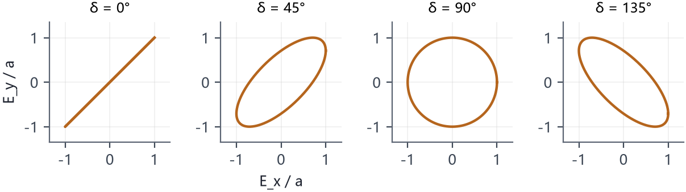
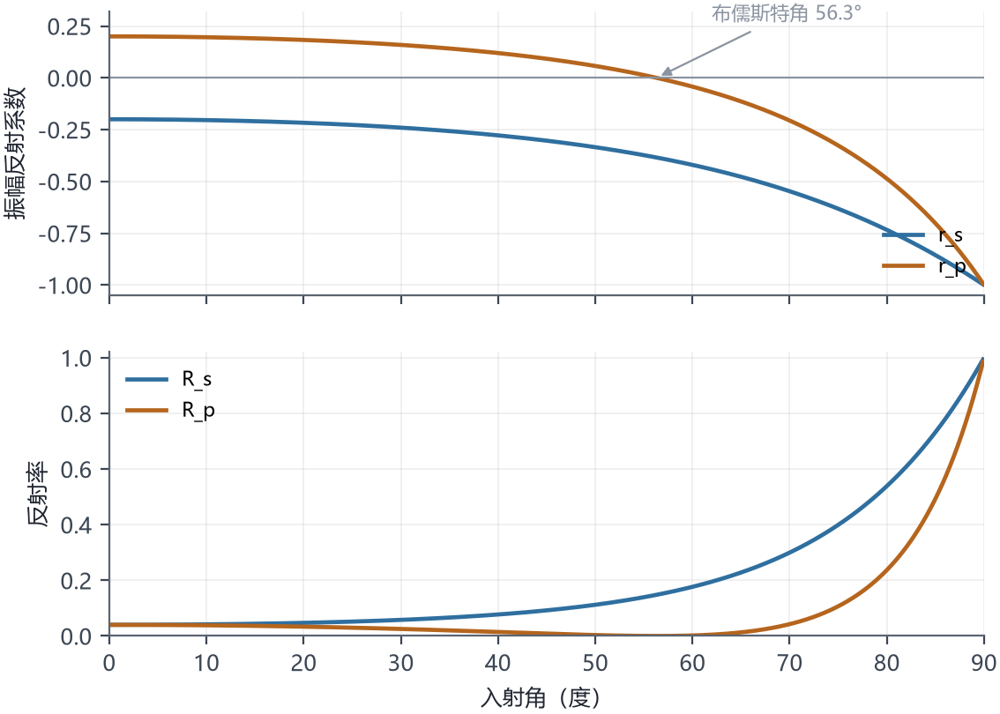
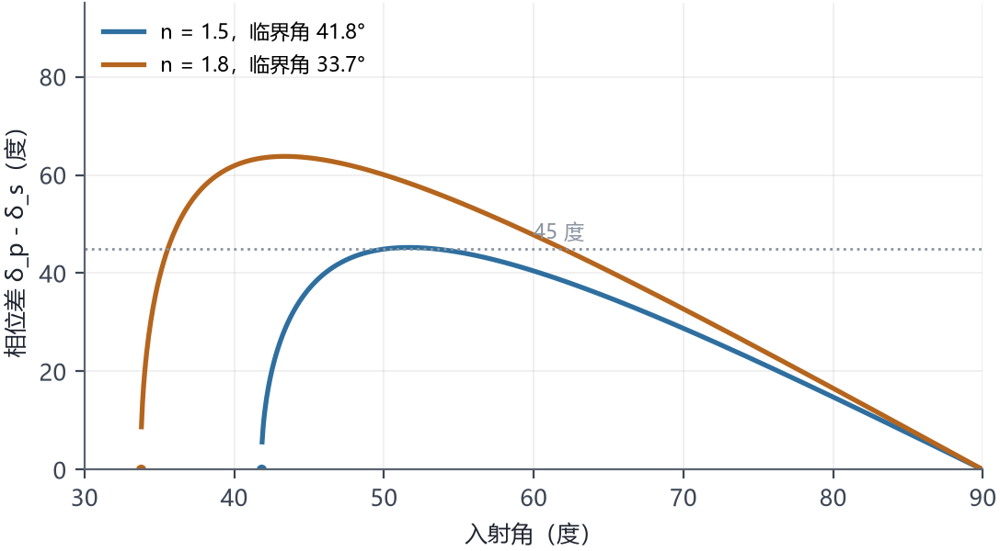

# 第 8 章 偏振、Stokes 向量与 Mueller 矩阵

## 8.1 一片偏振镜

拿起一片圆偏振镜，对着天空转一圈。某个角度上，天空突然变深，云从灰白变成有层次的翻卷；再转九十度，天空变浅，云的层次消失。同一个场景，同一台相机，只转了一片玻璃。

相机传感器测的是强度，它不知道光的方向。偏振镜做的事是：只让某个方向振动的光通过，把其余的吸收掉。天空的散射光是部分偏振的，散射角九十度附近偏振度最高，所以转动偏振镜时，通过的光强变化很大。云反射的是多次散射的太阳光，各部分偏振方向杂乱，转偏振镜几乎不影响它。

偏振是横波的性质。电场垂直于传播方向，这个垂直平面里还有一个方向自由度，标量模型把它压掉了。这一章把这一个自由度补回来，用的工具是 Stokes 向量和 Mueller 矩阵。

## 8.2 偏振椭圆

取一个沿 $z$ 传播的平面波。电场只有 $x$、$y$ 两个分量：

$$\mathbf{E}(z,t)=\mathrm{Re}\left\{\begin{bmatrix}E_x\\ E_y\end{bmatrix}e^{i(kz-\omega t)}\right\} , \tag{8.1}$$

$E_x$、$E_y$ 是复数，各自带振幅和相位。写开：

$$E_x=a_xe^{i\varphi_x},\qquad E_y=a_ye^{i\varphi_y} . \tag{8.2}$$

固定 $z=0$，看电矢量端点随时间怎么走。两个分量都是简谐振动，频率相同，相位差固定为 $\delta=\varphi_y-\varphi_x$。两个同频垂直振动的合成是一个椭圆：

$$\frac{E_x^{2}}{a_x^{2}}+\frac{E_y^{2}}{a_y^{2}}-\frac{2E_xE_y}{a_xa_y}\cos\delta=\sin^{2}\delta . \tag{8.3}$$

椭圆的形状由两个量决定：振幅比 $a_y/a_x$ 和相位差 $\delta$。$\delta=0$ 或 $\pi$ 时椭圆退化成直线（线偏振）；$\delta=\pm\pi/2$ 且 $a_x=a_y$ 时是圆（圆偏振）；其余情况是椭圆。椭圆的旋向由 $\delta$ 的符号决定。

任何一个偏振态都可以分解成两个相互正交的偏振态的非相干叠加，而且分法不唯一：可以按 $x$、$y$ 分解，可以按 $+45$、$-45$ 度分解，也可以按左旋、右旋分解。三个分解给出的系数不同，但描述的是同一个场。这种不唯一性正是 Stokes 向量比 Jones 向量更适合做渲染的原因：它记录的是分解之后的强度，不依赖你选了哪一组基。

线偏振、圆偏振、椭圆偏振这三种叫法并不平行。线偏振和圆偏振都是椭圆的特例，用"偏振椭圆"一个词就能覆盖全部。

## 8.3 Jones 向量

把 (8.2) 的两个复数直接写成一个二维复向量：

$$\mathbf{J}=\begin{bmatrix}E_x\\ E_y\end{bmatrix} . \tag{8.4}$$

这叫 Jones 向量，由 R. C. Jones 在 1941 年引入。强度是

$$I=\left|E_x\right|^{2}+\left|E_y\right|^{2}=\mathbf{J}^{\dagger}\mathbf{J} . \tag{8.5}$$

光学元件对光的作用写成一个 2×2 复矩阵：

$$\mathbf{J}'=M\,\mathbf{J} . \tag{8.6}$$

三个基本元件就够用。旋转矩阵把坐标系绕传播方向转 $\phi$：

$$R(\phi)=\begin{bmatrix}\cos\phi & -\sin\phi\\ \sin\phi & \cos\phi\end{bmatrix} . \tag{8.7}$$

延迟器在两个分量之间引入相位差 $\delta$，不改变振幅：

$$D(\delta)=\begin{bmatrix}e^{i\delta/2} & 0\\ 0 & e^{-i\delta/2}\end{bmatrix} . \tag{8.8}$$

偏振片只让一个方向通过：

$$P=\begin{bmatrix}1 & 0\\ 0 & 0\end{bmatrix} , \tag{8.9}$$

任意方向的偏振片写成 $R(\phi)PR(-\phi)$。

Jones 向量的限制很明确：它只能描述完全偏振的光。自然光、部分偏振光它描述不了，因为那需要一个统计的描述。而渲染器里的光几乎都是部分偏振的：光源通常非偏振，经过一次反射后才带上一点偏振，反射系数又随微面朝向变化，结果是偏振度介于 0 和 1 之间。

## 8.4 Stokes 向量

Stokes 在 1852 年给了一套参数，只用四个实数，能描述任意偏振态，包括部分偏振。

$$\mathbf{S}=\begin{bmatrix}I\\ Q\\ U\\ V\end{bmatrix}=
\begin{bmatrix}\left\langle|E_x|^{2}+|E_y|^{2}\right\rangle\\
\left\langle|E_x|^{2}-|E_y|^{2}\right\rangle\\
\left\langle2\,\mathrm{Re}(E_xE_y^{*})\right\rangle\\
\left\langle-2\,\mathrm{Im}(E_xE_y^{*})\right\rangle\end{bmatrix} . \tag{8.10}$$

尖括号是时间平均，这就是它能处理部分偏振的原因：不相干的成分在平均里互相抵消。

四个分量的含义可以直接读出来。$I$ 是总强度。$Q$ 是 $x$ 与 $y$ 分量的强度差，$Q>0$ 表示偏 $x$。$U$ 是 $+45^{\circ}$ 与 $-45^{\circ}$ 方向的强度差。$V$ 是圆偏振的强度差，$V>0$ 对应一种旋向。

完全偏振的光满足

$$I^{2}=Q^{2}+U^{2}+V^{2} . \tag{8.11}$$

部分偏振的光，$Q^{2}+U^{2}+V^{2}<I^{2}$，定义偏振度

$$\mathrm{DoP}=\frac{\sqrt{Q^{2}+U^{2}+V^{2}}}{I} . \tag{8.12}$$

自然光的 Stokes 向量是 $(1,0,0,0)$。这个形式非常重要，因为渲染器的光源默认就是它。

Stokes 向量与 Jones 向量之间有一个中间量，叫相干矩阵（coherency matrix）：

$$C=\left\langle\mathbf{E}\mathbf{E}^{\dagger}\right\rangle=
\begin{bmatrix}\left\langle E_xE_x^{*}\right\rangle & \left\langle E_xE_y^{*}\right\rangle\\
\left\langle E_yE_x^{*}\right\rangle & \left\langle E_yE_y^{*}\right\rangle\end{bmatrix} . \tag{8.13}$$

(8.10) 就是 $C$ 的四个分量的线性组合。这个联系在后面推 Mueller 矩阵时要用。

Stokes 参数还有一个几何解释，对理解后面的矩阵很有帮助。把 $Q$、$U$、$V$ 都除以 $I$，得到的三个数落在单位球内，这个球叫 Poincaré 球。球面是完全偏振，赤道是线偏振，两极为圆偏振，球心是全非偏振，球内其他点是部分偏振，半径就是偏振度。一个元件对偏振态的作用，在这个球上就是一次刚体旋转：坐标旋转绕 $V$ 轴转 $2\phi$，延迟器绕赤道面上某根轴转 $\delta$。这就是为什么 (8.16) 与 (8.17) 都是旋转矩阵的样子。

## 8.5 Mueller 矩阵

Stokes 向量是四维实向量，作用在它上面的是一个 4×4 实矩阵：

$$\mathbf{S}'=M\,\mathbf{S} . \tag{8.14}$$

$M$ 叫 Mueller 矩阵。它必须满足几条约束。第一，把物理上可实现的 Stokes 向量映射到可实现的 Stokes 向量，具体条件是 $I'\ge0$ 且 $I'^{2}\ge Q'^{2}+U'^{2}+V'^{2}$。第二，$M_{00}$ 是总透射率，必须有 $0\le M_{00}\le1$（不含增益的元件）。

几个基本元件的 Mueller 矩阵。

偏振片的透射轴沿 $x$：

$$M_{P}=\frac{1}{2}\begin{bmatrix}1&1&0&0\\1&1&0&0\\0&0&0&0\\0&0&0&0\end{bmatrix} . \tag{8.15}$$

延迟器，快轴沿 $x$：

$$M_{D}(\delta)=\begin{bmatrix}1&0&0&0\\0&1&0&0\\0&0&\cos\delta&-\sin\delta\\0&0&\sin\delta&\cos\delta\end{bmatrix} . \tag{8.16}$$

坐标旋转 $\phi$：

$$M_{R}(\phi)=\begin{bmatrix}1&0&0&0\\0&\cos2\phi&-\sin2\phi&0\\0&\sin2\phi&\cos2\phi&0\\0&0&0&1\end{bmatrix} . \tag{8.17}$$

注意旋转矩阵里是 $2\phi$ 而不是 $\phi$。原因是 Stokes 参数是二次型（强度的差），转 $\phi$ 相当于在二次型上转 $2\phi$。这个因子在实现里漏掉，偏振结果会转错一倍的角度，是偏振代码里最常见的错误。

第二常见的是 $V$ 的符号。不同教材对 $V$ 取不同的正负，对应的圆偏振旋向相反，Mueller 矩阵里所有含 $V$ 的元素也跟着翻号。(8.10) 到 (8.27) 这一套是自洽的，但如果你从另一本书抄一段矩阵、从这一本抄一段定义，拼起来就会算错。实现时最稳的做法是自己用两个已知答案的算例验证一遍：一束 45 度线偏振经过延迟器 90 度后应该变成圆偏振；自然光经过布儒斯特角的反射应该变成完全的 $s$ 偏振。这两个算例能抓住绝大部分符号错误。

## 8.6 Fresnel 界面的 Mueller 矩阵

现在把 Jones 矩阵换成 Mueller。界面对 $s$ 与 $p$ 两个分量的作用不同，所以 Jones 矩阵是对角的：

$$J=\begin{bmatrix}r_p&0\\0&r_s\end{bmatrix} . \tag{8.18}$$

分量定义在哪个坐标系里很重要。这里取 $p$ 沿入射面，$s$ 垂直入射面。作用在相干矩阵上：

$$C'=JCJ^{\dagger} , \tag{8.19}$$

写成分量：

$$\left\langle E_p'E_p'^{*}\right\rangle=|r_p|^{2}\left\langle E_pE_p^{*}\right\rangle,\quad
\left\langle E_s'E_s'^{*}\right\rangle=|r_s|^{2}\left\langle E_sE_s^{*}\right\rangle,\quad
\left\langle E_p'E_s'^{*}\right\rangle=r_pr_s^{*}\left\langle E_pE_s^{*}\right\rangle . \tag{8.20}$$

把 (8.10) 的定义代进去。$I'$ 与 $Q'$ 直接得到：

$$I'=\frac{1}{2}\left(R_p+R_s\right)I+\frac{1}{2}\left(R_p-R_s\right)Q , \tag{8.21}$$

$$Q'=\frac{1}{2}\left(R_p-R_s\right)I+\frac{1}{2}\left(R_p+R_s\right)Q , \tag{8.22}$$

其中 $R_p=|r_p|^{2}$，$R_s=|r_s|^{2}$。$Q$ 的定义里 $p$ 与 $s$ 是对称的，所以这两个式子只差一个符号。

$U$ 与 $V$ 的耦合稍微绕一点。记 $r_pr_s^{*}=u+iv$，$u=\mathrm{Re}(r_pr_s^{*})$，$v=\mathrm{Im}(r_pr_s^{*})$。由 (8.20)：

$$\left\langle E_p'E_s'^{*}\right\rangle=(u+iv)\,C_{ps},\qquad
\left\langle E_s'E_p'^{*}\right\rangle=(u-iv)\,C_{sp} . \tag{8.23}$$

于是

$$U'=\left\langle E_p'E_s'^{*}\right\rangle+\left\langle E_s'E_p'^{*}\right\rangle
=u\left(C_{ps}+C_{sp}\right)+iv\left(C_{ps}-C_{sp}\right) . \tag{8.24}$$

由定义 $U=C_{ps}+C_{sp}$，$V=-i(C_{ps}-C_{sp})$，即 $i(C_{ps}-C_{sp})=-V$。代入：

$$U'=uU-vV . \tag{8.25}$$

同法算 $V'$：

$$V'=-i\left[\left(u+iv\right)C_{ps}-\left(u-iv\right)C_{sp}\right]
=-iu\left(C_{ps}-C_{sp}\right)+v\left(C_{ps}+C_{sp}\right)=uV+vU . \tag{8.26}$$

四式合起来：

$$M_{F}=\frac{1}{2}\begin{bmatrix}
R_p+R_s & R_p-R_s & 0 & 0\\
R_p-R_s & R_p+R_s & 0 & 0\\
0 & 0 & 2u & -2v\\
0 & 0 & 2v & 2u
\end{bmatrix} . \tag{8.27}$$

这就是 Fresnel 界面的 Mueller 矩阵。它的结构值得读一遍。

左上 2×2 只含 $R_p$、$R_s$，只管线偏振。右下 2×2 只含 $r_pr_s^{*}$，只管圆偏振，而且它是一个旋转（行列式 $4(u^{2}+v^{2})$）。两块之间是零，意味着对 $s$、$p$ 为轴的反射，线偏振与圆偏振互不转化。

$v=0$ 时（$r_p$、$r_s$ 同相），右下角退化成 $2u$ 乘单位矩阵，$V$ 不变。介质界面在临界角以内就是这样，所以单次反射不会把线偏振变成圆偏振。这也是为什么很多人以为"反射不改变偏振态"：在常见的介质反射里，它只改变 $s$ 与 $p$ 的相对振幅，不改变它们的相对相位。

全反射时情况不同。$r_p$ 与 $r_s$ 都是复数，而且相位不同，$v\neq0$，$U$ 与 $V$ 开始互相转化。这正是菲涅尔菱体能造出圆偏振的原因。

## 8.7 三个可以直接算的例子

**布儒斯特角。** $\theta_i=\arctan(n_2/n_1)$ 时 $r_p=0$。一束 45 度线偏振的入射光，$E_p=E_s$，反射只剩 $s$ 分量，出射是完全的线偏振，方向转到了 $s$。反射率也降到最低。这就是激光腔里用布儒斯特窗片选偏振的原理。玻璃在 550 纳米的布儒斯特角是 56.3 度。

**自然光的反射偏振度。** 自然光 $S=(1,0,0,0)$，反射后

$$S'=\frac{1}{2}\begin{bmatrix}R_p+R_s\\ R_p-R_s\\ 0\\ 0\end{bmatrix} , \tag{8.28}$$

偏振度是

$$\mathrm{DoP}=\left|\frac{R_p-R_s}{R_p+R_s}\right| . \tag{8.29}$$

空气到玻璃，30 度入射时 $R_s=0.058$、$R_p=0.025$，DoP 是 0.39；45 度时 $R_s=0.092$、$R_p=0.0085$，DoP 到 0.83；布儒斯特角附近 $R_p$ 趋近零，DoP 到 1。这就是为什么水面和玻璃面的反射光偏振度很高，偏振镜能把它压掉。

金属是另一种情形。铝在 550 纳米处的复折射率是 $0.96+6.7i$，45 度入射时 $r_p$ 与 $r_s$ 的相位差是 192 度，两个系数几乎反相，一束 45 度线偏振反射后方向转了将近 90 度。金属的反射因此不只是压暗，它还会把偏振方向拧过去，标量模型完全看不到这件事。

**菲涅尔菱体。** 光在玻璃内部以大于临界角的角度打到界面上，全反射，$s$ 与 $p$ 之间产生相位差 $\delta=\delta_p-\delta_s$：

$$\tan\frac{\delta_s}{2}=-\frac{\sqrt{\sin^{2}\theta_i-(n_2/n_1)^{2}}}{\cos\theta_i},\qquad
\tan\frac{\delta_p}{2}=-\frac{\sqrt{\sin^{2}\theta_i-(n_2/n_1)^{2}}}{(n_2/n_1)^{2}\cos\theta_i} . \tag{8.30}$$

棱镜折射率 1.51，入射角 54 度，代入得 $\delta_s=-77^{\circ}$、$\delta_p=-122^{\circ}$，差 45 度。做两次全反射，累计 90 度，一束 45 度的线偏振进去，圆偏振出来。这块玻璃叫菲涅尔菱体，是把线偏振变成圆偏振的标准器件。

图 8-3 给出了 (8.30) 的结果。相位差在临界角处从零起跳，随角度上升，到一个最大值之后回落，掠射时回到零。$n=1.5$ 的最大值是 45 度，出现在 50 度附近；$n=1.8$ 的最大值是 64 度。

这个最大值决定了单次全反射能产生多少相位差。$n=1.5$ 的玻璃最多给出 45 度，想造 90 度需要两次反射；折射率越高，单次能给的角度越大。菲涅尔菱体选折射率 1.51、入射角 54 度，每次 45.3 度，两次合起来 90.6 度，误差不到一度。

## 8.8 什么时候必须考虑偏振

偏振在渲染里是一个可选的维度，加上它会让计算量翻倍甚至更多。判断标准有两条：光是否经过多次界面，以及场景里是否有对偏振敏感的元件。

单次反射。忽略偏振的误差不超过 $|R_p-R_s|/(R_p+R_s)$。正入射时这个量是零；45 度时约 0.8；掠射时接近 1。所以在正对着看的平面上，忽略偏振完全没问题。

多次反射与折射。误差会累积，而且方向会变。一个玻璃球，光在里面反射两三次，每次的 $s$、$p$ 比例都变，几次之后偏振态与初始完全不同，标量模型给的能量分配也就偏了。玻璃球、水滴、多层膜、光纤，这些都必须算偏振。

对偏振敏感的元件。偏振片、波片、液晶、某些晶体的双折射、金属在掠射角的相位跳变。这些在渲染里出现得少，但在做显示器件、光学仪器、科学可视化时会遇到。

实现上还有一个工程问题：Stokes 向量每弹射一次都要乘一次矩阵，四个分量都要带着走，内存与计算都是标量的四倍。多数渲染器只在需要的时候打开它，并且用一个标志位区分完全非偏振的光线：如果一条光线一直是自然光，可以只追踪 $I$，遇到第一个非退偏的界面再把 $Q$、$U$、$V$ 初始化。这个优化能把开销压到接近标量。

天空与水面的偏振。这是室外场景里最明显的偏振效应。天空的 Rayleigh 散射产生强烈的偏振，水面的 Fresnel 反射又把它挑出来，两件事叠在一起，偏振镜的效果就很强。要还原这一点，渲染器必须同时有偏振的散射模型和偏振的反射模型。

---

这一章搭起了偏振的语言：Jones 向量管完全偏振，Stokes 向量管部分偏振，Mueller 矩阵管元件对偏振态的作用。Fresnel 界面的 Mueller 矩阵是 (8.27)，它的块对角结构说明介质反射只改变线偏振的两个分量，不改变它们的相位。

语言有了，还差一件事：把 BSDF 从标量函数换成 Mueller 矩阵，并且让它在路径上传递。这就是下一章。
