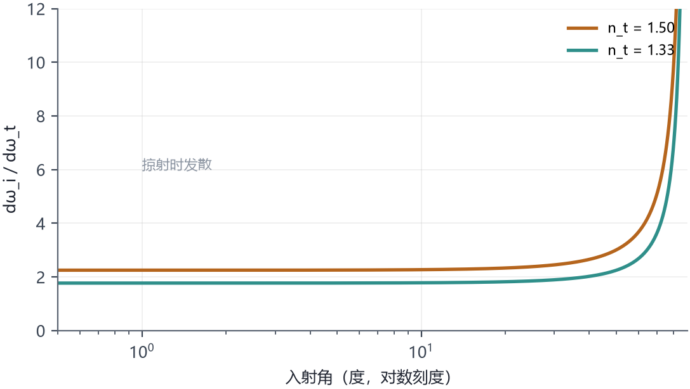
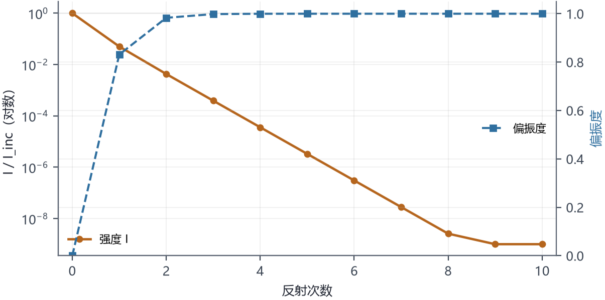

# 第 9 章 BSDF 的 Mueller 形式与偏振路径追踪

## 9.1 转动偏振片时玻璃球变亮

桌上放一个玻璃球，后面是白墙，前面放一盏台灯，台灯前加一片偏振片。转动偏振片，玻璃球的亮度明显变化，球面上高光的位置也在移动。加第二片偏振片放在相机前，转动它，变化更复杂：某些角度上球亮度最大，某些角度上几乎消失。

一个纯镜面的介质球，在标量渲染里是一个很"死"的物体：亮度只由 Fresnel 和几何决定，与光的偏振无关。真实的玻璃球不是这样。光每次进出界面都会改变偏振态，两次反射之后偏振方向转了几十度，第三次再转，转到的方向可能与第一片偏振片的透射轴垂直，于是被挡住。这个链条在标量模型里完全不存在。

这一章把 BSDF 从标量函数升级成 Mueller 矩阵，并处理升级带来的三个具体问题：坐标系怎么对齐，pdf 怎么取，权重怎么算。

## 9.2 渲染方程的矩阵形式

标量的渲染方程是

$$L_o(\omega_o)=\int_{\Omega}f(\omega_i,\omega_o)\,L_i(\omega_i)\left|\cos\theta_i\right|d\omega_i . \tag{9.1}$$

把 $L$ 换成 Stokes 向量 $\mathbf{S}$，$f$ 换成 4×4 的 Mueller 矩阵：

$$\mathbf{S}_o(\omega_o)=\int_{\Omega}M(\omega_i,\omega_o)\,\mathbf{S}_i(\omega_i)\left|\cos\theta_i\right|d\omega_i . \tag{9.2}$$

一般的 $M$ 有 16 个元素，但物理约束会把它们压掉一部分。无吸收的互易介质，$M$ 满足 (9.11) 的对称关系；各向同性介质，$M$ 是块对角的，线偏振与圆偏振不耦合，只有 8 个非零元素；只有手性介质（比如糖溶液、某些液晶）才会填满 16 个。渲染里遇到的绝大多数材质属于第二类，这一点在实现时很值得利用：块对角意味着 $I$、$Q$、$U$、$V$ 的更新可以分成两组独立的 2×2 运算，比 4×4 乘法快一倍。

$M$ 的量纲与 BSDF 相同，$1/\mathrm{sr}$。它的第一行第一列 $M_{00}$ 就是标量 BSDF：当入射、出射都是自然光时，$I_o=M_{00}I_i$，其余三个分量不参与。

(9.2) 看起来只是把乘法换成了矩阵乘法，实际工作量是四倍。更大的代价在于：BSDF 不再是两个方向的标量函数，而是一个 4×4 矩阵函数，任何一次采样都要先构造这个矩阵。

## 9.3 参考平面

Mueller 矩阵的定义依赖坐标系。入射光与出射光各自的 $s$、$p$ 基由方向与法线决定：

$$\mathbf{s}=\frac{\mathbf{n}\times\omega}{\left|\mathbf{n}\times\omega\right|},\qquad
\mathbf{p}=\omega\times\mathbf{s} . \tag{9.3}$$

$\mathbf{s}$ 在表面内、垂直于入射面，$\mathbf{p}$ 与 $\omega$、$\mathbf{s}$ 构成右手系。

入射的 $\mathbf{s}_i$ 与出射的 $\mathbf{s}_o$ 通常不重合。一束光从 $\omega_i$ 方向来、向 $\omega_o$ 方向去，两个平面绕法线转了一个角 $\phi$：

$$\cos\phi=\mathbf{s}_i\cdot\mathbf{s}_o,\qquad
\sin\phi=\left(\mathbf{s}_i\times\mathbf{s}_o\right)\cdot\mathbf{n} . \tag{9.4}$$

Fresnel 的 Mueller 矩阵 (8.27) 是在 $s$、$p$ 基下写的，作用之前要把入射的 Stokes 从它自己的 $s$ 基转到 BSDF 的 $s$ 基，作用之后再转回出射的 $s$ 基：

$$M_{\mathrm{local}}=R(\phi_o)\,M_{sp}\,R(-\phi_i) , \tag{9.5}$$

$R$ 就是 (8.17) 的旋转矩阵，注意它里面是 $2\phi$。

这一步漏掉的后果很具体：在一个平面上看不出问题，因为 $\phi=0$；在一个曲面上，不同像素的 $\phi$ 不同，偏振图案就会错位、错周期。玻璃球上的偏振条纹是这类错误的典型表现。

实现上有一个技巧可以省掉一半旋转：把 BSDF 直接在 $\mathbf{s}_i$、$\mathbf{s}_o$ 定义的世界坐标里构造，即先用 $\phi_i$ 把 $\mathbf{S}_i$ 转到局部系，算完再转出。因为 $R(-\phi_i)=R(\phi_i)^{-1}$ 且旋转矩阵是正交的，这一步的代价很小。

## 9.4 镜面反射与折射

对一个光滑界面，$M_{sp}$ 就是 (8.27)，把 $R$ 换成 $T$ 就得到透射的版本：

$$M_{T}=\frac{1}{2}\begin{bmatrix}
T_p+T_s & T_p-T_s & 0 & 0\\
T_p-T_s & T_p+T_s & 0 & 0\\
0 & 0 & 2u_t & -2v_t\\
0 & 0 & 2v_t & 2u_t
\end{bmatrix},\qquad u_t+iv_t=t_pt_s^{*} . \tag{9.6}$$

$T_p=|t_p|^{2}$，$T_s=|t_s|^{2}$。注意这里的 $t$ 是振幅透射系数，要把两侧的导纳比算进去，否则能量不守恒。

透射还有一个标量因子。折射时立体角会变，(3.8) 那种几何推导在这里也要做一遍：

$$\frac{d\omega_t}{d\omega_i}=\left(\frac{n_i}{n_t}\right)^{2}\frac{\cos\theta_i}{\cos\theta_t} . \tag{9.7}$$

亮度在折射时不守恒，$L_t=(n_t/n_i)^{2}L_i$，这个因子必须乘进透彻 BSDF。它不影响偏振度，因为它对两个偏振相同。但它影响能量，漏掉之后玻璃内部的亮度会偏，透过玻璃看到的物体亮度不对。



图 9-1 画的是它的倒数，也就是入射立体角与出射立体角之比。垂直入射时比值是 $(n_t/n_i)^{2}$，1.5 的界面给出 2.25；越接近掠射，折射角越接近临界角、在出射侧压得越紧，比值迅速发散。这不是数值问题，是真实的几何：掠射进来的光被压缩在出射侧的一薄层方向里。采样时如果按出射方向均匀取，这一段的方差会极大，必须按这个 Jacobian 做重要性采样。

## 9.5 pdf 该怎么取

这是偏振路径追踪里最容易出错的地方。

标量渲染里，pdf 是一个方向上的概率密度，与波长无关，与偏振无关。偏振渲染里，被积函数变成了四维向量，pdf 仍然是一个标量。两者维度不同，但没关系：Monte Carlo 的无偏性只要求 pdf 在支撑集上非零，估计量是

$$\hat{\mathbf{S}}_o=\frac{M(\omega_i,\omega_o)\,\mathbf{S}_i\left|\cos\theta_i\right|}{p(\omega_o)} . \tag{9.8}$$

只要 $p$ 不依赖当前路径携带的 $\mathbf{S}_i$，这个估计量的期望就是 (9.2) 的积分。证明与标量情形完全一样，逐分量做一遍即可。

反过来说，如果让 $p$ 依赖 $\mathbf{S}_i$，无偏性就破了。举个具体的例子：按出射 $I$ 分量的大小构造一个 pdf，也就是

$$p(\omega_o)\propto\left[M(\omega_i,\omega_o)\mathbf{S}_i\right]_{0}\left|\cos\theta_i\right| , \tag{9.9}$$

这个 pdf 依赖 $\mathbf{S}_i$，而 $\mathbf{S}_i$ 本身是随机变量（它由上一段路径的随机选择决定）。同一个方向在不同样本里对应不同的 $p$，加权平均就不再收敛到正确的期望。这种情况要用 MIS 处理，每个策略的贡献除以自己的 pdf 并加权，代码复杂度显著上升，收益在多数场景下不明显。

如果确实要用偏振相关的 pdf，正确的做法是把它明确写成一个与路径状态有关的函数，并且在 MIS 里让每个策略的 pdf 都能互相求值。这要求把 $\mathbf{S}_i$ 作为参数传进 pdf 函数，代价是 pdf 不再是一个纯几何量，缓存的采样表全部失效。收益只在高偏振度的场景里出现，而这类场景在渲染里是少数。

**结论是：pdf 用标量的就行。** 通常取 $M_{00}\left|\cos\theta_i\right|$ 或者一个与偏振无关的近似（比如 GGX 的 VNDF 采样概率），然后用完整的 $M$ 去乘 $\mathbf{S}_i$。这样 pdf 便宜、无偏、且与现有代码兼容。

这个结论有一个例外值得记住。在偏振度很高、$M$ 的两个偏振方向差别很大的情形里，标量 pdf 的方差会明显变大，因为大量样本落在贡献很小的偏振方向上。做偏振测量模拟（比如模拟椭偏仪）时，这一点很重要。普通渲染里可以不管。

## 9.6 完整流程

下面是一个最小的偏振路径追踪器，只处理镜面界面与理想漫反射。

```python
import numpy as np

def rot(phi):
    c, s = np.cos(2 * phi), np.sin(2 * phi)
    return np.array([[1, 0, 0, 0],
                     [0, c, -s, 0],
                     [0, s, c, 0],
                     [0, 0, 0, 1]], dtype=float)

def fresnel_mueller(rp, rs):
    Rp, Rs = abs(rp) ** 2, abs(rs) ** 2
    u = (rp * np.conj(rs)).real
    v = (rp * np.conj(rs)).imag
    return 0.5 * np.array([[Rp + Rs, Rp - Rs, 0, 0],
                           [Rp - Rs, Rp + Rs, 0, 0],
                           [0, 0, 2 * u, -2 * v],
                           [0, 0, 2 * v, 2 * u]])

def trace(S, path):
    """S 是 (4,) 的 Stokes，path 是一串 (M, cos, pdf)。"""
    for M, cos_t, pdf in path:
        S = M @ S * abs(cos_t) / pdf
    return S
```

这段代码少了三样东西：几何项、光源方向采样、多弹射。它只够用来验证矩阵与旋转的正确性，跑一张完整的图还要把 (9.8) 的权重接到现有的路径追踪循环里。

三个要点。

Stokes 向量在整条路径上都要保持四个分量，直到写入帧缓冲才取 $I$。中途截断会让后续的偏振作用失效。

镜面界面不需要采样方向，方向由反射或折射定律唯一确定，pdf 取 1，权重里的 $1/\cos$ 用 Jacobian 代替。这一点与标量版本一致。

理想漫反射体通常按去偏振处理：

$$M_{\mathrm{diff}}=\frac{\rho}{\pi}\begin{bmatrix}1&0&0&0\\0&0&0&0\\0&0&0&0\\0&0&0&0\end{bmatrix} . \tag{9.10}$$

这个矩阵把任何入射偏振变成非偏振，能量按 $\rho/\pi$ 缩放。真实的漫反射表面（比如白纸、石膏）是微面反射的宏观平均，会有百分之几的残余偏振，但对多数场景，(9.10) 的误差在可接受范围内。要更准，可以把漫反射当成粗糙的 Fresnel 界面，用第 7 章的方法处理。

玻璃球上的偏振条纹值得单独说一句。把球放在自然光下，用偏振片看，球面上会出现一条暗带，位置随偏振片的角度绕球心转动。这条暗带的物理来源是这样的：球面上不同点的入射角不同，光在球内反射一到两次后，偏振方向被旋转了不同的角度，某些位置上旋转后的方向正好与偏振片的透射轴垂直，于是被挡住。这条带子的形状完全由几何和 Fresnel 决定，与材质参数无关，所以它是检验偏振实现的极好测试用例：形状对了，矩阵和旋转基本就对；形状错了，多半是参考平面没对齐。

## 9.7 验证

偏振代码的验证比标量麻烦，因为结果不是一张亮度图，而是一组偏振量。有几个可靠的自检。

**能量守恒。** 对无吸收的界面，$R_p+T_p=1$、$R_s+T_s=1$。用 (8.27) 与 (9.6) 检查，对 45 度线偏振入射，反射加透射的 $I$ 应该等于 1。

**退偏极限。** 自然光经过任意界面的反射或透射，出来的 $Q$、$U$、$V$ 必须满足 $Q^{2}+U^{2}+V^{2}\le I^{2}$。如果算出来超过，说明矩阵抄错了或者旋转方向反了，因为一个物理矩阵不能把非偏振光变成完全偏振光。

**互易性。** 对互易介质，Mueller 矩阵满足

$$M^{T}=D\,M\,D,\qquad D=\mathrm{diag}(1,1,1,-1) . \tag{9.11}$$

把入射与出射方向对调，转置之后再翻 $V$ 的符号，应该回到原矩阵。这个检查能抓住旋转角符号的错误，因为旋转矩阵的转置等于逆，方向反了就对不上。

**与解析解对比。** 单层膜的偏振反射率有闭式解（把 (8.27) 用于两个界面），可以拿它检查多层膜的实现。全反射的相位差有 (8.30)，可以检查全反射的实现。

与测量数据对比是最后一道关。Joo 等人在 2018 年给出了一套偏振 BRDF 的高效测量方法与数据集，用椭偏仪的原理逐角度测出完整的 $4	imes4$ 矩阵，覆盖了金属、涂层、布料几类材料。把自己的实现算出的矩阵与这套数据逐元素比对，是目前最可靠的验证方式，因为它同时检查了振幅、相位和坐标系三件事。



图 9-2 是一个可以手算检验的例子。非偏振光从外部以 45 度进入玻璃球，球内的折射角是 28.1 度，光在内壁按这个角度反射，$s$ 与 $p$ 的反射率分别是 0.092 与 0.0083（这两个数与空气到玻璃 45 度入射的值相同，这是 Fresnel 系数在方向反转下的对称性）。第一次反射把强度从 1 降到 0.05，偏振度直接到了 0.83。之后每次再乘 $R_s$，五次之后只剩百万分之四。

偏振度并没有随次数上升。原因很简单：一旦光变成纯 $s$，再反射也不会更纯。偏振度的上限由单次反射的 $R_p/R_s$ 决定，不是次数。

---

这一章把 BSDF 升成了 4×4 矩阵，并且说清了三个工程问题：参考平面的旋转、透射的 Jacobian 与 $n^{2}$ 因子、以及 pdf 必须与偏振无关。三者都做对，偏振路径追踪才与标量版本同样无偏，只是慢。

还有一个实践上的细节：帧缓冲只存 $I$，但 $Q$、$U$、$V$ 在路径上的作用必须在最终写出之前全部完成。这意味着 AOV（arbitrary output variables）里如果要输出偏振度，必须在最后一个顶点之前保留完整 Stokes，然后一次算出 DoP 写出来。等到像素合成阶段再想恢复偏振信息是不可能的。

代价是真实的。四倍的内存、四倍以上的计算、以及一堆新的数值陷阱。最后一章讨论怎么把这个代价压下来，以及什么时候根本不值得付。
