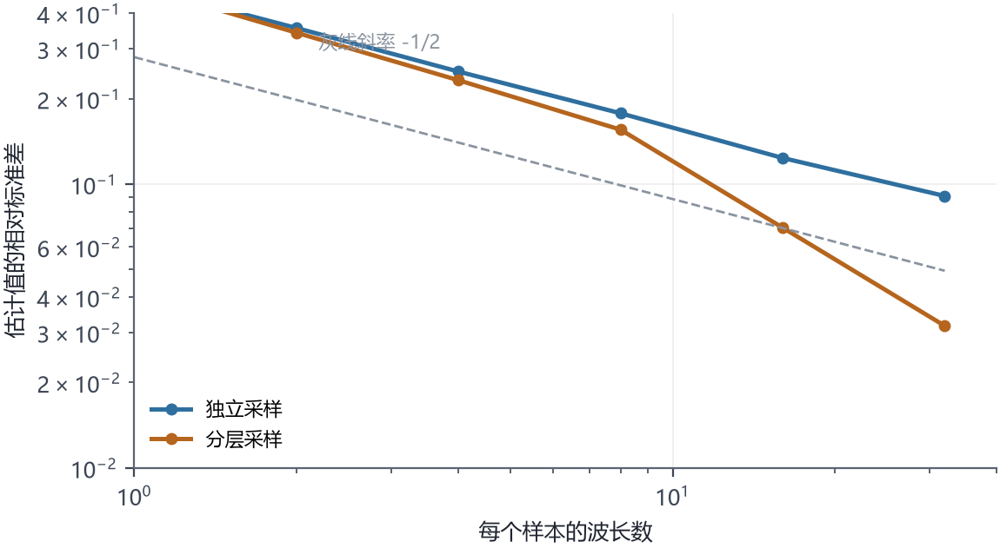
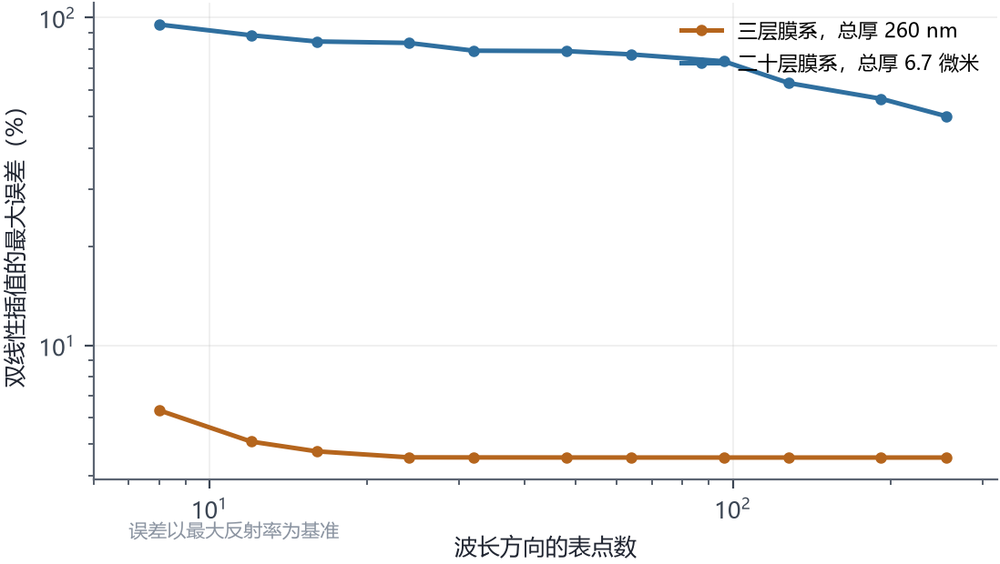
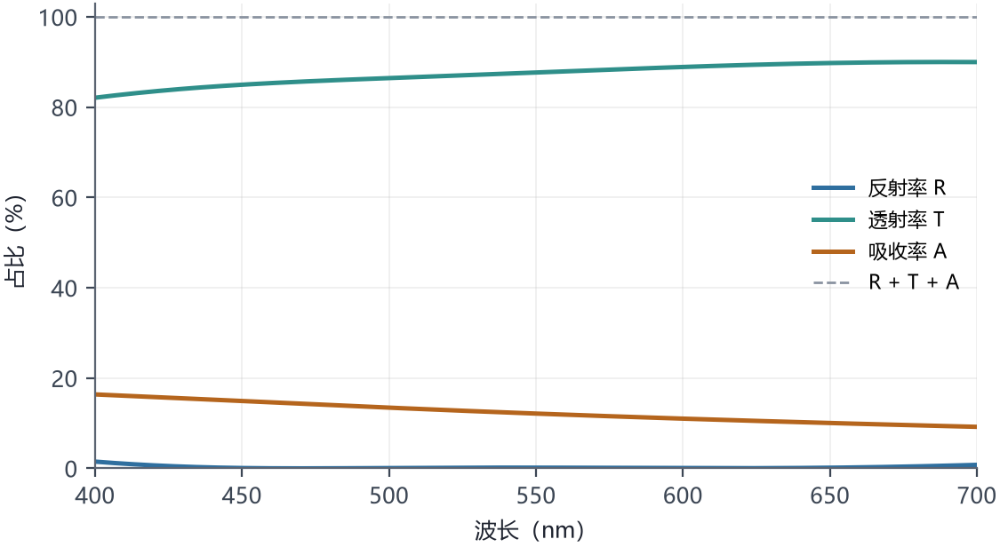

# 第 10 章 实现、验证与性能

## 10.1 一张图从三十秒变成二十分钟

一个已经能出图的光谱路径追踪器，渲一个 512×512、每像素 256 个样本的室内场景，三十秒。给其中一个材质加上十层膜的反射，同一个场景，二十分钟。慢了四十倍。

慢的部分不在光线求交，也不在光源采样，全在那十层膜上。每次光线打到这个材质，渲染器要做的是：对当前波长算出十层的相位与导纳，连乘十个 2×2 复数矩阵，得到反射率。一次这样的计算约两千次浮点运算，而一次普通的 GGX 求值只要几十次。场景里这个材质占了画面的三分之一，采样又集中在高光上，于是总开销被它主导。

四十倍不是个别现象。波动光学的模型天生比几何光学的贵，因为它要在每个着色点上做一次小型的谱计算。这一章讨论怎么把这个代价压到可以接受，以及压不下去的时候怎么办。

## 10.2 开销的构成

把一次薄膜着色的成本拆开：

$$C=N_{\lambda}\times N_{\mathrm{layer}}\times C_{2\times2} , \tag{10.1}$$

$N_{\lambda}$ 是这个样本用到的波长数，$N_{\mathrm{layer}}$ 是层数，$C_{2\times2}$ 是一次复数 2×2 乘法。三个因子分别对应三条优化路线。

降 $N_{\lambda}$ 靠采样策略。可见光 400 纳米宽，要准确积分一条带振荡的反射谱，均匀取点需要几十个波长；用分层采样和相关性可以利用光谱的平滑性，把有效波长数降到四到八个。

降 $N_{\mathrm{layer}}$ 靠缓存。同一个材质、同一个入射角，反射率只与波长有关，可以预计算成表。层数越多，表越值钱。

降 $C_{2\times2}$ 靠化简。块对角的 Mueller 矩阵、实数相位（无吸收层）、预先算好的 $\cos$ 与 $\sin$，都能省掉一部分乘法。

把数字代进去估一下量级。1080p 有 200 万像素，每像素 500 个样本，每个样本 8 个波长，十层膜，总共是 $8	imes10^{10}$ 次矩阵连乘，每次约 50 次复数乘加，也就是四千亿次浮点运算。现代 CPU 单核每秒十亿次量级，这就是几个小时；GPU 快两个数量级，仍然不是实时的。

三条路可以叠加。下面分别说。

## 10.3 光谱采样策略

先说清一件事：为什么不能退回 RGB。第 1 章给过理由，薄膜的反射谱在 40 纳米的尺度上就有完整的振荡，三个固定采样点会整段跳过峰谷。用 RGB 渲染薄膜，颜色会在厚度变化时跳变，而不是平滑过渡。

要用光谱，就要在可见光上积分：

$$C=\int_{380}^{780}R(\lambda)\,S(\lambda)\,b(\lambda)\,d\lambda . \tag{10.2}$$

$b$ 是颜色匹配函数。Monte Carlo 的做法是每个样本随机取若干波长，按概率加权。

最朴素的策略是每个样本独立均匀取 $N_{\lambda}$ 个波长。方差来自两个地方：波长落点的随机性和被积函数的振荡。前者可以用分层消除——把 400 纳米分成 $N_{\lambda}$ 段，每段里取一个随机点，这样落点均匀覆盖，方差降到 $1/N_{\lambda}^{3}$ 量级而不是 $1/N_{\lambda}$。

图 10-1 是一次直接的数值实验：被积函数取一层 900 纳米厚膜的反射率乘以一个平滑的光源谱，用两种策略各估计两千次，统计标准差。独立采样的斜率是 $-0.5$，符合 $1/\sqrt{N}$。分层采样在 $N=2$ 时只低百分之十几，到 $N=32$ 时降到独立采样的三分之一，而且曲线更陡，斜率接近 $-1$。原因是分层消除了落点的随机性，剩下的误差只来自被积函数的振荡，而振荡的幅度随段宽线性下降。

另一个策略叫 hero wavelength，由 Wilkie 等人在 2014 年提出。它的做法是每个样本只随机一个"主角"波长，其余波长按固定的偏移量跟随，比如 $\lambda_0+50$、$\lambda_0+100$、$\lambda_0+150$ 纳米，超出范围就绕回。这样一条路径上所有波长共享同一个几何，材质求值的结果高度相关，颜色噪声大幅下降。

它与分层不是一回事。分层降的是积分误差，hero 降的是"不同波长的路径不同"造成的彩色噪点。两者可以同时用：主角波长分层，跟随波长按固定偏移。

实现上还有一个细节：波长的 pdf 必须与采样策略一致。如果用了分层，pdf 是 $1/(\text{段宽}\times N_{\lambda})$；如果用 hero，跟随波长的 pdf 是主角波长 pdf 的平移，不能当独立样本处理。

## 10.4 查表与预积分

十层膜、32 个波长、每像素 1000 样本，算一次图要 $10^{11}$ 次矩阵乘法。这个量级用 CPU 是几分钟，用 GPU 也谈不上实时。查表是唯一的出路。

表的自变量是波长与入射角，因变量是反射率（或者完整的 Mueller 矩阵）。表的分辨率由两个因素决定：谱的振荡周期和最陡的斜率。

反射谱的振荡周期在厚度方向上是 $\lambda/(2n)$，在波长方向上是 $\lambda^{2}/(2nd)$。后者对一层 1 微米的膜、550 纳米处是 150 纳米，对 10 微米的膜只有 15 纳米。表在波长方向的步长必须小于周期的四分之一，否则插值会把峰削平。

角度方向的步长由 $\cos\theta$ 决定。在掠射角附近，$\cos\theta$ 随角度变化极快，等角度间隔的表在这里不够用，要按 $\cos\theta$ 均匀取。

图 10-2 是对两个膜系做的一次实测：真值逐点算，插值用双线性，误差取 0 到 75 度上的最坏值。三层膜系在 8 个波长点时误差 9%，32 个点时 3.3%，之后不再下降——因为限制它的已经不是波长方向，而是 64 个角度点的插值误差。二十层、总厚 6.7 微米的那条曲线完全不同，256 个点还有 42%，因为它的谱周期只有 13 纳米，1.2 纳米的步长仍然太粗。

这张图给出的经验很直接：表的分辨率要按谱的最短周期定，而不是按层数或者总厚度。三层膜系用 $64	imes64$ 的表，误差 3% 左右；二十层的厚堆要 $1024	imes64$ 才降到 5% 以下，内存涨到十几兆，GPU 的常量缓存放不下，只能放纹理。这就是为什么离线渲染器愿意为厚膜系花内存，实时渲染器通常把层数限制在十层以内。

## 10.5 偏振的代价

偏振让每个样本的状态从 1 个浮点变成 4 个，让每次界面作用从标量乘法变成 4×4 矩阵乘法。粗算是十六倍，实际因为块对角结构可以降到四到八倍。

三个实用的剪枝。

**按需开启。** 大部分场景不需要偏振。给每个路径一个布尔标志，初始为"非偏振"，遇到第一个会改变偏振的界面才把 $Q$、$U$、$V$ 分配出来。非偏振光的 $Q=U=V=0$，反射之后只有 $I$ 非零的那一行矩阵元起作用，计算量与标量相同。

**块对角。** 各向同性介质的 $M$ 是块对角的，(9.6) 与 (8.27) 都是这个结构。把 $I$、$Q$ 与 $U$、$V$ 分成两组各做 2×2，比 4×4 快一倍，而且避免了大量零元素的乘法。

**存储布局。** Stokes 向量在内存里怎么摆，对 GPU 的影响比想象的大。按样本交错存（AoS）在相干性好的路径上更快，因为四个分量在同一条缓存行里；按分量分开存（SoA）在同一个 warp 内的样本分叉时更好，因为每个分量可以独立向量化。多数实现选 AoS，因为偏振路径的分支很少，而 4×4 矩阵乘法正好需要四个分量同时在寄存器里。

**降低精度。** Stokes 向量不需要双精度。$Q$、$U$、$V$ 通常比 $I$ 小一到两个数量级，用半精度存储会有可见的量化噪声，用单精度足够。

## 10.6 验证

波动光学的实现有一个好处：几乎所有模型都有可以独立计算的参照。这让验证比几何光学容易。

**能量守恒。** 无吸收的界面与膜系，$R+T=1$；有吸收时 $R+T+A=1$，$A$ 由复折射率的虚部算出。这条检查能在任何角度、任何波长上做，误差应该是浮点量级。

**互易性。** 把入射与出射对调，结果不变。对 BSDF 是 $f(\omega_i,\omega_o)=f(\omega_o,\omega_i)$；对 Mueller 矩阵是 (9.11)。这条检查能抓住矩阵乘序与旋转方向的一类错误。

**与解析解对比。** 单层膜对 Airy 公式，多层膜对解析的周期结构（Bragg 反射镜的峰位与峰高有闭式解），全反射对 (8.30)。三条对比能覆盖绝大多数实现错误。

**白炉测试。** 把场景做成一个封闭的、反射率为 1 的球，光源放在中心，渲染结果应该是常数。这条测试检查的是采样权重与 pdf 的一致性，与物理模型无关，但它能抓住偏振版本里 pdf 与权重不匹配的错误。

**收敛性。** 方差应该按 $1/\sqrt{N}$ 下降。如果某一块区域的方差下降得比这慢，那里多半有一个方差极大的采样策略（比如掠射角的折射）。

**与测量数据对比。** 前五条都是自洽性检查，查不出"模型选错了"这类错误。要和真实材料对上，必须用测量数据。Joo 等人 2018 年的偏振 BRDF 数据集、各类薄膜的椭偏测量数据，都可以直接拿来比对。

## 10.7 什么时候不该用波动光学

这一章开头那个慢四十倍的例子，最正确的解法可能不是优化，而是判断这个材质到底需不需要波动光学。

先看尺度。第 1 章的判据：结构的高度或厚度是否小于 $\lambda/(4n)$，横向特征尺寸是否在 $0.5\lambda$ 到 $20\lambda$ 之间。两个条件都不满足时，几何光学加 Fresnel 就够了，算出来的差别在肉眼不可见的范围内。

再看视觉贡献。一个远处的、只占几十个像素的物体，即使有结构色，观众也看不出角度依赖。这种情况下用一张预计算的平均颜色贴图，比实时算十层膜划算得多。

最后看交互需求。离线渲染可以承受几分钟一张图，实时渲染不能。实时场景里的结构色，现在的做法基本是"预计算 + 查表 + 近似"，把十层膜压成一个以角度为索引的立方体贴图。

一个粗略的决策表：

| 情形 | 做法 |
| --- | --- |
| 结构尺寸远大于波长，无薄膜 | 几何光学，Fresnel |
| 单层或双层膜，视角变化小 | 解析 Airy，或三通道近似 |
| 多层膜，离线 | 光谱 + 查表，误差可控到 1% |
| 多层膜，实时 | 预积分表 + 半球查表 |
| 光栅、光子晶体 | 预计算的 BSDF 表，必须光谱 |
| 亚波长结构 | 矢量求解，离线预计算 |

这张表不是物理分类，是工程取舍。每一行的"做法"都对应前面某一章的模型，选哪一行取决于精度要求和预算，不取决于模型本身有多精确。

---

这一章把前面的模型落到工程上。开销来自波长、层数、矩阵三个因子，分别用采样策略、查表、结构化简来压。验证有六条，前五条自洽，最后一条必须靠测量。而最重要的判断不在优化上，在于认出一个场景是否需要波动光学——这个判断的依据，回到了第 1 章的尺度判据。
